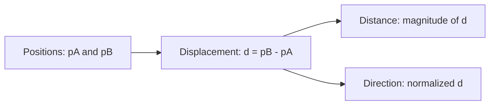

# Mathematical Foundations of Particle Motion

> **Goal:** Describe particle positions, directions, and motion with a small set of mathematical operations.  
> **Scope:** Point particles in two or three spatial dimensions; translation only.  
> **Prerequisites:** Basic algebra and Cartesian coordinates.

A particle has a **position** that changes with **time**. The mathematics of a particle simulation therefore has two parts: vector algebra, which describes quantities in space, and calculus, which describes how those quantities change.

## At a glance

| Question | Mathematical tool | Key relationship |
| --- | --- | --- |
| Where is another particle relative to this one? | Vector subtraction | $\mathbf d=\mathbf p_B-\mathbf p_A$ |
| How far away is it? | Vector magnitude | $d=\lVert\mathbf d\rVert$ |
| In which direction is it? | Normalization | $\mathbf n=\mathbf d/d$ when $d>0$ |
| How fast is it moving along a direction? | Dot product | $v_n=\mathbf v\cdot\mathbf n$ |
| How does its position change? | Differentiation | $\mathbf v=d\mathbf p/dt$ |
| How does its velocity change? | Differentiation | $\mathbf a=d\mathbf v/dt$ |
| Where will it be after a time interval? | Integration | $\mathbf p_1=\mathbf p_0+\int_{t_0}^{t_1}\mathbf v(t)\,dt$ |

---

## 1. Scalars, vectors, and coordinates

A **scalar** is a single numerical value, such as time, mass, or distance. A **vector** contains components along spatial axes and represents a quantity with magnitude and direction, such as displacement, velocity, or acceleration.

In a three-dimensional Cartesian coordinate system,

$$
\mathbf a=
\begin{bmatrix}
a_x\\a_y\\a_z
\end{bmatrix}
\in\mathbb R^3.
$$

For a two-dimensional simulation, use $\mathbb R^2$ and omit the $z$ component. The operations below work in either dimension unless otherwise stated.

A **position** $\mathbf p$ locates a point relative to an origin. A **displacement** describes the difference between two positions:

$$
\boxed{\mathbf d=\mathbf p_B-\mathbf p_A.}
$$

Positions and displacements may share the same numerical representation, but they have different geometric meanings: subtracting positions produces a displacement; adding a displacement to a position produces another position.

**Coordinate convention.** Choose an axis orientation (for example, $x$ right, $y$ up, $z$ forward) and apply it consistently throughout the simulation and rendering system. The choice of left- or right-handed coordinates does not change vector addition or the equations of translational motion; it affects orientation-dependent operations such as the cross product.

## 2. Essential vector operations

Let $\mathbf a=(a_x,a_y,a_z)$, $\mathbf b=(b_x,b_y,b_z)$, and let $k$ be a scalar.

### Addition, subtraction, and scaling

$$
\begin{aligned}
\mathbf a+\mathbf b
  &=(a_x+b_x,\ a_y+b_y,\ a_z+b_z),\\
\mathbf a-\mathbf b
  &=(a_x-b_x,\ a_y-b_y,\ a_z-b_z),\\
k\mathbf a
  &=(ka_x,\ ka_y,\ ka_z).
\end{aligned}
$$

Addition combines displacements. Scalar multiplication changes a vector's magnitude; a negative scalar also reverses its direction. The expression $\mathbf a+k\mathbf b$ is especially useful for advancing a quantity over a time interval.

### Magnitude and unit direction

The magnitude (Euclidean length) of a vector is

$$
\lVert\mathbf a\rVert=\sqrt{a_x^2+a_y^2+a_z^2},
\qquad
\lVert\mathbf a\rVert^2=a_x^2+a_y^2+a_z^2.
$$

The squared magnitude avoids a square root when only lengths need to be compared.

For a nonzero vector, **normalization** extracts its direction:

$$
\boxed{\widehat{\mathbf a}=\frac{\mathbf a}{\lVert\mathbf a\rVert}},
\qquad
\lVert\widehat{\mathbf a}\rVert=1.
$$

Thus every nonzero vector can be decomposed as

$$
\mathbf a=\lVert\mathbf a\rVert\,\widehat{\mathbf a}.
$$

**Degenerate case:** the zero vector has no defined direction. A numerical implementation must check for a sufficiently small magnitude before division; the fallback depends on the physical operation being performed.

### Component-wise multiplication

For completeness, the *Hadamard product* multiplies corresponding components:

$$
\mathbf a\odot\mathbf b=(a_xb_x,\ a_yb_y,\ a_zb_z).
$$

Its result is a vector. It is useful for per-axis scaling, but it must not be confused with either of the geometric products below.

## 3. The dot product: measuring alignment

The **dot product** of two vectors produces a scalar:

$$
\boxed{\mathbf a\cdot\mathbf b=a_xb_x+a_yb_y+a_zb_z
=\lVert\mathbf a\rVert\lVert\mathbf b\rVert\cos\theta.}
$$

Here $\theta$ is the angle between two nonzero vectors. Consequently:

| Condition | Interpretation |
| --- | --- |
| $\mathbf a\cdot\mathbf b>0$ | The vectors have components in the same general direction. |
| $\mathbf a\cdot\mathbf b=0$ | The vectors are perpendicular, provided both are nonzero. |
| $\mathbf a\cdot\mathbf b<0$ | The vectors have components in opposing directions. |

Two particularly useful identities are

$$
\begin{aligned}
\mathbf a\cdot\mathbf a&=\lVert\mathbf a\rVert^2,\\
\operatorname{proj}_{\mathbf n}(\mathbf v)
  &=(\mathbf v\cdot\mathbf n)\mathbf n
  &&\text{if }\lVert\mathbf n\rVert=1.
\end{aligned}
$$

The scalar $\mathbf v\cdot\mathbf n$ is the **signed velocity component** along the unit direction $\mathbf n$. The vector projection retains only that part of the velocity. This is the main tool for reasoning about motion along a contact normal.

> **Important:** $\mathbf v\cdot\mathbf n$ is a signed component, not necessarily a speed. It can be negative. If $\mathbf n$ is not normalized, divide by its magnitude to obtain the scalar component along its direction.

## 4. Three-dimensional orientation: optional reference

A particle's translational state does **not** require rotations or a local orientation basis. Two 3D concepts are nevertheless useful when constructing geometric directions.

The **cross product** returns a vector perpendicular to both inputs:

$$
\mathbf a\times\mathbf b=
\begin{bmatrix}
a_yb_z-a_zb_y\\
a_zb_x-a_xb_z\\
a_xb_y-a_yb_x
\end{bmatrix},
\qquad
\lVert\mathbf a\times\mathbf b\rVert
=\lVert\mathbf a\rVert\lVert\mathbf b\rVert\sin\theta.
$$

Its direction follows the right-hand rule when using a right-handed coordinate system. Operand order matters:

$$
\mathbf a\times\mathbf b=-(\mathbf b\times\mathbf a).
$$

An **orthonormal basis** is a set of mutually perpendicular unit axes $\mathbf e_i$ satisfying $\mathbf e_i\cdot\mathbf e_j=\delta_{ij}$, where $\delta_{ij}$ is $1$ when $i=j$ and $0$ otherwise. Neither a cross product nor a custom basis is needed merely to update a point particle's position and velocity.

## 5. Motion as differentiation

Let $\mathbf p(t)$ be the particle's position at time $t$. Its **instantaneous velocity** is the rate of change of position, and its **acceleration** is the rate of change of velocity:

$$
\boxed{
\mathbf v(t)=\frac{d\mathbf p}{dt}=\dot{\mathbf p}(t),
\qquad
\mathbf a(t)=\frac{d\mathbf v}{dt}
=\frac{d^2\mathbf p}{dt^2}=\ddot{\mathbf p}(t).
}
$$

Differentiation acts **component by component**:

$$
\frac{d\mathbf p}{dt}
=\left(\frac{dp_x}{dt},\frac{dp_y}{dt},\frac{dp_z}{dt}\right).
$$

For measurements separated by a finite interval $\Delta t$, the *average* velocity is

$$
\overline{\mathbf v}
=\frac{\mathbf p(t+\Delta t)-\mathbf p(t)}{\Delta t}.
$$

It approaches instantaneous velocity as $\Delta t\to0$ when the derivative exists.

**Velocity versus speed.** Velocity is a vector; speed is the nonnegative scalar

$$
s=\lVert\mathbf v\rVert.
$$

An acceleration may change a particle's direction without increasing its speed. In fact, when $\mathbf v\ne\mathbf 0$,

$$
\frac{ds}{dt}=\frac{\mathbf v\cdot\mathbf a}{\lVert\mathbf v\rVert}.
$$

Thus acceleration perpendicular to velocity produces zero *instantaneous* change in speed, although the direction of travel may change.

## 6. Integration: motion over a time interval

Differentiation describes a rate of change; **integration** accumulates that change over time. Given $t_1=t_0+\Delta t$,

$$
\begin{aligned}
\mathbf v(t_1)&=\mathbf v(t_0)+\int_{t_0}^{t_1}\mathbf a(t)\,dt,\\
\mathbf p(t_1)&=\mathbf p(t_0)+\int_{t_0}^{t_1}\mathbf v(t)\,dt.
\end{aligned}
$$

These relations hold for time-varying acceleration and velocity whenever the relevant integrals exist.

### Exact motion under constant acceleration

If $\mathbf a$ remains constant throughout an interval of length $\Delta t$, then

$$
\boxed{
\begin{aligned}
\mathbf v_1&=\mathbf v_0+\mathbf a\Delta t,\\
\mathbf p_1&=\mathbf p_0+\mathbf v_0\Delta t
                    +\tfrac12\mathbf a(\Delta t)^2.
\end{aligned}
}
$$

For constant velocity (zero acceleration), the position equation reduces to $\mathbf p_1=\mathbf p_0+\mathbf v_0\Delta t$.

### The discrete-time approximation

A simulation updates its state at discrete times $t_n$. A simple first-order approximation uses values at the start of a step:

$$
\begin{aligned}
\mathbf v_{n+1}&\approx\mathbf v_n+\mathbf a_n\Delta t,\\
\mathbf p_{n+1}&\approx\mathbf p_n+\mathbf v_n\Delta t.
\end{aligned}
$$

These are **forward Euler** updates. They approximate, rather than reproduce, the continuous motion. In particular, the position update omits the displacement caused by acceleration during the step. Choosing and implementing an integrator is a separate design decision.

> **Units must remain consistent:** position in metres (m), time in seconds (s), velocity in m/s, and acceleration in m/s². A frame duration in milliseconds must be converted to seconds before it is used in these equations.

## 7. Worked example: are two particles approaching?

Suppose two particles have the following positions and velocities:

$$
\begin{aligned}
\mathbf p_A&=(1,2,0)\ \mathrm m,
&\mathbf v_A&=(1,0,0)\ \mathrm{m/s},\\
\mathbf p_B&=(4,6,0)\ \mathrm m,
&\mathbf v_B&=(-1,0,0)\ \mathrm{m/s}.
\end{aligned}
$$

The displacement from $A$ to $B$ is $\mathbf d=(3,4,0)\ \mathrm m$. Therefore,

$$
\lVert\mathbf d\rVert=5\ \mathrm m,
\qquad
\mathbf n=\frac{\mathbf d}{\lVert\mathbf d\rVert}
=\left(\frac35,\frac45,0\right).
$$

The relative velocity of $B$ with respect to $A$ is $\mathbf v_{B/A}=\mathbf v_B-\mathbf v_A=(-2,0,0)\ \mathrm{m/s}$. Its component along the separation direction is

$$
\boxed{
\mathbf v_{B/A}\cdot\mathbf n
=(-2)\frac35=-1.2\ \mathrm{m/s}.
}
$$

Because $\mathbf n$ points from $A$ toward $B$, the negative value means their **separation distance is currently decreasing**. This calculation describes relative motion; it does not, by itself, decide whether the particles will collide.

---

## 8. Practical work — restore Cyclone's vector calculations

**Source file:** `include/cyclone/core.h`, inside the **`cyclone::Vector3`** class. The course starter intentionally leaves the four methods below incomplete. Implement **only their calculations**: keep their names, parameters, return types, and class structure. This is the prerequisite for the movement, force, and contact exercises in the following chapters.

| Method to complete | Mathematical responsibility | Quick numerical test |
| --- | --- | --- |
| `real Vector3::magnitude() const` | Return the Euclidean length of this vector. | `(3, 4, 12)` has magnitude `13`. |
| `void Vector3::normalise()` | Replace a nonzero vector by its unit direction, **in place**. | `(0, 3, 4)` becomes approximately `(0, 0.6, 0.8)`. |
| `real Vector3::scalarProduct(const Vector3& vector) const` | Return a **scalar**, not a vector; use corresponding components. | `(1, 2, 3)` dotted with `(-2, 5, 4)` gives `20`. |
| `void Vector3::addScaledVector(const Vector3& vector, real scale)` | Add a scaled vector to `*this` **without overwriting the original value**. | Starting at `(1, 2, 3)`, adding `0.5 * (2, -1, 4)` gives `(2, 1.5, 5)`. |

### Exercise 1 — Distances and directions

Complete `Vector3::magnitude()` and `Vector3::normalise()`. Check a vector with three nonzero components, an already-unit vector, and the zero vector. **Expected behavior:** normalization must never divide by zero; a zero vector should remain a valid zero vector rather than become `NaN`.

### Exercise 2 — Measuring alignment

Complete `Vector3::scalarProduct(...)`. Test parallel, perpendicular, and opposite directions. **Expected behavior:** the sign matches the alignment table in Section 3; `a.scalarProduct(a)` agrees with the squared magnitude of `a`.

### Exercise 3 — Scaled updates

Complete `Vector3::addScaledVector(...)`. Test positive, negative, and zero scale. **Expected behavior:** all three components change in place by the correct amount; the input vector remains unchanged.

**Important implementation detail:** Cyclone also has `Vector3::operator*(const Vector3&)`, an independent dot-product overload. Completing `scalarProduct()` does not automatically fill the operator overload, and vice versa. The exercises target the **four methods named above**; leave unrelated vector operations intact unless your starter explicitly marks them as incomplete. Test these methods before starting [particle motion](02-laws-of-motion-and-particle-demos.md), because the integrator and the constraint solver depend on them.

---

## Implementation precautions

Before using these operations in a particle simulation, ensure that:

- **Directions are defined:** never normalize a zero-length displacement.
- **Normals are unit length:** projections interpreted as signed components assume $\lVert\mathbf n\rVert=1$.
- **Subtraction order is intentional:** $\mathbf p_B-\mathbf p_A$ points from $A$ to $B$, not the reverse.
- **Time is measured consistently:** use $\Delta t>0$ in seconds, not a frame count.
- **Vector quantities retain their units:** an acceleration is not a velocity; a speed is not a velocity vector.
- **Exact equations and approximations remain distinct:** constant-acceleration formulas are exact under their assumptions; finite-step integration usually introduces numerical error.

**Next:** use these definitions to connect forces, mass, and acceleration, then evolve the state of a particle over time.
