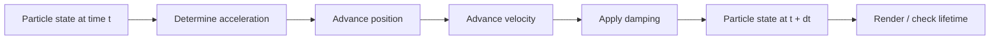
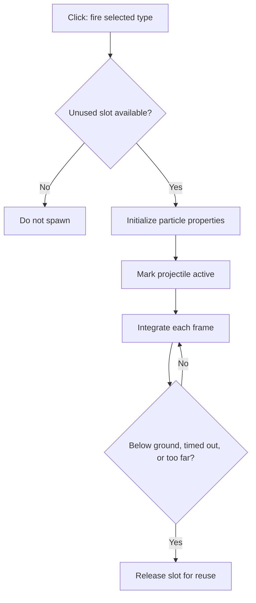
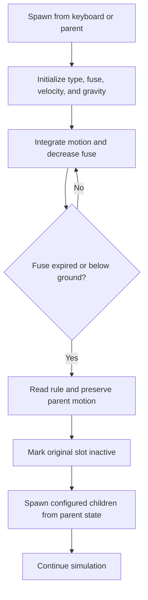

# Laws of Motion — Building a Particle Simulator

> **Goal:** Turn a particle's physical properties into motion over time, then use the resulting engine to animate projectiles and fireworks.  
> **Scope:** Point particles, Newton's first two laws, gravity, damping, and numerical integration. No rotation, springs, or collision response.  
> **Prerequisite:** [Mathematical Foundations of Particle Motion](01-mathematical-foundations.md).

A particle simulator has two responsibilities: **describe the state of a particle** and **advance that state through time**. The physical model determines its acceleration; the *integrator* converts that acceleration into changes in velocity and position.

## At a glance

| Concept | Relationship | Meaning |
| --- | --- | --- |
| Velocity | $\mathbf v=\dot{\mathbf p}$ | Rate of change of position |
| Acceleration | $\mathbf a=\dot{\mathbf v}$ | Rate of change of velocity |
| Newton's first law | $\sum\mathbf F=\mathbf 0\Rightarrow\mathbf v=\text{constant}$ | For a constant-mass particle |
| Newton's second law | $\sum\mathbf F=m\mathbf a$ | Net force changes velocity |
| Inverse mass | $m^{-1}=1/m$ | Convenient representation of mass |
| Momentum | $\mathbf q=m\mathbf v$ | Quantity of motion |
| Near-surface gravity | $\mathbf F_g=m\mathbf g$ | Gravity produces acceleration $\mathbf g$ |
| Position update | $\mathbf p_{n+1}=\mathbf p_n+\mathbf v_n\Delta t$ | First-order approximation |
| Velocity update | $\mathbf v_{n+1}=(\mathbf v_n+\mathbf a_n\Delta t)d^{\Delta t}$ | Acceleration followed by damping |

---

## 1. The particle: a state without orientation

A **particle** is a point mass: it has mass and a location in space, but no extent or orientation. It can translate but cannot rotate. This is a useful abstraction for objects whose orientation is irrelevant to the effect being simulated—for example, a projectile represented by a small point or a spark of light.

For a particle at time $t$, the fundamental state is:

$$
\mathbf p(t)\in\mathbb R^3,\qquad
\mathbf v(t)\in\mathbb R^3,\qquad
\mathbf a(t)\in\mathbb R^3.
$$

The simulation also needs a **mass** $m$ and a **damping coefficient** $d$. An implementation can represent this with the following conceptual fields:

| Field | Type | Physical interpretation | Unit |
| --- | --- | --- | --- |
| `position` | `Vector3` | Location in world space | m |
| `velocity` | `Vector3` | Rate and direction of travel | m/s |
| `acceleration` | `Vector3` | Prescribed acceleration (often gravity) | m/s² |
| `inverseMass` | scalar | Reciprocal mass, $1/m$ | kg⁻¹ |
| `damping` | scalar | Proportion of velocity retained per second | dimensionless |

**State versus input.** Position and velocity persist from one update to the next. Acceleration is an input to that evolution: it may be set when a particle is created, and later changed when its physical conditions change. Directly replacing the position or velocity during ordinary motion bypasses the physical model; doing so is appropriate for initialization or an intentional teleport, not continuous movement.

## 2. Newton's first two laws

### 2.1. First law: inertia

Without a net external force, a constant-mass particle retains its velocity:

$$
\sum\mathbf F=\mathbf 0
\quad\Longrightarrow\quad
\mathbf a=\mathbf 0,
\qquad \mathbf v(t)=\mathbf v_0.
$$

Consequently, a particle initially at rest remains at rest; a moving particle continues in a straight line at constant speed. Objects appearing to slow down in everyday life experience forces such as friction and air resistance.

A practical simulator often uses a **damping** parameter to gently reduce velocity even when no explicit resistance force is modeled. Damping is a numerical/gameplay approximation, not an additional law of Newton.

- $d=1$: no damping; velocity is fully retained.
- $0<d<1$: velocity gradually decreases.
- $d=0$: velocity is completely removed over a positive update interval; this is generally unsuitable for free-moving particles.

Damping should be close to $1$ when its main purpose is to control small numerical artifacts. Lower values create visibly stronger resistance.

### 2.2. Second law: forces produce acceleration

The effect of forces is described by:

$$
\boxed{\sum\mathbf F=m\mathbf a}
\qquad\Longleftrightarrow\qquad
\boxed{\mathbf a=\frac{\sum\mathbf F}{m}}.
$$

Force is measured in newtons ($\mathrm N=\mathrm{kg\,m/s^2}$). For the **same net force**, a particle with twice the mass acquires half the acceleration. For the **same prescribed acceleration**, however, two particles move identically if they share the same initial position and velocity and no other effects differ.

The distinction matters in Cyclone: setting a particle's `acceleration` directly is different from applying a force whose effect must be divided by the particle's mass. The demonstrations in this chapter primarily use **prescribed acceleration** rather than a general force-generation system.

### 2.3. Why store inverse mass?

Evaluating $\mathbf F/m$ repeatedly requires division. It is more convenient to store:

$$
\boxed{\mu=\frac1m},
\qquad
\mathbf a=\mu\sum\mathbf F.
$$

This also gives a useful representation for a particle that should not move under forces:

| `inverseMass` | Interpretation |
| --- | --- |
| $\mu>0$ | Finite positive mass $m=1/\mu$ |
| $\mu=0$ | Infinite mass: treated as immovable by the integrator |
| $\mu<0$ | Invalid physical state |

**Zero mass is not supported**: $m=0$ would make $1/m$ undefined. When the API accepts a mass through `setMass`, its internal representation must remain consistent with the inverse-mass field. An infinite-mass particle must not be advanced by the integrator.

### 2.4. Momentum

The **linear momentum** of a particle is:

$$
\boxed{\mathbf q=m\mathbf v}.
$$

For a constant-mass particle, an absence of net force means constant momentum and therefore constant velocity. More generally, the force law can be expressed as $\sum\mathbf F=d\mathbf q/dt$. This simulator assumes particle mass does not change during a particle's lifetime.

Momentum is distinct from velocity: two particles may travel at the same velocity but carry different momentum because their masses differ.

### 2.5. Gravity as a constant acceleration

The gravitational attraction between two masses has magnitude:

$$
F=G\frac{m_1m_2}{r^2}.
$$

Near the surface of a planet, its mass and the distance to its center are approximately constant on the scale of a game scene. The gravitational force on a particle can therefore be written:

$$
\mathbf F_g=m\mathbf g
\quad\Longrightarrow\quad
\mathbf a_g=\frac{\mathbf F_g}{m}=\mathbf g.
$$

For a world where $+y$ points upward:

$$
\boxed{\mathbf g=(0,-g,0)},
\qquad g\approx9.81\ \mathrm{m/s^2}
$$

is a common Earth-like choice. A game may deliberately choose a different value to achieve a particular trajectory. The important property is that **gravitational acceleration does not depend on the particle's mass**, when air resistance is neglected.

A particle can also be assigned an upward acceleration, or no gravitational acceleration at all, for stylized effects. Those choices alter the simulated physical model; they are not integration errors.

---

## 3. The integrator: advancing motion through time

A renderer draws the current particle state. The **integrator** is responsible for producing the next state from the previous one and the elapsed duration $\Delta t$.

### 3.1. Elapsed time is part of the simulation

A numerical update advances the simulation from $t_n$ to $t_{n+1}=t_n+\Delta t$. The duration must be **positive and measured in seconds**. If frame timing is returned in milliseconds:

$$
\boxed{\Delta t_{\mathrm s}=\frac{\Delta t_{\mathrm{ms}}}{1000}}.
$$

Without $\Delta t$, the simulation's speed would depend on its frame rate. A variable update duration can work, but large or inconsistent steps produce less accurate motion. A fixed physics timestep is another valid design, independent of the rendering frequency.

### 3.2. Updating position

Under constant acceleration during a step, the exact relationship is:

$$
\mathbf p(t+\Delta t)=\mathbf p(t)
+\mathbf v(t)\Delta t
+\frac12\mathbf a(\Delta t)^2.
$$

For a simple real-time integrator, we use the first-order approximation:

$$
\boxed{\mathbf p_{n+1}=\mathbf p_n+\mathbf v_n\Delta t.}
$$

This uses the velocity **at the beginning of the step**. It omits the second-order displacement caused by acceleration during that step. The approximation becomes more accurate as the timestep becomes smaller, but it is not exact for accelerated motion.

### 3.3. Updating velocity

Acceleration changes velocity:

$$
\mathbf v^*=\mathbf v_n+\mathbf a_n\Delta t.
$$

Damping then reduces the updated velocity. Applying a fixed multiplier once per frame would make damping artificially stronger at higher frame rates. Instead, interpret $d$ as the fraction retained **over one second**, and scale it by elapsed time:

$$
\boxed{\mathbf v_{n+1}=\mathbf v^*d^{\Delta t}
=(\mathbf v_n+\mathbf a_n\Delta t)d^{\Delta t}.}
$$

For example, if $d=0.9$ and no acceleration acts, then after a total of one second the remaining velocity is $0.9\mathbf v_0$, whether the second was subdivided into 20, 60, or 120 equal updates (up to floating-point error).

**Order matters:** this chapter's integrator first advances position using $\mathbf v_n$, then computes the new velocity using acceleration, then damps that new velocity. Other numerical integrators use different update orders and therefore produce different trajectories.

### 3.4. What `Particle::integrate(duration)` must guarantee

The Cyclone library supplied for this project is intentionally incomplete. Its particle calculations are part of the exercise; the demonstrations cannot behave correctly until those calculations are implemented.

The required observable contract is:

1. Reject or safely handle nonpositive durations; do not integrate invalid time intervals.
2. Do not advance particles whose inverse mass represents an immovable object.
3. Advance position using the **previous** velocity and the duration.
4. Calculate the resulting velocity from acceleration and duration, and apply time-adjusted damping.
5. Leave particle properties in a valid state for the next frame; clear any per-step force accumulator according to the provided Cyclone interface.

The acceleration field in these demonstrations is set directly. A more general force accumulator or force generator is **not required** to understand the two applications below. Do not add collision impulses, spring forces, or rigid-body rotation here.

A useful sanity check is a particle with $\mathbf p_0=(0,0,0)$, $\mathbf v_0=(2,0,0)$, $\mathbf a=\mathbf0$, and $d=1$. After one integration step of $0.5\ \mathrm s$, its position should be $(1,0,0)$ and its velocity should still be $(2,0,0)$.

### 3.5. Exact Cyclone exercise — `Particle::integrate()`

**File:** `src/particle.cpp`  
**Method to complete:** `void cyclone::Particle::integrate(real duration)`  
**Required beforehand:** the four `Vector3` methods from [the mathematical exercises](01-mathematical-foundations.md#8-practical-work--restore-cyclones-vector-calculations).

Do **not** replace the function signature or write a new integrator elsewhere. Fill the missing calculations inside the existing function:

| Code region | Student calculation | Course equation |
| --- | --- | --- |
| Position update | Advance `position` with the **old** `velocity` and `duration`. | $\mathbf p_{n+1}=\mathbf p_n+\mathbf v_n\Delta t$ |
| Resulting acceleration | Combine the particle's prescribed `acceleration` and any accumulated force divided by mass (`forceAccum * inverseMass`). | $\mathbf a_{\mathrm{total}}=\mathbf a_{\mathrm{base}}+\mu\mathbf F_{\mathrm{accum}}$ |
| Velocity update | Add the acceleration contribution over the same duration. | $\mathbf v^*=\mathbf v_n+\mathbf a_{\mathrm{total}}\Delta t$ |
| Damping | Multiply the **updated** velocity by the time-corrected damping factor. | $\mathbf v_{n+1}=\mathbf v^*d^{\Delta t}$ |

Keep the existing guard for immovable particles, the duration assertion or validation, and `clearAccumulator()` after a successful step. The accumulator calculation belongs here **even though** `Particle::addForce()` will only be completed in the next chapter. Do not multiply acceleration by the duration twice.

**Focused test:** with `position=(0,0,0)`, `velocity=(2,0,0)`, `acceleration=(0,0,0)`, `damping=1` and `duration=0.5`, the new position must be `(1,0,0)` and the velocity must remain `(2,0,0)`. A second test with nonzero acceleration must use the **old** velocity for the position update.

**Already supplied:** mass setters/getters, state accessors, the demo-specific configuration, rendering, and lifecycle management. Do not reimplement them as part of this exercise.

---

## 4. Practical application A — Ballistic

**Purpose:** Verify that the same particle integrator produces several visibly different trajectories when given different initial velocities, accelerations, and damping values.

The Ballistic application maintains a fixed pool of **16 projectile slots**. A mouse click launches one projectile of the currently selected type; keys **1–4** select the projectile profile. The projectile begins at $\mathbf p_0=(0,1.5,0)$, and the display uses $+y$ as up and $+z$ as forward.

### Projectile specifications

| Key | Type | Mass (kg) | Initial velocity (m/s) | Acceleration (m/s²) | Damping |
| --- | --- | ---: | --- | --- | ---: |
| `1` | Pistol | 2 | $(0,0,35)$ | $(0,-1,0)$ | 0.99 |
| `2` | Artillery | 200 | $(0,30,40)$ | $(0,-20,0)$ | 0.99 |
| `3` | Fireball | 1 | $(0,0,10)$ | $(0,+0.6,0)$ | 0.90 |
| `4` | Laser | 0.1 | $(0,0,100)$ | $(0,0,0)$ | 0.99 |

These profiles define **gameplay behavior**, not four physically realistic weapons. Because each profile directly assigns its own acceleration, differences in trajectory must not be attributed to mass alone.

### Required behavior

- **Pistol:** moves forward while gradually falling; its trajectory bends downward slightly.
- **Artillery:** initially rises because of positive vertical velocity, then falls under a strong downward acceleration, producing a prominent arc.
- **Fireball:** moves forward and gains upward velocity; its stronger damping makes the motion progressively less energetic.
- **Laser:** moves straight ahead without gravitational curvature. Its damping still slightly decreases its speed over time.

Every active projectile must be integrated once per update. A slot becomes reusable when **any** of these conditions is met: the projectile passes below the ground plane ($y<0$), its lifetime exceeds **5 seconds**, or it passes **$z=200$**. When all 16 slots are active, another click must not create a seventeenth projectile.

**Student work — use the existing `BallisticDemo` as a test bench.** The calculation to restore is `Particle::integrate(real duration)` in `src/particle.cpp` (Section 3.5). Its caller is `BallisticDemo::update()` in `src/demos/ballistic.cpp`, and shots are initialized by `BallisticDemo::fire()`. These demo functions already contain the launch profiles, the call to `integrate(duration)`, and the three removal conditions: **leave that orchestration in place**. The intended task here is to make its physics operate by restoring the shared calculation, not to rewrite a new projectile simulator.

**What to verify:** launching the four types should yield four distinct motion patterns; successive clicks should allow several simultaneous projectiles; expired shots should disappear; freed slots should be available to later clicks. Changing rendering frame rate should not multiply or divide apparent movement speed.

---

## 5. Practical application B — Fireworks

**Purpose:** Extend the same particle motion to a system in which particles have **finite lifetimes** and can create new particles when they expire. This is an application of particle motion plus simple lifecycle rules—not a new physics law.

Each firework extends a Cyclone particle with:

| Additional field | Meaning |
| --- | --- |
| `type` | Rule identifier; `0` means the slot is inactive |
| `age` | Remaining fuse time, in seconds |

A firework's update first advances its physical state and reduces `age` by the elapsed duration. It expires if its fuse is exhausted **or** it falls below the ground ($y<0$). An expired firework can spawn child particles according to its rule.

### Rules, inheritance, and payloads

A **firework rule** specifies a type, a minimum and maximum fuse duration, minimum and maximum initial-velocity offsets, a damping coefficient, and zero or more payload entries. Each payload is a pair **(child type, number of children)**.

A newly created firework must have:

- A randomly chosen fuse time within its type's configured interval.
- Mass $1\ \mathrm{kg}$, the rule's damping, and the common gravity acceleration `Vector3::GRAVITY`.
- A velocity selected within the rule's per-axis velocity bounds.
- An initial position and velocity determined by whether it has a parent.

For a **root** firework, the spawning positions are distributed along the ground at $x\in\{-5,0,5\}$, with $y=z=0$. For a **child**, the initial position is inherited from its parent, and its initial velocity is **the parent's velocity plus a randomly sampled relative velocity**:

$$
\boxed{
\mathbf p_{\mathrm{child},0}=\mathbf p_{\mathrm{parent}},
\qquad
\mathbf v_{\mathrm{child},0}=\mathbf v_{\mathrm{parent}}+\Delta\mathbf v_{\mathrm{rule}}.
}
$$

Here each component of $\Delta\mathbf v_{\mathrm{rule}}$ lies between the minimum and maximum defined by that child's rule. **The velocity is inherited, not the acceleration or the remaining fuse time.** Those are initialized from the child's own rule.

### Required effects

The demo uses **nine firework types** (selected with keys `1`–`9`) and a circular pool of **1024 slots**. The main behavior is defined by these payload relationships:

| Parent type | Payload produced on expiry | Expected visual effect |
| --- | --- | --- |
| 1 | 5 of type 3 and 5 of type 5 | One launch branches into two groups of sparks |
| 2 | 2 of type 4 | One launch splits into a small pair |
| 3 | None | Terminal spark |
| 4 | None | Terminal spark |
| 5 | 5 of type 3 | Secondary branching burst |
| 6 | None | Long-lived particle without children |
| 7 | 10 of type 8 | High launch followed by a burst |
| 8 | None | Short-lived terminal spark |
| 9 | None | Independent terminal particle |

These are **counts and types**, not predetermined directions. The visual spread comes from random velocities and the inherited parent motion. For instance, a type-1 burst can subsequently branch again because its type-5 children have their own payloads.

The pool is bounded. Creating a new firework advances the insertion index and wraps around at the maximum capacity; newly created particles may therefore reuse old slots. Each active particle should be drawn in the color assigned to its type, with the simple reflected image shown below the ground plane by the demo renderer.

**Student work — use the existing `FireworksDemo` as a second test bench.** Restore the same `Particle::integrate(real duration)` function, now exercised by `Firework::update(duration)` in `src/demos/fireworks.cpp`. The supplied demo already implements countdown, expiration, payload generation, and parent-state inheritance; **do not erase or duplicate these mechanics**. They are observable results to verify, not separate engine functions to fill. If a particular course starter has additional explicit `TODO` markers in the demo, address only those marked pieces.

**Startup detail in the supplied file:** the `getApplication()` factory at the end of `fireworks.cpp` is commented out. If the application is built as its own executable and no other factory is supplied, re-enable an appropriate entry point; otherwise this demo cannot be instantiated by the common application framework. This is a startup concern, separate from the particle physics calculations.

**What to verify:** a type-1 launch produces branching generations; a type-7 launch creates a later burst of type-8 particles; terminal types vanish without spawning children; particles that hit the ground expire even if their fuse remains; repeated launches reuse the pool rather than growing memory indefinitely.

---

## 6. Validation scenarios

The following scenarios define observable results, rather than an implementation checklist.

| System | Scenario | Expected result |
| --- | --- | --- |
| Particle core | No acceleration, damping $d=1$ | Constant velocity and position advance proportional to $\Delta t$ |
| Particle core | Nonzero acceleration, positive duration | Velocity changes by the acceleration contribution; position uses the pre-update velocity |
| Particle core | Damping, fixed total elapsed time | Velocity retention uses $d^{\Delta t}$, not one fixed multiplier per frame |
| Particle core | Zero inverse mass or invalid duration | State is not advanced; no division by zero |
| Ballistic | Select keys `1`–`4` and fire | Four distinct projectile trajectories with the prescribed profiles |
| Ballistic | Launch repeatedly | At most 16 simultaneous active shots; expired slots are reused |
| Ballistic | Reach ground, 5-second lifetime, or $z>200$ | The projectile becomes inactive |
| Fireworks | Trigger types `1`–`9` | Each particle follows its own rule, fuse, and color |
| Fireworks | Expire a type-1 or type-7 particle | The configured payloads appear, inheriting parent position and velocity |
| Fireworks | Spawn many generations | At most 1024 firework slots are retained; reused slots are reinitialized |

**Files touched in this chapter:** `include/cyclone/core.h` (the mathematical prerequisites) and `src/particle.cpp` (`Particle::integrate`). Neither demo needs a second motion formula.

**Success criterion:** Both demonstrations run on **one shared particle-motion implementation**. Their differences arise from initial conditions, damping, and lifecycle rules—not separate, hard-coded movement algorithms.
