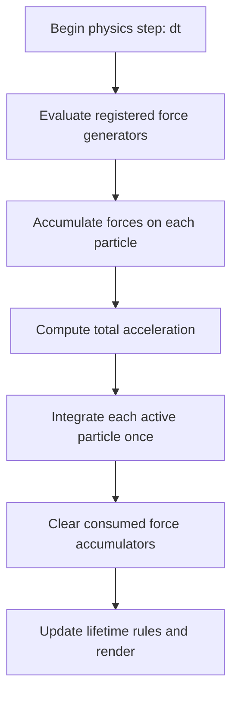
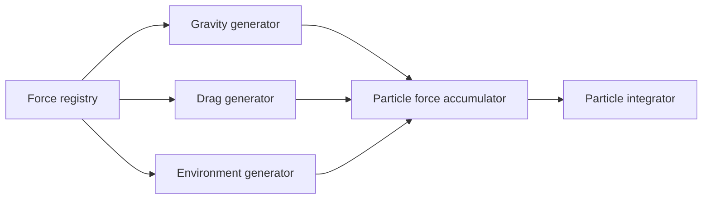

# General Forces — From Particle Motion to Force-Driven Simulation

> **Goal:** Extend a particle simulator so that several independent forces can act on the same particle, without embedding every new physical effect inside the integrator.  
> **Scope:** Force accumulation, force generators, a force registry, gravity, aerodynamic drag, and time- or position-dependent effects. **No springs, contacts, or rigid-body physics.**  
> **Prerequisite:** [Laws of Motion — Building a Particle Simulator](02-laws-of-motion-and-particle-demos.md).

A particle already has a position, velocity, mass, and integrator. What it lacks is a flexible answer to a new question: **what happens when gravity, air resistance, and an environmental force act simultaneously?**

The solution is to separate three responsibilities:

1. **Force generators** determine which forces act on a particle.
2. **The particle** accumulates those forces into a single resultant.
3. **The integrator** uses the resultant to update motion.

## At a glance

| Concept | Relationship | Purpose |
| --- | --- | --- |
| Resultant force | $\mathbf F_{\mathrm{net}}=\sum_i\mathbf F_i$ | Combine simultaneous forces |
| Force-driven acceleration | $\mathbf a_F=\mathbf F_{\mathrm{net}}/m$ | Convert force to motion |
| Total acceleration | $\mathbf a_{\mathrm{total}}=\mathbf a_{\mathrm{base}}+\mathbf a_F$ | Preserve any built-in acceleration |
| Gravity force | $\mathbf F_g=m\mathbf g$ | Produce mass-independent gravitational acceleration |
| Drag magnitude | $k_1s+k_2s^2$ | Model resistance at speed $s$ |
| Drag direction | $-\widehat{\mathbf v}$ | Oppose motion |
| Damped velocity | $\mathbf v_{n+1}=(\mathbf v_n+\mathbf a_{\mathrm{total}}\Delta t)d^{\Delta t}$ | Advance velocity with damping |

---

## 1. Combining forces

### 1.1. One particle, several forces

For a particle with constant mass $m>0$, Newton's second law gives

$$
\boxed{m\mathbf a_F=\mathbf F_1+\mathbf F_2+\cdots+\mathbf F_N.}
$$

The forces are **vectors**: forces in the same direction reinforce one another, and forces in opposite directions may cancel. The particle does not need a separate integration step for each force. It integrates **once**, using their vector sum.

For example, suppose a projectile experiences gravity, drag, and a lateral gust:

$$
\mathbf F_{\mathrm{net}}
=\underbrace{m\mathbf g}_{\text{gravity}}
+\underbrace{\mathbf F_{\mathrm{drag}}}_{\text{resistance}}
+\underbrace{\mathbf F_{\mathrm{gust}}}_{\text{environment}}.
$$

The resultant is then converted to acceleration using inverse mass $\mu=1/m$:

$$
\boxed{\mathbf a_{\mathrm{total}}=\mathbf a_{\mathrm{base}}+\mu\mathbf F_{\mathrm{net}}.}
$$

Here $\mathbf a_{\mathrm{base}}$ is an optional acceleration already stored in the particle, such as constant gravity. This allows the original particle model and the new force system to coexist.

**Important:** If gravity is already included in $\mathbf a_{\mathrm{base}}$, adding $m\mathbf g$ through a generator will apply it **twice**. Decide which mechanism owns each physical effect.

### 1.2. Accumulating forces over a frame

Each particle has a temporary vector, `forceAccum`, initially zero. Every applicable force adds its contribution to this vector. The integrator reads the total, advances the particle, and clears the accumulator after a successful integration step.

$$
\mathbf F_{\mathrm{accum}}
\leftarrow\mathbf 0
\quad\longrightarrow\quad
\mathbf F_{\mathrm{accum}}
\leftarrow\mathbf F_{\mathrm{accum}}+\mathbf F_i.
$$

Accumulated forces apply to the **current simulation step only**. A persistent force must be generated again on every step; otherwise, it disappears when the accumulator is cleared.

Force calculation must happen **before** integration. Adding a force after `integrate(duration)` means that the force will not affect the motion just calculated—and may be lost or applied at the wrong time.

---

## 2. Force generators and the registry

A **force generator** is an object responsible for computing one kind of force. It can depend on the particle's position, velocity, mass, the elapsed time, or the current environment. The particle only receives a force vector; it does not know which effect produced it.

### 2.1. A common interface

In Cyclone, force generators share an abstract interface named `ParticleForceGenerator`. Its principal operation is:

`updateForce(Particle* particle, real duration)`

The operation receives a particle and a timestep, calculates any applicable force, and passes it to the particle's `addForce(...)` method. It does **not** integrate the particle or directly replace its position and velocity.

The same interface can represent a constant gravitational force, velocity-dependent drag, or a temporary gust. **Polymorphism** allows the engine to invoke all of them without special cases for each concrete force type.

### 2.2. Registering which forces affect which particles

Not every generator affects every particle. A central `ParticleForceRegistry` records associations between particles and generators.

| Operation | Responsibility |
| --- | --- |
| `add(particle, generator)` | Register a force source for one particle |
| `remove(particle, generator)` | Remove an association |
| `clear()` | Remove all associations, without deleting the objects |
| `updateForces(duration)` | Ask every registered generator to contribute its force |

A generator may be **shared** by many particles if its configuration does not contain particle-specific mutable state. The registry stores associations; it does not own the particles or generators.

**Lifetime matters in both demos.** Ballistic reuses a pool of 16 projectile slots, and Fireworks reuses a circular pool of 1024 slots. When a slot is deactivated or repurposed, its registrations must remain consistent with the **new** particle type. Reusing the memory address does not automatically make an old registration appropriate.

### 2.3. Where timestep scaling belongs

A generator normally computes force in newtons; it should **not** multiply an ordinary continuous force by $\Delta t$. The integrator handles the duration:

$$
\Delta\mathbf v\approx\frac{\mathbf F_{\mathrm{net}}}{m}\Delta t.
$$

A generator may *inspect* time to decide whether an effect is active or how its strength changes. That is different from prematurely multiplying its force by the timestep.

---

## 3. Two essential force models

### 3.1. Gravity as a force

For approximately uniform gravity,

$$
\boxed{\mathbf F_g=m\mathbf g.}
$$

After dividing by mass, every finite-mass particle experiences the same gravitational acceleration $\mathbf g$, provided no other forces distinguish them:

$$
\mathbf a_g=\frac{m\mathbf g}{m}=\mathbf g.
$$

A gravity generator therefore needs a gravity vector and the particle's mass. It should not apply a gravitational force to a particle modeled with infinite mass.

**Two valid engine designs:**

- **Built-in gravity:** store $\mathbf g$ in the particle's base acceleration. This is simple and inexpensive.
- **Generated gravity:** set the corresponding base acceleration to zero and add $m\mathbf g$ each step through a registered generator. This is more flexible when gravitational behavior varies.

Both describe the same acceleration when configured consistently. They must not be combined accidentally.

### 3.2. Drag as a velocity-dependent force

Damping from the previous chapter simply multiplies velocity by $d^{\Delta t}$. **Aerodynamic drag** instead depends on how fast the particle is moving.

Let $s=\lVert\mathbf v\rVert$ be its speed. A useful simplified model is:

$$
\boxed{
\mathbf F_{\mathrm{drag}}=
-\widehat{\mathbf v}\left(k_1s+k_2s^2\right),
\qquad s>0,
}
$$

with $\widehat{\mathbf v}=\mathbf v/s$ and nonnegative coefficients $k_1,k_2$.

- The **linear term** $k_1s$ increases proportionally with speed.
- The **quadratic term** $k_2s^2$ becomes especially important at high speeds.
- The minus sign makes drag oppose the velocity.
- At $s=0$, the drag force is **zero**; do not normalize the zero vector.

The units of $k_1$ and $k_2$ are respectively $\mathrm{N\,s/m}$ and $\mathrm{N\,s^2/m^2}$ when speed is measured in $\mathrm{m/s}$.

For a simple particle model, drag depends on velocity relative to the *air*, not necessarily the ground. If the air moves with velocity $\mathbf u$, replace $\mathbf v$ in the drag equation with $\mathbf v-\mathbf u$. This extension is useful for simulating wind.

**Damping is not the same as drag.** When testing an explicit drag generator, set the built-in damping close to $1$ so that the two mechanisms do not obscure each other's effects. You may retain a small amount of damping if your simulation requires it, but report that choice.

---

## 4. Updating Cyclone correctly

The original particle integrator can keep its numerical method. Its *acceleration input* changes from a single prescribed vector to the sum of prescribed acceleration and force-induced acceleration:

$$
\begin{aligned}
\mathbf p_{n+1}&=\mathbf p_n+\mathbf v_n\Delta t,\\
\mathbf a_{\mathrm{total},n}&=\mathbf a_{\mathrm{base},n}
+\mu\mathbf F_{\mathrm{accum},n},\\
\mathbf v_{n+1}&=\left(\mathbf v_n
+\mathbf a_{\mathrm{total},n}\Delta t\right)d^{\Delta t}.
\end{aligned}
$$

The position equation still uses velocity from the **start of the step**. The velocity equation uses the accumulated forces from that step. Once consumed, the accumulator is reset before forces are collected for the next step.

A reliable frame sequence is therefore:

1. Determine the positive elapsed simulation time $\Delta t$ in seconds.
2. Update the force registry for the particles that should receive forces this frame.
3. Integrate every active, finite-mass particle once.
4. Process projectile removal or firework expiration and spawning.
5. Keep registrations consistent with any changes to active particle slots.

The key distinction is architectural: **the force generator determines *what* acts; the integrator determines *how motion changes*.** Neither needs to know how the other is implemented.

### 4.1. Exact Cyclone functions to restore

The following three existing methods contain the calculations students must implement. The force registry and the integration loop are **infrastructure supplied by the starter**, not a second implementation exercise.

| File | Existing method to complete | Expected calculation |
| --- | --- | --- |
| `src/particle.cpp` | `void Particle::addForce(const Vector3& force)` | Accumulate the new vector force in `forceAccum` without replacing previous contributions. |
| `src/pfgen.cpp` | `void ParticleGravity::updateForce(Particle* particle, real duration)` | For a finite-mass particle, calculate its weight from the configured gravity vector and pass the resulting **force** to `addForce()`. |
| `src/pfgen.cpp` | `void ParticleDrag::updateForce(Particle* particle, real duration)` | Measure speed, determine the drag magnitude, construct a force opposite velocity, and add it; avoid normalizing zero speed. |

**Preserve:** `Particle::clearAccumulator()`, `ParticleForceRegistry::updateForces()`, `ParticleWorld::runPhysics()` and the already completed `Particle::integrate()`. Do not multiply a force by `duration` in the generator; the integrator handles time.

**Integration detail for these two demos:** `BallisticDemo::update()` and `FireworksDemo::update()` call `Particle::integrate()` themselves; neither automatically invokes `ParticleWorld::runPhysics()`. If you introduce a `ParticleForceRegistry` in either application, call `registry.updateForces(duration)` **before** integrating the relevant active particles, and keep its registrations aligned with reused slots. The game update and life-cycle code must remain in place.

**Starter preparation note:** In the inspected Cyclone repository, `ParticleForceRegistry::remove()` and `clear()` are **declared** in `include/cyclone/pfgen.h` but do not have definitions in `src/pfgen.cpp`. Whoever prepares the starter must supply these small registry utilities if the exercises use them, or provide a different fully working registration lifecycle. They are not part of the three physics calculations above. Also ensure `Particle::hasFiniteMass()` distinguishes positive inverse mass from zero inverse mass before using it for gravity checks.

---

## 5. Practical work — five extensions

The following exercises modify the existing **Ballistic** and **Fireworks** applications. They build on the same force-generation mechanism; none requires a spring, a contact solver, or a separate motion integrator. The specifications describe expected behavior, **not implementation solutions**.

### Exercise 1 — Ballistic: replace prescribed acceleration with registered forces

**Objective:** Use force accumulation and the registry without changing the four established projectile behaviors.

The application currently assigns a different constant acceleration to each projectile type: Pistol falls gently, Artillery falls sharply, Fireball accelerates upward, and Laser has no prescribed acceleration.

**Cyclone entry points:** complete `Particle::addForce()` and `ParticleGravity::updateForce()`. Adapt `BallisticDemo::fire()` to configure the appropriate per-profile generator, and `BallisticDemo::update()` to update the registry before calling `integrate()`; reset registrations whenever a slot is reused.

**Your task:** Reproduce these behaviors using force generators. Treat the downward effects as profile-specific gravity and the Fireball's upward effect as a stylized constant force. Laser should remain free of vertical force. Use the particle mass when converting a desired constant acceleration into a force. Ensure each new shot has exactly the registrations appropriate to its type.

**Expected result:** For matching initial conditions and damping, the modified version follows the same trajectories as the previous one, within floating-point tolerance. Launching a new projectile in a reused slot must not inherit forces from the preceding projectile.

**Explain:** Why does a gravitational *force* depend on mass while gravitational *acceleration* does not?

### Exercise 2 — Ballistic: compare damping with aerodynamic drag

**Objective:** Implement and observe a velocity-dependent drag generator.

**Cyclone entry point:** complete the existing `ParticleDrag::updateForce()` in `src/pfgen.cpp`; then register or enable that generator for Ballistic shots in `src/demos/ballistic.cpp`.

**Your task:** Add optional drag to the Ballistic projectiles, using the linear-plus-quadratic model. Provide a way to compare a shot launched **without explicit drag** to the same shot launched **with explicit drag**, keeping its initial position, velocity, and acceleration equal. Use damping $d=1$ in the comparison so the effect is attributable to the new force alone.

**Expected result:** Drag reduces forward travel, with a stronger force at high speed and a force opposing current motion. A stationary projectile receives no drag force. The same drag force produces less acceleration in a heavier particle, while mass-scaled gravity still produces the chosen gravitational acceleration.

**Explain:** How would the result differ if only the linear coefficient were nonzero, compared with only the quadratic coefficient?

### Exercise 3 — Ballistic: a localized crosswind corridor

**Objective:** Add an environmental force that depends on the particle's location.

**New demo-local class to add:** `BallisticCrosswind : public ParticleForceGenerator`, with `void updateForce(Particle* particle, real duration)`. Put its declaration and implementation alongside the Ballistic demo (or in a clearly named optional force-generator file). Do not modify `Particle::integrate()`.

**Your task:** Create a sideways gust acting only on shots whose forward coordinate satisfies $20\leq z\leq80$. The gust pushes in the $+x$ direction; outside this interval, it contributes zero force. Make the gust strength adjustable, and display whether it is enabled. Apply this effect through a force generator rather than by modifying projectile positions directly.

**Expected result:** A projectile travels normally before reaching the corridor, begins drifting sideways inside it, and stops gaining *additional sideways acceleration from the gust* after leaving it. Any sideways velocity already acquired remains unless another force or damping reduces it. Disabling the gust restores the original trajectory.

**Explain:** If the generator applies the same force to every projectile, why do particles with different masses drift by different amounts? How could you instead model air moving sideways, using relative velocity in the drag equation?

### Exercise 4 — Fireworks: powered launch followed by free flight

**Objective:** Create a time-dependent thrust generator while preserving firework lifetimes and payload rules.

**New demo-local class to add:** `FireworkLaunchThrust : public ParticleForceGenerator`, with `void updateForce(Particle* particle, real duration)`. The provided demo code must also track time since spawn for each relevant firework, reset that time on slot reuse, and call its active generators before `Firework::update()`.

**Your task:** Add a short propulsion phase to **type 7** fireworks. For the first $0.75\ \mathrm s$ after spawning, apply an upward thrust force in addition to gravity. After that interval, the thrust generator contributes zero force, and the particle continues its ordinary flight. Track elapsed time since creation independently of the remaining fuse time.

**Expected result:** Type 7 rises differently during the powered phase, then transitions smoothly to gravity-driven motion. When its fuse expires, it still creates **10 type-8 children** according to the existing rule. Other firework types behave as before. Reusing a slot must reset the propulsion phase correctly; no expired registration may affect a later particle.

**Explain:** Why must the thrust be generated over several simulation steps rather than applied just once as an ordinary force? Why must gravity remain active when thrust ends?

### Exercise 5 — Fireworks: temporary radial force field

**Objective:** Combine position-dependent forces, finite duration, and overlapping generators.

**New demo-local class to add:** `FireworkRadialField : public ParticleForceGenerator`, with `void updateForce(Particle* particle, real duration)`. The demo owns the field center, radius, strength, remaining lifetime, and registration/cleanup; the student writes the **force calculation** and the required simple lifetime behavior.

**Your task:** When a **type-1 firework** detonates, create a temporary spherical force field centered on its detonation position. For $0.2\ \mathrm s$, it should push **other active fireworks** outward inside a configurable radius $R$. Use a **continuous field**: zero at the exact center, increasing to a maximum at an intermediate radius, then decreasing to zero at the boundary. Keep the existing child types and counts unchanged.

One suitable force profile, with $r=\lVert\mathbf p-\mathbf c\rVert$ and $R>0$, is:

$$
\boxed{
\mathbf F_{\mathrm{field}}=
\begin{cases}
4K\left(1-\dfrac{r}{R}\right)\dfrac{\mathbf p-\mathbf c}{R},
&0\le r<R,\\[8pt]
\mathbf 0,&r\ge R.
\end{cases}
}
$$

Here $\mathbf c$ is the burst center and $K>0$ is the **peak force magnitude**, reached at $r=R/2$. The formula is defined at $r=0$ without normalization and has zero magnitude at both $r=0$ and $r=R$. This deliberately simplified field is a **gameplay model**, not a full explosion or collision simulation.

**Expected result:** Nearby fireworks are deflected outward during the field's brief lifetime; distant fireworks remain unaffected. A firework inside two fields receives the **sum** of both forces. When a field expires, it no longer acts on any particle, and its registrations are removed or otherwise made inactive safely.

**Explain:** Why is adding a force for $0.2\ \mathrm s$ different from instantly changing the velocities of nearby fireworks?

---

## 6. What the finished system must demonstrate

A correct implementation no longer needs special-case motion code for gravity, drag, gusts, thrust, or radial fields. The **same particle integrator** advances every object, while generators supply the forces for each frame.

The strongest evidence of correctness is not a screenshot: it is that **different simultaneous forces combine predictably**, inactive or reused particles do not retain stale effects, and changing the physics timestep does not inadvertently change the meaning of a force.
