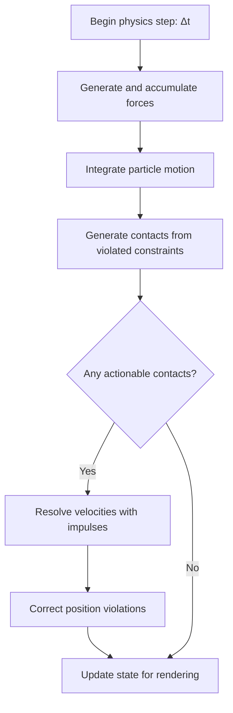
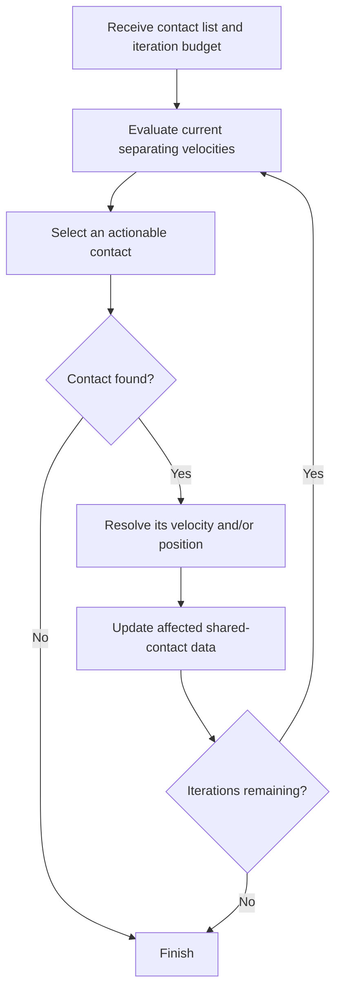
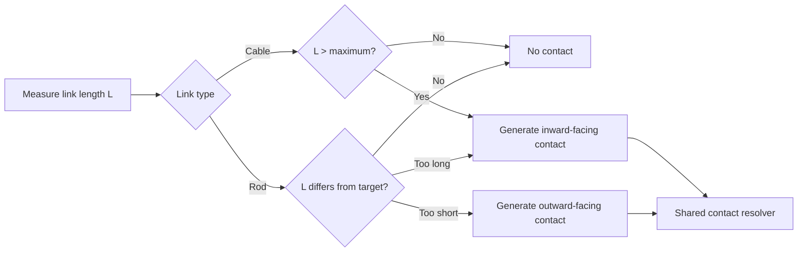
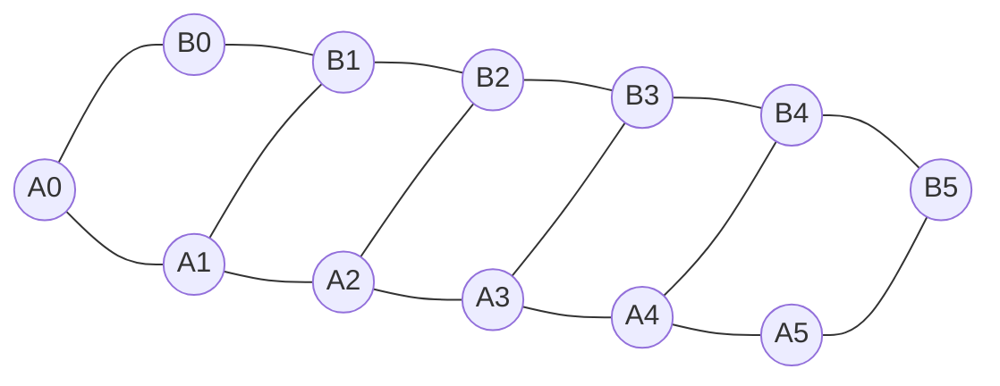

# Hard Constraints — Contacts, Impulses, and Particle Links

> **Goal:** Extend a particle engine beyond independent motion: detect when a geometric restriction is violated and correct the affected particles without relying on excessively stiff forces.  
> **Scope:** Contact normals, restitution, impulses, penetration correction, resting contacts, iterative resolution, cables, rods, and fixed anchors. **No springs, friction, or rigid-body rotation.**  
> **Prerequisite:** [General Forces — From Particle Motion to Force-Driven Simulation](03-general-forces.md).

A force describes how motion changes **over time**. A hard constraint imposes a condition that the motion must **not violate**: two objects must not pass through one another; a cable must not become longer than its limit; the ends of a rod must remain a fixed distance apart.

Instead of introducing an extremely large force, the engine computes a **contact**, applies an **impulse** to correct velocity, and—when necessary—adjusts positions to remove a geometric violation. The same resolution machinery can handle collisions and connections between particles.

## At a glance

| Idea | Key relationship | Interpretation |
| --- | --- | --- |
| Separating velocity | $v_s=(\mathbf v_A-\mathbf v_B)\cdot\mathbf n$ | Negative means *closing* along the chosen normal |
| Restitution | $v_s'=-e\,v_s$ | Controls rebound, $0\le e\le1$ |
| Impulse | $\mathbf J=j\mathbf n$ | Immediate change in momentum, not a continuous force |
| Impulse magnitude | $j=-(1+e)v_s/(w_A+w_B)$ | Basic frictionless contact, $v_s<0$ |
| Penetration correction | $\Delta\mathbf p_A=\dfrac{w_A}{w_A+w_B}\,d\mathbf n$ | Lighter particles move more |
| Cable | $\lVert\mathbf p_B-\mathbf p_A\rVert\le L_{\max}$ | Maximum distance only |
| Rod | $\lVert\mathbf p_B-\mathbf p_A\rVert=L_0$ | Fixed distance in both directions |

Here $\mathbf n$ is a **unit contact normal**, $d$ is a positive violation depth, and $w_i=1/m_i$ is inverse mass. A fixed object is represented by $w=0$.

---

## 1. From forces to hard constraints

### 1.1. What changes in the simulation?

The particle integrator advances position and velocity under the forces accumulated during a timestep $\Delta t$. However, it has no knowledge of relationships between particles. Two particles can move through each other, or two connected particles can drift farther apart than a link permits.

A **constraint** is a mathematical requirement on the simulated state. There are two useful categories:

- **Unilateral (inequality):** a condition must hold on one side of a limit, such as *no penetration* or *no cable extension beyond a maximum*.
- **Bilateral (equality):** a value must remain fixed, such as the length of a rigid rod.

A contact-based solver handles these conditions by modifying the state **after ordinary motion has been integrated**. Forces remain responsible for continuous influences; contacts are responsible for enforcing limits.

**The essential separation:** a *contact generator* reports a problem; a *contact resolver* decides how to change the particles. A cable, for example, should not have to know the equations for applying impulses.

### 1.2. What is a contact?

A contact describes the local relationship between one or two particles:

| Information | Meaning |
| --- | --- |
| `particle[0]`, `particle[1]` | Participating particles; the second may be absent for fixed scenery |
| `contactNormal` | Unit direction in which the first particle should be corrected |
| `restitution` | Rebound coefficient for the normal motion |
| `penetration` | Positive depth by which the condition is violated |

The normal and penetration are **geometric** information. Velocity and inverse mass come from the particle state. The resolver must not assume that all contacts represent two free-moving objects: the other end can be an immovable anchor.

---

## 2. Resolving a contact in velocity

### 2.1. Relative motion along a normal

Let particles $A$ and $B$ have velocities $\mathbf v_A$ and $\mathbf v_B$. Choose a normalized contact direction $\mathbf n$. The *separating velocity* is

$$
\boxed{v_s=(\mathbf v_A-\mathbf v_B)\cdot\mathbf n.}
$$

The sign is meaningful **only with respect to the selected normal**:

| $v_s$ | Interpretation | Normal response |
| --- | --- | --- |
| $v_s<0$ | The pair is approaching a forbidden configuration | Apply an impulse |
| $v_s=0$ | No relative movement along the normal | Usually no bounce |
| $v_s>0$ | The pair is moving away from the forbidden configuration | Do not reverse its motion |

For a conventional collision between particles, $\mathbf n$ points **from $B$ to $A$**. For a stretched cable, the normal must instead point **from $A$ toward $B$**: the required correction pulls the ends inward. Reversing a normal without adjusting the convention reverses the physical behavior.

**Example — approaching a horizontal floor:** let $\mathbf n=(0,1,0)$, $\mathbf v_A=(3,-4,0)$, and let the floor be stationary. Then $v_s=-4\ \mathrm{m/s}$. The sideways velocity of $3\ \mathrm{m/s}$ is irrelevant to a **frictionless** normal contact.

### 2.2. Restitution: how much motion remains after impact?

The **coefficient of restitution**, $e$, relates normal motion immediately before and after a collision:

$$
\boxed{v_s'=-e\,v_s,\qquad 0\le e\le1.}
$$

- $e=0$: no rebound along the normal; the particles leave the contact with zero relative normal velocity.
- $e=1$: ideal elastic rebound along the normal.
- $0<e<1$: partial rebound.

Restitution does **not** specify tangential friction. In this particle model, the tangential component of relative velocity remains unchanged by a normal impulse.

### 2.3. Impulses rather than large forces

A force changes velocity over a duration. An **impulse** changes velocity immediately:

$$
\mathbf J=\Delta\mathbf q=m\,\Delta\mathbf v,
\qquad
\Delta\mathbf v=w\mathbf J,
$$

where $\mathbf q=m\mathbf v$ is momentum and $w=1/m$. The unit of impulse is $\mathrm{N\,s}$ (equivalently $\mathrm{kg\,m/s}$).

For a frictionless contact, the impulse lies along the contact normal:

$$
\mathbf J=j\mathbf n.
$$

Conservation of momentum gives equal and opposite impulses on the two particles:

$$
\begin{aligned}
\mathbf v_A'&=\mathbf v_A+jw_A\mathbf n,\\
\mathbf v_B'&=\mathbf v_B-jw_B\mathbf n.
\end{aligned}
$$

Substituting these changes into the target separating velocity yields, for an approaching contact,

$$
\boxed{
 j=\frac{-(1+e)v_s}{w_A+w_B}
}\qquad(v_s<0,\ w_A+w_B>0).
$$

This formula assumes no friction and no angular motion. It is **not multiplied by the timestep**: the contact impulse already represents an instantaneous change of momentum.

**Special cases:**

- If $B$ is fixed, take $w_B=0$ and $\mathbf v_B=\mathbf 0$.
- If $w_A+w_B=0$, neither object can move; do not divide by zero.
- If $v_s>0$, applying the collision formula would create an unphysical reversal. The velocity response is skipped, even if a separate position correction is still needed.

**Sanity check — equal masses:** two particles with the same mass moving toward one another at equal and opposite speeds should exchange their *normal* velocities when $e=1$. With $e=0$, their relative normal velocity should become zero.

---

## 3. Removing interpenetration

Changing velocities alone cannot undo a violation that **already exists**. An overextended cable may stop stretching yet remain too long indefinitely. Likewise, two overlapping objects may stop approaching without becoming separated.

Let $d>0$ measure the violation along $\mathbf n$. Move the two particles in opposite directions, with displacement proportional to inverse mass:

$$
\boxed{
\begin{aligned}
\Delta\mathbf p_A&=\frac{w_A}{w_A+w_B}\,d\mathbf n,\\[3pt]
\Delta\mathbf p_B&=-\frac{w_B}{w_A+w_B}\,d\mathbf n.
\end{aligned}
}
$$

Then update $\mathbf p_A$ and $\mathbf p_B$ with these displacements. The lighter particle receives a larger share of the correction; an anchored or otherwise immovable endpoint receives none.

**Do not confuse the two corrections:**

| Velocity resolution | Position resolution |
| --- | --- |
| Responds to approaching motion | Responds to a positive constraint violation |
| Changes $\mathbf v$ via an impulse | Changes $\mathbf p$ directly |
| Depends on restitution | Depends on violation depth |
| Can be unnecessary while objects separate | Can still be required while objects separate |

For a contact system that handles several connected particles, one position correction may change the violations of other contacts. Those shared-contact values must be reconsidered during iterative resolution.

---

## 4. Resting contacts and numerical stability

A particle lying on the ground is still subject to gravity. After integration, it may acquire a small downward velocity, which the contact solver could incorrectly interpret as a fresh impact. If every frame converts this small velocity into a rebound, a supposedly resting particle begins to jitter or hop.

The solver therefore distinguishes **impact velocity** from velocity acquired through acceleration during the current timestep.

For the normal component of relative acceleration,

$$
a_n=(\mathbf a_A-\mathbf a_B)\cdot\mathbf n,
\qquad
\Delta v_{\mathrm{acc}}=a_n\Delta t,
$$

if $\Delta v_{\mathrm{acc}}<0$, part of the measured closing velocity may have been produced by forces pressing the particles together during this step. A practical correction to the desired post-contact velocity is

$$
\boxed{
 v_{\mathrm{target}}
 =\max\!\left(0,\,-ev_s+e\min(0,\Delta v_{\mathrm{acc}})\right).
}
$$

The resolver then computes the impulse from the required change $v_{\mathrm{target}}-v_s$ rather than blindly using $-ev_s$ as the target.

This approximation suppresses artificial rebounds at persistent contacts. It must act **along the normal only**: a particle sliding sideways across a floor should not lose its horizontal velocity just because gravity presses it downward.

**Implementation note:** the acceleration used for this estimate should be consistent with the acceleration that the integrator applied during the step. If your particle model combines prescribed acceleration and force-generated acceleration, do not silently ignore one of them when reasoning about resting contacts.

A resting-contact correction is **not friction**. It prevents undesired motion *through* a surface; friction would additionally resist motion *along* that surface.

---

## 5. Multiple contacts: why a resolver needs iterations

Contacts are coupled. Correcting one particle can change the relative velocity, position, or penetration of every other contact that references it. Resolving the list once in its original order is generally insufficient for a bridge, chain, or densely connected system.

A practical iterative solver repeatedly chooses an actionable contact, resolves it, and reconsiders the others. A useful priority for normal velocity resolution is the **most negative separating velocity**.

A contact is actionable when its normal motion is closing ($v_s<0$), its penetration is positive, or both. A solver can resolve velocity and penetration together for each chosen contact, or treat them in distinct passes. If separate passes are used, **velocity severity** and **penetration severity** can have different priorities.

The iteration budget places an upper bound on computation. More iterations may reduce visible constraint error, but they also cost time; they do not guarantee perfect rigidity for an arbitrary network.

**Three implementation hazards:**

1. **Stale values.** A previously measured $v_s$ or penetration may no longer be valid after another contact modifies shared particles.
2. **Incorrect contact capacity.** A generator must respect the number of free entries in the contact buffer; it must not write beyond the limit.
3. **Undefined directions.** When two endpoints coincide, the difference vector has zero length; it cannot be normalized. Handle this case deliberately.

### An alternative: resolve at the exact collision time

Instead of detecting overlap at the end of a frame, an event-based engine can find the time at which objects first touch, integrate up to that event, apply the impulse, and continue for the remaining time. This reduces penetration error but requires repeated detection and integration, and resting contacts remain difficult.

For the particle systems in this project, use a **discrete timestep and an iterative end-of-step resolver**. Continuous collision detection is outside the required implementation.

---

## 6. Links are contacts with a different normal

The most useful connection is conceptual: **a rod or cable does not need its own physics solver**. Each link examines the distance between its endpoints and generates a contact whenever its geometric condition is violated.

Define

$$
\mathbf d=\mathbf p_B-\mathbf p_A,\qquad
L=\lVert\mathbf d\rVert,\qquad
\widehat{\mathbf d}=\frac{\mathbf d}{L}\quad(L>0).
$$

### 6.1. Cables: a maximum length

A cable allows its endpoints to move closer together freely. It only resists movement that would extend its length beyond $L_{\max}$:

$$
\boxed{L\le L_{\max}.}
$$

When $L\ge L_{\max}$, the cable can generate a contact with

$$
\boxed{
\mathbf n=\widehat{\mathbf d},\qquad
\mathrm{penetration}=\max(0,L-L_{\max}).
}
$$

The equality case is important: a cable **exactly at its limit** can still need a velocity impulse if its ends are moving farther apart, even when the penetration depth is zero. When $L<L_{\max}$, the cable is slack and contributes no contact. Here the normal points **toward the other endpoint**, because the correction must pull $A$ and $B$ together. The cable's restitution determines how strongly the ends rebound inward when its length limit is reached.

### 6.2. Rods: a fixed length

A rod maintains a distance $L_0$ and resists **both extension and compression**:

$$
\boxed{L=L_0.}
$$

The sign of the distance error chooses the direction of correction:

| Current state | Required correction | Contact normal for particle $A$ | Violation |
| --- | --- | --- | --- |
| $L>L_0$ | Pull endpoints together | $+\widehat{\mathbf d}$ | $L-L_0$ |
| $L<L_0$ | Push endpoints apart | $-\widehat{\mathbf d}$ | $L_0-L$ |
| $L=L_0$ | No position correction | — | $0$ |

For a rigid-distance link, **restitution is zero**: the connection should not bounce in and out of its permitted length. The underlying solver must also remove closing normal velocity so the error does not immediately return.

A simple rod generator reports a contact in the currently violated direction. Such a method can exhibit one-step drift or oscillation near the target length. A more stable solver may explicitly enforce **zero relative velocity along the link** when the rod is at its target length, and may represent both limiting directions to prevent oscillation. The latter requires additional contact capacity and iterations. The essential invariant is the same: rod length should remain close to $L_0$, and restitution is zero.

### 6.3. Fixed anchors: one immovable endpoint

A **cable constraint** connects a particle to a fixed point $\mathbf a$ in world space. Mathematically, this is a cable whose second endpoint never changes position and has zero inverse mass:

$$
\lVert\mathbf p-\mathbf a\rVert\le L_{\max},
\qquad w_{\mathrm{anchor}}=0.
$$

Only the particle moves when the distance is corrected. The fixed point is not another free particle and should not be integrated.

---

## 7. Practical application — Bridge

The provided `bridge.cpp` already describes **what the bridge contains** and how it is drawn. The intentionally incomplete Cyclone code must make the underlying constraints function. Do not replace missing physics by manually moving vertices into place inside the rendering code.

### 7.1. Understand the existing topology

The bridge has **12 particles** arranged as six pairs across its width. The connections consist of:

| Element | Count | Role |
| --- | ---: | --- |
| Particles | 12 | Dynamic points of the deck |
| Longitudinal cables | 10 | Five links along each side; maximum length $1.9$ |
| Transverse rods | 6 | One rigid link per pair; target length $2$ |
| Anchored support cables | 12 | One fixed-anchor cable per particle |
| Movable load | 1 displayed marker | Changes the masses assigned to nearby deck particles |

Let $A_i$ and $B_i$ denote the two particles at station $i$, for $i=0,\dots,5$. The longitudinal cables join successive $A$ particles and successive $B$ particles. Each rod joins $A_i$ to $B_i$.

*Conceptual deck topology; anchored support cables are omitted from this diagram to keep it readable.*

The initial deck particles are spaced **2 units** apart along each side, while the longitudinal cables have maximum length **1.9**. These cables therefore begin slightly beyond their limits: a working resolver should correct the discrepancy rather than assume every link starts satisfied.

### 7.2. What is already provided?

The application creates the particles, assigns gravity and damping, constructs links, registers their contact generators with the world, draws each connection, and supports moving a displayed load with **W/A/S/D**.

The moving load is a simplified model: it does not have its own particle trajectory. Instead, its weight is represented indirectly by distributing an additional **10 units of mass** among nearby deck particles, on top of a base mass of **1 per particle**. The distribution changes as the marker moves. Consequently, inverse masses—and therefore the shares of impulses and position corrections—also change.

The visible geometry is not enough to prove correctness. The bridge must obey the **distance constraints** while responding to gravity and to changes in the load's location.

### 7.3. The incomplete engine: responsibilities to restore

The bridge is an integration test for the contact system. The missing Cyclone calculations should collectively provide the following behavior:

| Component | Responsibility | Observable consequence |
| --- | --- | --- |
| Particle contact | Measure relative normal velocity; apply an impulse and penetration correction | No runaway overlap or uncontrolled extension |
| Contact resolver | Choose and process contacts repeatedly, with an iteration limit | Interacting links settle rather than depend entirely on registration order |
| Particle link | Measure the distance between linked particles | Connections react to their actual geometry |
| Cable generator | Produce a contact when the maximum length is reached or exceeded | Slack cables do not push their endpoints apart; taut cables can oppose further extension |
| Rod generator | Correct excessive *or insufficient* length | Transverse width stays approximately constant |
| Anchored cable generator | Enforce a maximum distance to a fixed point | Supports hold the suspended deck without moving anchors |

The **contact-generation stage** should only describe violated restrictions. The **resolution stage** should implement the shared mathematics developed in Sections 2–5.

### 7.4. Exact Cyclone functions to restore

Restore the calculations **inside the existing methods**, not in separate bridge-specific implementations. All previous mathematical, motion, and force methods are prerequisites.

| File | Existing method to complete | What the student calculates |
| --- | --- | --- |
| `src/pcontacts.cpp` | `real ParticleContact::calculateSeparatingVelocity() const` | Relative velocity projected onto the unit contact normal; a null `particle[1]` represents a fixed environment. |
| `src/pcontacts.cpp` | `void ParticleContact::resolveVelocity(real duration)` | Restitution, acceleration-aware resting-contact correction, normal impulse, and inverse-mass-weighted velocity updates. |
| `src/pcontacts.cpp` | `void ParticleContact::resolveInterpenetration(real duration)` | Penetration correction distributed by inverse mass; write to `particleMovement[0]` and `[1]` before adjusting positions. |
| `src/plinks.cpp` | `unsigned ParticleCable::addContact(ParticleContact* contact, unsigned limit) const` | Slack/taut test, inward contact normal, penetration, restitution, and `0`/`1` return count. |
| `src/plinks.cpp` | `unsigned ParticleRod::addContact(ParticleContact* contact, unsigned limit) const` | Fixed-length test, the correct normal for extension **or** compression, penetration, zero restitution. |
| `src/plinks.cpp` | `unsigned ParticleCableConstraint::addContact(ParticleContact* contact, unsigned limit) const` | Maximum-length test against an immovable anchor, with `particle[1] == nullptr`. |

**Provided, not to empty:** `ParticleContactResolver::resolveContacts()`, `ParticleContact::resolve()` and `ParticleLink::currentLength()` / `ParticleConstraint::currentLength()`. The original iterative resolver reads `particleMovement` after `resolveInterpenetration()`; initialize both movement vectors to zero even when no position correction is needed, or ensure the instructor's stub does so reliably. Every contact generator must honor `limit == 0` and must return the number of initialized contacts, never more than the available capacity.

`ParticleRodConstraint::addContact()` exists in Cyclone, but **Bridge does not instantiate it**; it is not required for this course. The length-limited cable test is active at **equality** (`length >= maxLength`), even if positional penetration is zero, so that it can oppose outward velocity at its limit.

---

## 8. Five exercises — from contact mathematics to a working bridge

These tasks are progressive. Each specifies the required behavior and how to judge it, without giving a ready-to-copy C++ implementation. Complete the engine calculations in the supplied incomplete classes; change `bridge.cpp` only when the exercise explicitly calls for an application-level modification.

### Exercise 1 — Contact normals and separating velocity

**Objective:** Establish the sign conventions used by every subsequent contact.

**Method:** `ParticleContact::calculateSeparatingVelocity()` in `src/pcontacts.cpp`.

Implement the missing relative normal velocity calculation for a contact between two dynamic particles and for a particle against an immovable environment. Test approaching, separating, and purely tangential motion.

**Expected behavior:** Approaching motion produces $v_s<0$; separating motion produces $v_s>0$; motion tangent to the normal produces $v_s=0$. Reversing a normal reverses the sign. An absent second particle does not lead to an invalid memory access.

**Explain:** Why is the dot product more useful here than the magnitude of relative velocity?

### Exercise 2 — Impulse and restitution

**Objective:** Correct normal velocity without treating a collision as a force lasting for $\Delta t$.

**Method:** `ParticleContact::resolveVelocity(real duration)` in `src/pcontacts.cpp`.

Complete the velocity response using inverse masses and restitution. Compare equal-mass contacts, unequal-mass contacts, and a particle hitting a fixed surface. In a temporary diagnostic scene, vary $e$ between $0$, $0.5$, and $1$.

**Expected behavior:** The post-contact separating velocity agrees with the selected restitution when there is a genuine impact. Heavier particles receive smaller velocity corrections under the same impulse. Tangential velocity is preserved. Fixed endpoints remain fixed.

**Explain:** Why would multiplying the impulse by $\Delta t$ make the apparent rebound depend on frame rate?

### Exercise 3 — Penetration and resting contacts

**Objective:** Make contacts stable even when an integration step begins or ends with a violated position.

**Method:** `ParticleContact::resolveInterpenetration(real duration)` in `src/pcontacts.cpp`. Keep the `particleMovement` bookkeeping correct for every exit path.

Add inverse-mass-weighted position correction and the acceleration-aware treatment of resting normal motion. Test a free particle against a stationary horizontal ground before using Bridge, then verify that an overextended cable can return within its limit.

**Expected behavior:** A penetrating particle is moved out in the correct direction. Zero-inverse-mass endpoints do not move. A nearly resting particle does not repeatedly bounce because of gravity, and an already separating particle is not given an unnecessary collision impulse.

**Explain:** Why do correct post-collision velocities not guarantee correct positions?

### Exercise 4 — Bridge cables, rods, and anchors

**Objective:** Make the existing bridge topology enforce three different distance conditions.

**Methods:** `ParticleCable::addContact()`, `ParticleRod::addContact()`, and `ParticleCableConstraint::addContact()` in `src/plinks.cpp`.

Complete the missing contact generation for longitudinal cables, transverse rods, and anchored support cables. Respect contact-buffer capacity and handle coincident endpoints safely. Keep the provided particle positions and link configuration initially unchanged so the demo remains a controlled test of the engine.

**Expected behavior:** Longitudinal links oppose further extension as soon as they are taut and correct existing overextension; they never behave like compression-resistant rods. Transverse rods resist becoming both longer and shorter. Anchored support cables prevent the deck from falling arbitrarily far while leaving anchor positions unchanged.

**Explain:** What sign change distinguishes a cable that pulls its endpoints inward from a conventional collision that pushes particles apart?

### Exercise 5 — Moving load and solver convergence

**Objective:** Observe how coupled constraints respond to a changing mass distribution.

**Demo-side work only:** `BridgeDemo::updateAdditionalMass()` and `BridgeDemo::update()` already handle the prescribed load. Add small diagnostics to `src/demos/bridge.cpp` if desired; do **not** replace the shared contact resolver or convert the displayed load into a physical particle yet (that is the final friction project).

Use **W/A/S/D** to move the load across the bridge. Add a small, noninteractive diagnostic display (or periodic console output) reporting the largest cable overextension, the largest rod length error, and the number of solver iterations used. Compare behavior at several iteration budgets without changing the links' target lengths.

**Expected behavior:** Moving the load redistributes deformation without disconnecting the deck. Constraint errors should generally decrease as the solver is given a more adequate iteration budget, although exact equality is not guaranteed at a finite timestep. The simulation should remain well-defined when the load reaches either end or edge of the bridge.

**Explain:** Why can correcting one link make a previously satisfied neighboring link violate its constraint again?

---

## 9. Final perspective

A particle engine becomes a **mass-aggregate** simulator when its particles can interact through shared constraints. The key architecture remains compact:

**Continuous forces determine motion; contact generators report forbidden configurations; the resolver changes velocities and positions to enforce the restrictions.**

The essential result is not a perfectly rigid-looking drawing. It is a system whose signs, inverse-mass weighting, impulse calculations, penetration corrections, and iterative behavior remain consistent when multiple constraints act on the same particles.

Friction and more advanced collision detection are intentionally left outside this stage.
