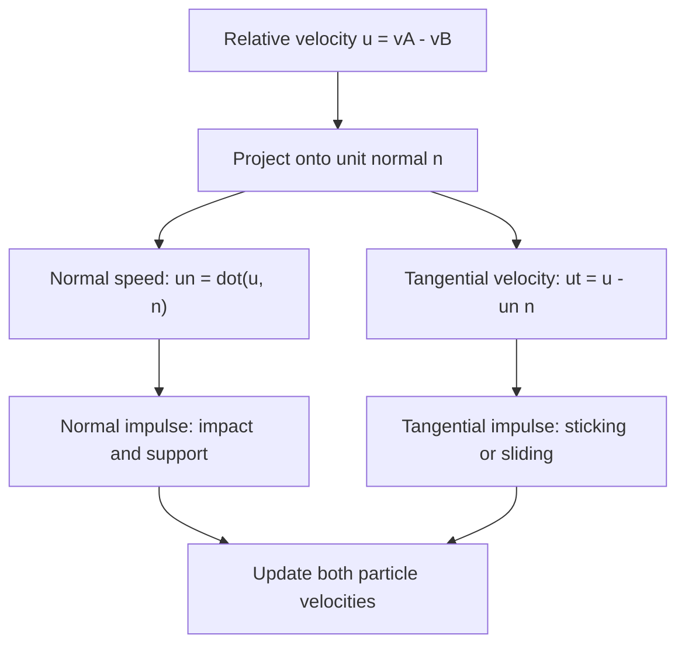
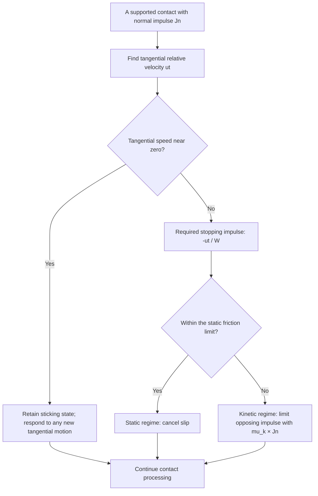
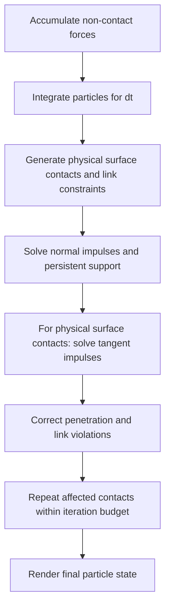

# Particle Contact Friction — From Sliding to Sticking

> **Goal:** Extend an impulse-based particle engine so that contact can resist motion **along** a surface, not only motion **through** it.  
> **Scope:** Resting contacts, normal reactions, static and kinetic friction, tangential impulses, contact-dependent viscous resistance, numerical stability, and a final Bridge project. **Particles only: no rotation, rigid bodies, springs, or rolling friction.**  
> **Prerequisite:** [Hard Constraints — Contacts, Impulses, and Particle Links](04-hard-constraints-and-bridge.md). The earlier chapters on [particle motion](02-laws-of-motion-and-particle-demos.md) and [force generators](03-general-forces.md) are also used.

A frictionless contact can stop a particle from falling through a floor while allowing it to slide indefinitely across that floor. **Friction adds a second response**: it resists *relative tangential motion* between surfaces that are already in contact.

The distinction matters because a contact impulse has two independent jobs:

- **Normal response:** prevent penetration and handle restitution.
- **Tangential response:** oppose sliding, or prevent it from starting, within the friction limit.

We can implement both using particle positions, velocities, inverse masses, and the contact solver already developed. No angular state is required.

## At a glance

| Concept | Essential relationship | Meaning |
| --- | --- | --- |
| Relative velocity | $\mathbf u=\mathbf v_A-\mathbf v_B$ | Motion of $A$ relative to $B$ |
| Normal component | $u_n=\mathbf u\cdot\mathbf n$ | Motion through/away from the contact |
| Tangential component | $\mathbf u_t=\mathbf u-u_n\mathbf n$ | Motion along the contact |
| Effective inverse mass | $W=w_A+w_B$ | Converts a particle-pair impulse into relative velocity |
| Static friction | $\lVert\mathbf F_s\rVert\le\mu_sN$ | Resists the onset of sliding |
| Kinetic friction | $\mathbf F_k=-\mu_kN\widehat{\mathbf u_t}$ | Opposes sliding already in progress |
| Static impulse condition | $\lVert\mathbf J_t^{*}\rVert\le\mu_s J_n$ | The contact can cancel tangential slip |
| Sliding impulse limit | $\lVert\mathbf J_t\rVert\le\mu_k J_n$ | Limits the impulse opposing slip |

Here $w_i=1/m_i$ (zero for an immovable contact partner), $\mathbf n$ is a unit contact normal, $N\ge0$ is a **normal reaction force**, and $J_n\ge0$ is a **normal contact impulse**. Friction coefficients $\mu_s$ and $\mu_k$ are dimensionless; typically $\mu_s\ge\mu_k\ge0$.

---

## 1. What counts as friction?

### 1.1. Friction requires a contact

Three effects can slow a particle, but they are not interchangeable:

| Effect | Acts when? | Depends on | Physical interpretation |
| --- | --- | --- | --- |
| **Air drag** | While moving through air | Velocity relative to air | Resistance from the surrounding medium |
| **Numerical damping** | Whenever the integrator runs | Damping factor and timestep | Convenient, approximate loss of velocity |
| **Dry contact friction** | Only while surfaces touch and press together | Relative tangential motion and normal reaction | Resistance to sliding at a material interface |

For example, an airborne projectile can experience drag, but it cannot experience **floor friction** before touching the floor. A particle resting against the floor can experience friction even with zero speed, because static friction can resist an attempted movement.

A cable or rod constraint is different from a sliding surface. It enforces a **distance**, not a physical area of contact. Do **not** automatically assign Coulomb friction to every cable, rod, or anchor in the engine.

### 1.2. The particle approximation

In a particle engine, a contact describes the interaction of one or two moving points with a **chosen surface normal**. The surface may be an immovable floor or an approximate patch supported by other particles.

This model can resolve translational sliding. It cannot simulate a wheel spinning, the torque generated by an off-center friction force, or rolling resistance. Those effects require additional degrees of freedom and are intentionally excluded.

---

## 2. Prerequisite: decompose contact velocity

Let $A$ be the particle being corrected and $B$ its contact partner (or the stationary environment). Choose the unit normal $\mathbf n$ so that **positive relative normal velocity means separation**:

$$
\mathbf u=\mathbf v_A-\mathbf v_B,
\qquad
u_n=\mathbf u\cdot\mathbf n.
$$

The tangential velocity is the part of $\mathbf u$ perpendicular to $\mathbf n$:

$$
\boxed{\mathbf u_t=\mathbf u-(\mathbf u\cdot\mathbf n)\mathbf n.}
$$

It lies in the contact plane because $\mathbf u_t\cdot\mathbf n=0$.

**Example — a particle sliding on a horizontal floor.** With $\mathbf n=(0,1,0)$ and $\mathbf v_A=(4,-2,3)$ m/s, the normal velocity is $u_n=-2$ m/s, while the tangential velocity is $\mathbf u_t=(4,0,3)$ m/s. Its tangential speed is $5$ m/s. A frictionless contact changes the vertical motion; friction must also act on the horizontal component.



### 2.1. How impulses change relative velocity

Let $\mathbf J$ be an impulse applied to $A$ and $-\mathbf J$ the corresponding impulse applied to $B$:

$$
\Delta\mathbf v_A=w_A\mathbf J,
\qquad
\Delta\mathbf v_B=-w_B\mathbf J.
$$

Thus the relative velocity changes by

$$
\boxed{\Delta\mathbf u=(w_A+w_B)\mathbf J=W\mathbf J.}
$$

This is why **the same scalar $W$ works for both normal and tangential impulse calculations** in a translation-only particle engine. A fixed environment is represented by $w_B=0$ and $\mathbf v_B=\mathbf0$.

If $W=0$, neither endpoint can respond. The solver must not divide by zero.

---

## 3. Normal support: the prerequisite for friction

Friction cannot be calculated until the contact has a meaningful **normal response**. The normal keeps the particles from moving through each other; the tangential response is then limited by how strongly that contact is supported.

For a closing contact, $u_n<0$, the frictionless normal impulse from the previous chapter is

$$
\boxed{J_n=\frac{-(1+e)u_n}{W}}
\qquad (u_n<0,\ W>0),
$$

where $e\in[0,1]$ is the restitution coefficient. The normal impulse vector is $\mathbf J_n=J_n\mathbf n$.

### 3.1. Why a particle can be stationary yet have a normal impulse

A particle resting on a floor is accelerated downward by gravity during each step. A discrete-time solver may let a very small downward velocity accumulate, then cancel it with a small **support impulse**. These repeated corrections are often called *microcollisions*.

For a simple particle of mass $m$ resting on a fixed horizontal floor,

$$
J_n\approx mg\,\Delta t,
\qquad
N\approx\frac{J_n}{\Delta t}\approx mg.
$$

This approximation is appropriate when the only relevant vertical external force is gravity and the floor supports the entire load. **It does not generally hold on an accelerating or inclined bridge**, where geometry, other forces, and neighboring contacts alter the reaction.

A practical solver suppresses artificial bouncing at low normal speeds: it reduces restitution to zero below a small impact threshold and avoids treating velocity gained under inward acceleration as a fresh high-energy impact. These corrections affect the **normal** response; they must not erase tangential velocity on their own.

### 3.2. Preserve persistent contacts

Friction must continue to operate while a particle is supported, not only on the first frame when two objects collide. Generate or maintain a contact whenever the surfaces are touching within an appropriate tolerance, even if there is little or no penetration.

**Important implementation detail:** friction is limited by the **compressive normal impulse generated for that contact**. In an iterative solver, use the accumulated nonnegative normal impulse when enforcing the friction limit; the last tiny normal-impulse *increment* may be zero even though the contact is supporting weight.

---

## 4. Dry friction: static and kinetic

### 4.1. Static friction prevents the start of sliding

Static friction opposes the force that would otherwise make two touching surfaces slide:

$$
\boxed{\lVert\mathbf F_s\rVert\le\mu_sN.}
$$

This is an **inequality**, not a force of constant magnitude. If a horizontal push requires only $3$ N of resistance and the contact can supply up to $10$ N, static friction supplies approximately $3$ N and the particle remains still. It does not apply the full $10$ N by default.

For a block-like point mass on a fixed horizontal surface with no other vertical effects, the largest sustainable horizontal force is $\mu_smg$. The particle starts sliding when the required tangential reaction exceeds that limit.

### 4.2. Kinetic friction opposes existing sliding

Once the surfaces slide relative to one another, a simple Coulomb model uses

$$
\boxed{
\mathbf F_k=-\mu_kN\frac{\mathbf u_t}{\lVert\mathbf u_t\rVert}
}
\qquad (\lVert\mathbf u_t\rVert>0).
$$

Its direction is opposite the **relative tangential velocity**, not necessarily opposite the total applied force. In this idealized model its magnitude depends on the normal force, not directly on the sliding speed.

The coefficients belong to the **pair of materials at the contact**. They are not obtained by adding two arbitrary per-object coefficients.

### 4.3. From forces to impulses

Our engine resolves contacts by impulses rather than continuous reaction forces. The corresponding friction limits are

$$
\boxed{\lVert\mathbf J_t\rVert\le\mu_sJ_n\quad\text{(sticking capacity)}},
$$

and, when sliding,

$$
\boxed{\lVert\mathbf J_t\rVert\le\mu_kJ_n\quad\text{(sliding capacity)}}.
$$

Here $\mathbf J_t$ lies entirely in the contact plane. Both limits are **magnitudes**, and both require $J_n\ge0$.

---

## 5. Deriving the tangential impulse for particles

The contact solver knows the current tangential relative velocity $\mathbf u_t$ and the effective inverse mass $W$.

**First consider a single, freshly resolved contact.** In Sections 5.1–5.2, $J_n$ means the **total nonnegative normal impulse available for that contact during the step**, not an arbitrary impulse increment from a later solver iteration. Section 7.1 gives the additional bookkeeping needed for repeated contacts.

### 5.1. Try to stop sliding

We first calculate the impulse that would remove *all* tangential relative velocity:

$$
\mathbf u_t+W\mathbf J_t^*=\mathbf0
\quad\Longrightarrow\quad
\boxed{\mathbf J_t^*=-\frac{\mathbf u_t}{W}.}
$$

If the required impulse is within the static-friction limit,

$$
\boxed{\lVert\mathbf J_t^*\rVert\le\mu_sJ_n,}
$$

then the contact can **stick**. Apply the required impulse: the tangential relative velocity becomes approximately zero.

### 5.2. Otherwise, allow sliding

When the required impulse exceeds the static limit, the contact is sliding. The kinetic impulse acts opposite the slip direction, with a smaller permitted magnitude:

$$
\boxed{
\mathbf J_t
=-\widehat{\mathbf u_t}\;
\min\!\left(\mu_kJ_n,\frac{\lVert\mathbf u_t\rVert}{W}\right)
}
\quad(\lVert\mathbf u_t\rVert>0).
$$

The second term in the minimum prevents one timestep's friction impulse from overshooting through zero and **reversing** the sliding direction. Handle $\lVert\mathbf u_t\rVert=0$ without normalizing a zero vector.

Both the normal and tangential impulses act on the same pair:

$$
\boxed{
\begin{aligned}
\mathbf v_A'&=\mathbf v_A+w_A(J_n\mathbf n+\mathbf J_t),\\
\mathbf v_B'&=\mathbf v_B-w_B(J_n\mathbf n+\mathbf J_t).
\end{aligned}}
$$

The equal and opposite impulses preserve the pair's **linear momentum** when both particles are dynamic and no external impulse is included in the comparison. With a fixed environment, the unmodeled environment receives the reaction.



**Why no matrix inversion?** Without rotation, an impulse changes each particle's velocity in the impulse's own direction. There are no torque-induced couplings between the normal and tangent directions. A single scalar $W$ replaces the more general contact-space response matrix.

### 5.3. One numerical example

A $2$ kg particle rests on a fixed horizontal floor. Take $g=9.81$ m/s$^2$, $\Delta t=0.01$ s, $\mu_s=0.6$, and $\mu_k=0.4$. Under gravity alone, the approximate support impulse for one step is

$$
J_n\approx mg\Delta t=2(9.81)(0.01)=0.1962\ \mathrm{N\,s}.
$$

The available static impulse is $0.6J_n=0.11772$ N s, while the kinetic limit is $0.4J_n=0.07848$ N s.

If the particle is sliding at $0.5$ m/s, its stopping impulse would require $m(0.5)=1$ N s. This exceeds the static limit, so it remains in the kinetic regime. The step's friction impulse reduces its speed by approximately

$$
\Delta v=\frac{0.07848}{2}=0.03924\ \mathrm{m/s}.
$$

Its new sliding speed is approximately $0.46076$ m/s (ignoring other horizontal forces). **This example is a flat, fixed-floor test**, not a prescription for computing the normal reaction of the whole bridge.

---

## 6. Other contact friction models

### 6.1. A single friction coefficient

A minimal game-oriented solver can use one coefficient $\mu$ for both sticking and sliding. This is a reasonable first milestone, but it cannot reproduce the stronger force often required to **start** a slide than to **maintain** one.

Using distinct $\mu_s$ and $\mu_k$ makes this transition explicit. A useful invariant for test materials is $\mu_s\ge\mu_k$.

### 6.2. Viscous resistance along a contact

A second model represents a thin viscous layer, such as a coating that resists relative motion in proportion to speed:

$$
\boxed{\mathbf F_v=-c_t\mathbf u_t,}
$$

where $c_t$ has units of kg/s. Over a short timestep, a first-order approximation is

$$
\mathbf J_v\approx-c_t\mathbf u_t\Delta t.
$$

Apply this **only while contact is active**, and limit its magnitude to the impulse required to stop slip, $\lVert\mathbf u_t\rVert/W$, to avoid numerical reversal. Unlike dry Coulomb friction, this model has **no strict static sticking threshold**: as relative speed approaches zero, its resisting force approaches zero.

This is a **contact-viscosity model**, not the aerodynamic drag generator from the previous chapter. If both models are enabled, record them separately so the same energy loss is not accidentally counted twice.

### 6.3. Direction-dependent friction (optional extension)

An **isotropic** surface has the same friction coefficients in every direction within the contact plane. An **anisotropic** surface resists sliding differently along two selected tangent directions—imagine a deck with longitudinal grooves.

The prerequisite is a stable pair of unit tangent vectors $\mathbf t_1,\mathbf t_2$, each perpendicular to $\mathbf n$, with $\mathbf t_1\cdot\mathbf t_2=0$. Tangential motion can then be split into

$$
\mathbf u_t=(\mathbf u\cdot\mathbf t_1)\mathbf t_1
+(\mathbf u\cdot\mathbf t_2)\mathbf t_2.
$$

Separate directional friction limits require an appropriate **two-dimensional admissible-impulse region**; independently clamping two axes is a convenient approximation but is **not equivalent to isotropic Coulomb friction**. The core engine in this course needs only isotropic friction. Directional friction is a stretch goal.

### 6.4. What is deliberately excluded

Rolling friction, spinning contact patches, torque, angular velocity, and inertia tensors are outside this particle model. There is no benefit in importing those mechanisms just to make a point particle slow down on a surface.

---

## 7. Fitting friction into Cyclone's contact solver

The previous contact system already has the essential data: the two particles (or a fixed second partner), the normal, penetration, and restitution. Friction extends each **physical contact** with material parameters, for example `staticFriction` and `kineticFriction`.

Keep three responsibilities separate:

| Component | Responsibility |
| --- | --- |
| **Contact generator** | Detect a physical surface contact, supply its normal and participating particles, and assign the contact's material properties |
| **Contact resolver** | Compute normal response, then a tangent impulse within the friction limit, and correct penetration |
| **Force system** | Continue to handle gravity, wind, aerodynamic drag, and other non-contact forces |

A frictionless contact remains valid: $\mu_s=\mu_k=0$ simply produces no tangential impulse. Existing cables, rods, and fixed-anchor distance constraints should retain their original behavior.



### 7.1. Iteration and accumulated impulses

With multiple contacts, the result of one correction affects neighboring contacts. The solver must revisit changed velocities. If it resolves only the most negative **normal** separating velocity, a purely tangential violation may never be revisited; contact selection or per-contact processing must also consider tangential motion at supported contacts.

For a more robust iterative implementation, maintain accumulated impulses per contact:

$$
J_n^{\mathrm{acc}}\ge0,
\qquad
\lVert\mathbf J_t^{\mathrm{acc}}\rVert\le\mu J_n^{\mathrm{acc}}.
$$

Apply **only the difference** between the newly permitted accumulated impulse and the impulse already applied. Otherwise, repeating a contact can repeatedly subtract the same velocity and produce excessive friction. Accumulators typically reset when a contact is newly generated; stable contact matching or warm starting is an optional improvement, not a prerequisite for the first implementation.

For the particle-only case, a possible **incremental tangent-impulse projection** during a solver iteration is:

$$
\mathbf J_t^{\mathrm{trial}}
=\mathbf J_t^{\mathrm{acc}}-\frac{\mathbf u_t}{W}.
$$

Then choose the new accumulated tangent impulse using the **accumulated** normal impulse:

$$
\mathbf J_t^{\mathrm{new}}=
\begin{cases}
\mathbf J_t^{\mathrm{trial}},
&\lVert\mathbf J_t^{\mathrm{trial}}\rVert\le\mu_sJ_n^{\mathrm{acc}},\\[3pt]
\mu_kJ_n^{\mathrm{acc}}
\dfrac{\mathbf J_t^{\mathrm{trial}}}{\lVert\mathbf J_t^{\mathrm{trial}}\rVert},
&\text{otherwise}.
\end{cases}
$$

Only the **increment** $\Delta\mathbf J_t=\mathbf J_t^{\mathrm{new}}-\mathbf J_t^{\mathrm{acc}}$ is applied to the particle velocities, after which the stored accumulated value becomes $\mathbf J_t^{\mathrm{new}}$. The division in the sliding branch is safe when $\mu_s\ge\mu_k\ge0$ and the static test has failed, provided $W>0$. This is a simplified sequential-impulse scheme, not an exact simultaneous solution for every bridge contact.

With two coefficients, use the static bound to decide whether sticking is feasible and the kinetic bound when sliding. Avoid oscillating between the two regimes solely because of tiny floating-point velocities; use a consistent small tolerance.

### 7.2. Stability requirements

- Keep $\mathbf n$ normalized; compute $\mathbf u_t$ **after** the current normal response, so it reflects the latest velocities.
- Never apply friction without a genuine supporting contact or with a negative normal impulse.
- Protect $W=0$ and $\lVert\mathbf u_t\rVert\approx0$ from division by zero.
- Make slow resting contacts effectively non-bouncy; do not let gravity create a new visible bounce each frame.
- Preserve the physical distinction between changing **velocity** with impulses and changing **position** to correct penetration. A position correction alone must not manufacture a friction impulse.
- Test timestep sensitivity and solver iteration counts. A sequential impulse solver approximates coupled contacts and can exhibit small drift even with high friction.

A simple quality check is **dissipation**: for an isolated tangential friction correction, relative kinetic energy should not increase. If friction speeds up an isolated sliding particle, inspect the contact normal, the impulse sign, and any overshoot.

### 7.3. The exact Cyclone extension: two new student calculations

Unlike the previous chapters, Cyclone's **particle** contact system has no friction methods waiting to be filled. To keep the assignment focused on simple physics, the course starter must **provide the interface and the contact-management code**. Students then implement only two new calculations in `src/pcontacts.cpp`:

| New method | Student responsibility | Mathematical reference |
| --- | --- | --- |
| `Vector3 ParticleContact::calculateTangentialVelocity() const` | Subtract the contact partner's velocity (or zero for the scenery) and remove the component parallel to `contactNormal`. | Section 2: $\mathbf u_t=\mathbf u-(\mathbf u\cdot\mathbf n)\mathbf n$ |
| `void ParticleContact::resolveFriction(real duration)` | Compute and apply a tangent impulse, using static/kinetic Coulomb limits or the selected contact-viscous model. Update both particle velocities and the stored tangential impulse. | Sections 4–7 |

**All method names and data fields below are proposed additions for the teaching starter, not members already present in the supplied Cyclone particle API.** They are intentionally limited to translational particle contacts.

#### Preparation A — extend `ParticleContact` in `include/cyclone/pcontacts.h`

Preserve the existing `particle[2]`, `restitution`, `contactNormal`, `penetration`, `particleMovement[2]`, `resolve()`, and normal-response functions. Add the **fields and reset method under the existing `public:` section**, and the **two calculation methods under `private:`**, all **inside the class**:

```cpp
// Public contact data, filled by a surface contact generator:
bool surfaceContact;             // false for rods, cables, and anchors
real staticFriction;             // mu_s >= 0
real kineticFriction;            // 0 <= mu_k <= mu_s
real contactViscosity;           // c_t >= 0; exclusive alternative to dry friction

// Response accumulated during this physics step:
real normalImpulse;              // compressive scalar normal impulse, >= 0
Vector3 tangentialImpulse;       // total tangent impulse already applied

// Public: supplied by the instructor, called before generating contacts:
void resetFrictionState();

// Private: students implement these two calculations in pcontacts.cpp:
Vector3 calculateTangentialVelocity() const;
void resolveFriction(real duration);
```

The existing `friend class ParticleContactResolver;` declaration grants the resolver access to the private methods. **Use the contact normal pointing away from the deck toward the load**, so positive normal relative velocity means separation.

#### Preparation B — give every generated contact a clean state

The contact array is **reused on every frame**. Merely initializing fields once in a constructor is insufficient. The instructor supplies `ParticleContact::resetFrictionState()`; at minimum it sets:

```cpp
void ParticleContact::resetFrictionState()
{
    surfaceContact = false;
    staticFriction = kineticFriction = contactViscosity = 0;
    normalImpulse = 0;
    tangentialImpulse.clear();
    particleMovement[0].clear();
    particleMovement[1].clear();
}
```

In `ParticleWorld::generateContacts()` (`src/pworld.cpp`), reset the reusable entries **before** calling any generators. For this small project, resetting the entire allocated `contacts` array once per step is sufficient; insert the following at the start of that method, before the existing contact-generation loop:

```cpp
for (unsigned i = 0; i < maxContacts; ++i) {
    contacts[i].resetFrictionState();
}
```

Then each physical **deck-contact generator** explicitly assigns `surfaceContact = true` and that region's material parameters. The existing cable, rod, anchor, and ground generators remain frictionless by default. Resetting the movement vectors also prevents stale values in the original iterative normal solver.

#### Preparation C — expose the normal impulse computed in Chapter 04

In `ParticleContact::resolveVelocity(real duration)` (`src/pcontacts.cpp`), the normal response from Chapter 04 already calculates a scalar normal impulse and applies it to the velocities. **The instructor prepares the storage hook**, or marks it as an additional one-line student task: after a positive normal impulse is computed, add it to `normalImpulse` for a physical surface contact.

```cpp
// After the existing positive normal impulse has been computed:
if (surfaceContact && impulse > 0) {
    normalImpulse += impulse;
}
```

Here `impulse` is the scalar computed by the normal-response method. Do not invent a constant $mg\Delta t$ for Bridge: its normal impulse comes from the **actual contact response**. The stored value is the **total applied during this step**, not merely the increment from the last solver visit.

#### Preparation D — schedule tangent calculations without rewriting the normal solver

Cyclone's existing `ParticleContactResolver::resolveContacts()` chooses contacts mainly by **closing normal velocity or penetration**. A supported contact can require friction even when it has no remaining normal violation. Therefore, **calling `resolveFriction()` only inside `ParticleContact::resolve()` is not sufficient**.

The instructor keeps the existing normal resolver and appends a **separate, small contact-friction pass** at the end of `resolveContacts()`:

1. Run the original normal-velocity and penetration iterations as before.
2. Visit the generated contacts marked `surfaceContact` and having `normalImpulse > 0`.
3. For **dry friction**, call `resolveFriction(duration)` a few times (for example, four sweeps over all such contacts). Each visit must apply **only a new impulse increment**, not reapply the total previously accumulated impulse.
4. For a **viscous contact**, call `resolveFriction(duration)` **once per timestep**, rather than once per dry-friction sweep: its impulse already contains the time interval and repeated application would multiply the effect.
5. Leave `ParticleContact::resolve()` and the distance-constraint generators unchanged. Do not apply surface friction to rod or cable contacts.

For example, the instructor can append this **plumbing code at the end of `ParticleContactResolver::resolveContacts()`**, after its existing `while` loop. The two student methods are still empty:

```cpp
// Dry-contact iterations: only apply incremental impulses.
for (unsigned sweep = 0; sweep < 4; ++sweep) {
    for (unsigned i = 0; i < numContacts; ++i) {
        ParticleContact& c = contactArray[i];
        if (c.surfaceContact && c.normalImpulse > 0 &&
            c.contactViscosity == 0) {
            c.resolveFriction(duration);
        }
    }
}

// Viscous contacts: exactly one timestep-scaled application.
for (unsigned i = 0; i < numContacts; ++i) {
    ParticleContact& c = contactArray[i];
    if (c.surfaceContact && c.normalImpulse > 0 &&
        c.contactViscosity > 0) {
        c.resolveFriction(duration);
    }
}
```

This two-phase arrangement is an **educational sequential-impulse approximation**. It is appropriate for the assignment, but it is not a complete persistent-contact or production solver. A supporting contact must still be **generated near zero gap**, rather than only once deep penetration has occurred.

#### Preparation E — give the students two compilable stubs

Add the following method definitions to `src/pcontacts.cpp`. They are **intentionally not solutions**:

```cpp
Vector3 ParticleContact::calculateTangentialVelocity() const
{
    // TODO (student): relative velocity; remove its normal component.
    return Vector3(0, 0, 0); // Placeholder, replace this return.
}

void ParticleContact::resolveFriction(real duration)
{
    // TODO (student): compute W and the current tangential velocity.
    // TODO (student): choose dry static/kinetic or viscous behavior.
    // TODO (student): limit the impulse and apply it to both velocities.
    // TODO (student): maintain the accumulated impulse for dry friction.
}
```

For dry friction, the proposed data correspond to $J_n^{\mathrm{acc}}=\texttt{normalImpulse}$ and $\mathbf J_t^{\mathrm{acc}}=\texttt{tangentialImpulse}$. Use the trial-impulse projection in Section 7.1, then apply **only** $\Delta\mathbf J_t=\mathbf J_t^{\mathrm{new}}-\mathbf J_t^{\mathrm{acc}}$. For a viscous material, use Section 6.2 and cap the one-step impulse to avoid reversing slip. Treat `contactViscosity > 0` as a separate preset, **not an extra friction force added to the dry model**.

**Instructor/student boundary:** The instructor supplies the additional fields, initialization, normal-impulse bookkeeping, iteration calls, and deck-contact generation. Students fill the **two new method bodies** and set up comparisons between the prepared material presets. No rigid-body collision machinery, torque, rotation, or inertia tensors are needed.

---

## 8. Final project — A bridge with multiple friction behaviors

**Project goal:** Turn Bridge into a particle-based demonstration in which a load can move **physically** across the deck, stick to some regions, slide over others, and respond to a viscous contact layer. Build on the contact solver rather than simulating friction by changing keyboard movement speed.

### 8.1. First, understand the provided demo

The scene contains **12 deck particles**, **10 longitudinal cables**, **6 transverse rods**, and **12 anchored support cables**. Its original red load marker is **not a dynamically integrated particle**. Pressing **W/A/S/D** changes a logical position; `updateAdditionalMass()` then redistributes an extra mass of $10$ among nearby deck particles and interpolates the marker's displayed position.

That is useful for demonstrating deformation under a **prescribed** load, but it has no independent load velocity or contact manifold. Friction cannot meaningfully decide whether this marker starts sliding: keyboard input simply moves it.

For this project, introduce a separate *sliding-load mode*. The load must now have its own position, velocity, and mass; keyboard input supplies a horizontal **force or impulse**, not a direct position change. Its visual marker follows the simulated particle. The original moving-load mode may be retained for comparison.

**Avoid double counting:** if the new load particle transfers weight through physical contacts, do not also represent its full mass using the original extra-mass redistribution. Choose a consistent load-transfer model.

### 8.2. Make the bridge a contact surface

A drawn line is not automatically a collision surface. Define a **finite-width deck surface** from the existing particle pairs or short deck patches. For the simplest version, use one representative supporting deck particle and a local upward-facing unit normal. This gives a *two-particle* approximation that reuses the equations from Sections 2–5, but it does **not** make a single point into a true surface.

Define the geometric test explicitly. For a candidate point $\mathbf q$ on the deck patch, a load center $\mathbf p$, its effective collision radius $\rho\ge0$, and a unit normal $\mathbf n$ pointing toward the load, the signed gap is

$$
g=(\mathbf p-\mathbf q)\cdot\mathbf n-\rho.
$$

Test that the load's projection is **inside the chosen finite patch**. For a touching or penetrating candidate ($g$ close to zero or negative), create a normal contact, with penetration $\max(0,-g)$ and a suitable near-contact tolerance for resting support. Once the load is outside the patch, the contact must disappear. The load's rendered radius need not equal $\rho$ unless you make that a design requirement.

A more accurate version can use an interpolated deck patch supported by several particles. If the contact surface has weights $\alpha_i\ge0$ with $\sum_i\alpha_i=1$, its approximate velocity is

$$
\mathbf v_{\mathrm{deck}}=\sum_i\alpha_i\mathbf v_i.
$$

When a contact impulse on the load is opposed by $-\alpha_i\mathbf J$ on each supporting particle, the effective inverse mass becomes

$$
\boxed{W_{\mathrm{patch}}=w_{\mathrm{load}}+\sum_i\alpha_i^2 w_i.}
$$

This **weighted contact** is an advanced extension: it requires contact resolution to distribute impulses among more than two particles. It is not necessary to demonstrate the first friction models. A local two-particle approximation is acceptable if its limitations are documented.

The load must remain supported by normal contacts and may leave the surface or fall off an edge. When the load is airborne, deck friction disappears.

### 8.2.1. Preparing the Bridge starter: make the load a particle

**File:** `src/demos/bridge.cpp`. The following changes are **starter infrastructure supplied by the instructor**, not extra mathematical exercises:

| Existing code / new item | Preparation for the final exercise |
| --- | --- |
| `BridgeDemo::updateAdditionalMass()` | Disable the **extra-mass redistribution** in dynamic-load mode and keep the deck particles at their base mass; otherwise the new load's weight is applied twice. |
| New member `cyclone::Particle slidingLoad` | Set a finite mass, initial position above the deck, zero initial velocity, prescribed gravity, and damping near 1. Register its address with `world.getParticles()` so `ParticleWorld::integrate()` updates it. |
| New `BridgeDeckContacts : public cyclone::ParticleContactGenerator` | Implement `unsigned addContact(ParticleContact* contact, unsigned limit) const`. Find the current finite deck patch under the load and emit at most one appropriately oriented **physical surface contact** (not a rod or cable). |
| `BridgeDemo::display()` | Render the red load at `slidingLoad.getPosition()` instead of the old interpolation marker. |
| `BridgeDemo::key()` / input state | Use W/A/S/D to request a **horizontal force** on the load, not to change its position directly. Supply a repeatable constant-push test for the static-friction experiment. |
| `BridgeDemo::update()` | Apply input **after** `world.startFrame()` but **before** `world.runPhysics(duration)`. Do not rely on the inherited `MassAggregateApplication::update()` when injecting forces, because that method starts by clearing force accumulators. |

A precise, simple geometric convention is to use the **five deck spans between the six crosswise particle pairs**, within the lateral range of the bridge. For each span, use the current particle positions to estimate its local deck height $q_y$; the simplest contact normal is $\mathbf n=(0,1,0)$, and one nearby deck particle represents the moving support. For load collision radius $\rho$, create a contact when the horizontal projection lies **inside a span** and the signed gap $g$ from Section 8.2 is less than a small positive contact tolerance. Set the penetration to $\max(0,-g)$, the restitution to zero for a resting load, and the second contact particle to the selected deck particle. This one-support approximation transfers opposite impulses into Bridge without introducing multi-particle contact mathematics.

The generator **must honor `limit == 0`**, set `particle[0]` to the load and `particle[1]` to the chosen support, assign `surfaceContact = true`, and set that span's material parameters. The instructor can fill these *data-assignment* lines after performing the geometric test:

```cpp
contact->particle[0] = &slidingLoad;
contact->particle[1] = supportingDeckParticle;
contact->contactNormal = cyclone::Vector3(0, 1, 0);
contact->penetration = penetration; // Computed by the supplied geometry code.
contact->restitution = 0;
contact->surfaceContact = true;
contact->staticFriction = zoneStaticFriction;
contact->kineticFriction = zoneKineticFriction;
contact->contactViscosity = zoneViscosity;
// Return 1 for this initialized contact; otherwise return 0.
```

Names such as `slidingLoad`, `supportingDeckParticle`, and `zoneStaticFriction` refer to values **provided by the instructor's generator**; they are not existing Cyclone variables. When outside the deck or clearly airborne, return zero contacts. The more accurate weighted four-particle patch in Section 8.2 is **optional** and requires extra solver work; it is not part of the two student functions.

To apply a continuous push correctly, the instructor can adapt `BridgeDemo::update()` to this ordering (the control helper itself is supplied):

```cpp
void BridgeDemo::update()
{
    cyclone::real duration = (cyclone::real)TimingData::get().lastFrameDuration * 0.001f;
    if (duration <= 0) return;

    world.startFrame();            // Reset last frame's forces.
    applyLoadControls(duration);   // Provided helper: add a horizontal force.
    world.runPhysics(duration);    // Registry, integration, contacts, resolution.
    Application::update();
}
```

`applyLoadControls` above is a **proposed new helper**, not a Cyclone method. The instructor must define it and any required input-state storage, or provide an equivalent working control scheme. Do not call the inherited mass-aggregate update again in this override, or the world would be advanced twice.

### 8.3. Assign several friction materials

Use distinct regions or selectable presets. The following values are **illustrative simulation parameters**, not measurements of real materials:

| Region / mode | $\mu_s$ | $\mu_k$ | Contact behavior |
| --- | ---: | ---: | --- |
| Frictionless | $0.00$ | $0.00$ | Sliding is limited only by other effects |
| Slippery | $0.08$ | $0.05$ | Easy to initiate motion; weak braking |
| Dry deck | $0.65$ | $0.45$ | Noticeable sticking and sliding resistance |
| High-grip | $1.00$ | $0.80$ | Larger push needed before slipping |
| Viscous coating | — | — | Speed-dependent resistance $\mathbf F_v=-c_t\mathbf u_t$ while touching |

For fair comparisons, use the same load mass, starting point, initial velocity, timestep, and applied input in every mode. Set unrelated damping or air drag to neutral values during isolated friction tests so they do not hide the differences.

**Concrete region mapping (suggested):** starting from the bridge's initial $x$ coordinates $-5,-3,-1,1,3,5$, use its five spans as five material zones. From left to right: **frictionless**, **slippery**, **dry deck**, **high-grip**, **viscous coating**. The material belongs to the **current load–deck contact**; it is not a damping parameter attached permanently to the load.

### 8.4. Student exercises — two methods, several surfaces

The instructor-provided starter handles geometry, force-input plumbing, contact selection, material assignment, and the normal solver. Students should **not** have to design an entire collision subsystem.

**Exercise 1 — Tangent velocity.** In `src/pcontacts.cpp`, complete `ParticleContact::calculateTangentialVelocity() const`. It must work for two moving particles as well as a load touching immovable scenery. Confirm that the computed vector is perpendicular to the contact normal. A particle moving purely upward or downward against a horizontal plane has zero tangent velocity.

**Exercise 2 — Dry contact friction.** In `src/pcontacts.cpp`, complete the dry branch of `ParticleContact::resolveFriction(real duration)`. Compute the inverse-mass sum, the impulse that would stop relative slip, the static limit $\mu_sJ_n$, and the kinetic limit $\mu_kJ_n$. Apply opposite velocity updates to the two particles and update `tangentialImpulse` with **the actual cumulative impulse**. A frictionless preset must leave the tangential component unchanged; a high-grip preset must resist a smaller applied push.

**Exercise 3 — Compare material zones.** With the provided `BridgeDeckContacts` generator and region mapping, cross the five spans using the **same** load, input force, timestep, and initial state. Verify the difference between a slippery, dry, and high-grip surface. No new physics method is needed: changing the contact's material coefficients is sufficient.

**Exercise 4 — Viscous contact.** Complete the viscous branch **in the same** `ParticleContact::resolveFriction(real duration)` method, using the law from Section 6.2. The instructor-provided friction pass calls it once per frame for this material. Verify that it slows slip continuously without a finite static breakaway threshold.

**Exercise 5 — Physical validation.** On a fixed horizontal test plane, compare a sustained force just below and just above $\mu_smg$. On the deformable bridge, observe how the local support velocity affects relative slip. Record the normal impulse and tangential speed for a short run. If the load moves without contact, or friction acts in mid-air, inspect **contact generation**, not the friction formula first.

**Required completion:** only the two new student calculation methods in Section 7.3, plus simple exercise-level comparison or diagnostic changes. The teacher's starter must already compile and run with zero-friction defaults before student calculations are filled.

---

### 8.5. Expected observations and numerical tests

| Test | Expected outcome |
| --- | --- |
| **No friction, no drag** on a fixed flat surface | Tangential velocity is unchanged by the contact solver |
| **Static threshold** on a fixed flat surface | A constant push below $\mu_smg$ can be resisted; one above it initiates sliding |
| **Kinetic braking** | A freely sliding load loses tangential speed without reversing direction purely from one friction step |
| **Surface change** | Equal initial conditions produce noticeably different travel distances across different materials |
| **Loss of contact** | No dry or viscous *deck-contact* friction acts on the airborne load |
| **Two dynamic particles** | Opposing contact impulses conserve total linear momentum; isolated friction does not add kinetic energy |
| **Time step and iterations** | Results remain qualitatively consistent when the timestep is reduced and the contact solver is given more iterations |

A useful independent sanity test is a particle on a fixed inclined plane. Gravity produces a tangential load $mg\sin\theta$ and a normal reaction $mg\cos\theta$, so the idealized static-friction condition is

$$
\boxed{\tan\theta\le\mu_s.}
$$

Use this result to verify the static threshold before interpreting the behavior of a deforming, dynamically supported bridge.

### 8.6. Questions for the final discussion

1. Why is **increasing particle damping** not equivalent to adding friction between the load and the bridge?
2. Why can a load remain motionless under a small push even though kinetic friction always opposes motion?
3. Why must a normal contact be resolved before applying a Coulomb friction limit?
4. How does the result change if the deck particle itself moves sideways with the load?
5. What inaccuracies are introduced by representing an entire deck patch with a single particle, and how would weighted impulses improve that approximation?

---

## 9. What this completes

The simulator now has three distinct layers:

1. **Motion:** forces and integration change particle velocities and positions over time.
2. **Constraints:** normal impulses and position corrections stop forbidden motion and maintain distance links.
3. **Surface response:** tangential impulses allow physical contacts to slide, stick, or exhibit contact-dependent resistance.

The completed Bridge experiment should demonstrate the difference between **being supported**, **starting to slip**, and **continuing to slide**, while every dynamic object remains a particle. That is sufficient for a substantial particle-physics engine without introducing a rotational rigid-body system.
