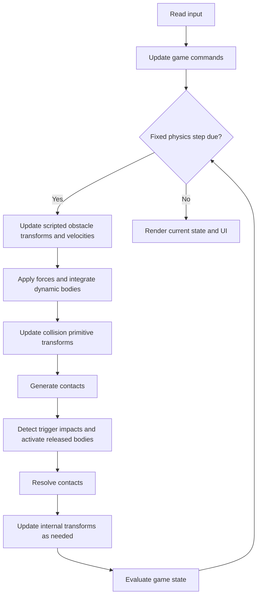
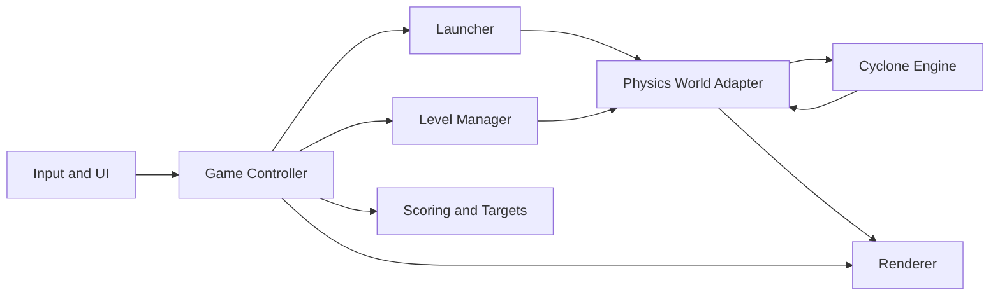

# Rigid Body Siege — Physics Game Project

> **Duration:** 32 hours · **Level:** Second-year software development students · **Language:** C++ · **Format:** Teams of 2
>
> **Starting point:** The Cyclone physics engine is provided. Your task is to build a playable physics-based destruction game around it, not to write another physics engine.

## 1. Project Overview

Build a 3D, *Angry Birds*-like game in which a player launches a limited number of projectiles at structures made of rigid bodies. Blocks can slide, rotate, topple, collide and knock down targets. A level ends when all targets are eliminated or the player runs out of projectiles and the simulation settles.

The project must feel like a **game**, rather than a collection of isolated physics demonstrations: it needs a launch mechanism, readable feedback, meaningful levels, clear rules, and the ability to restart and try another strategy.

The most important challenge is to combine concepts already encountered with particles—forces, motion and collisions—with the new behavior of **rigid bodies**: shape, orientation, angular velocity, inertia and off-center impacts.

The game is presented in **true 3D**. Players must be able to perceive depth and aim at targets positioned at different depths. The camera may be fixed, freely controlled, or orbiting, provided that the scene is readable. The game must not rely on a 2D physics solver or on scripted collapse animations.

## 2. What Is Provided—and What Is Not

The provided physics library is **Cyclone**. It supplies rigid bodies, physical state and integration, collision primitives, contact generation and contact resolution. You must study its public interfaces before building the game.

In particular, these engine-level types are relevant:

| Cyclone component | Role in the project |
|---|---|
| `cyclone::RigidBody` | Mass, inertia, position, orientation, linear/angular motion |
| `cyclone::CollisionSphere` | Projectile or spherical target collision geometry |
| `cyclone::CollisionBox` | Blocks and structural elements |
| `cyclone::CollisionPlane` | Ground and other planar boundaries |
| `cyclone::CollisionDetector` | Create contacts between supported primitive pairs |
| `cyclone::CollisionData` | Store generated contacts and material settings |
| `cyclone::ContactResolver` | Resolve contacts and penetration |

The **library is not a complete game framework**. You must build the application, rendering, interaction and game systems around it. Use **raylib** for the graphical interface and 3D primitives. You are responsible for researching how to install, compile and integrate the tools on Windows; no setup walkthrough or starter configuration is supplied in this specification.

Official resources: Cyclone Physics (will be provided) · [raylib](https://www.raylib.com/).

The visual representation should remain deliberately simple: boxes, spheres, cylinders, planes and lines are sufficient. **Cyclone is responsible for physics; raylib is responsible for drawing and input.** Geometry must follow the position and orientation of its corresponding simulated body. No external models, textures, shader effects or polished animations are required.

The software must keep three responsibilities separate: physics and collision management, game rules and level state, and presentation and player input. Changing the internals of Cyclone is not required for the core physics features; any extension beyond Cyclone's existing `Joint` functionality must be identified and justified.

## 3. The Game Scenario

The player controls a launcher on the left side of the scene. A limited number of spherical projectiles can be launched towards structures on the right side. Each structure protects one or more targets.

A successful shot can hit a target directly, shift the bottom block of a tower, or make a stack collapse. **Indirect destruction is intentional**: the game should reward understanding how impacts propagate through several bodies.

A playable session contains **three levels**, each demonstrating a different physical concept. The levels must be genuinely distinct; merely changing the number or color of blocks is insufficient.

### Level 1 — Ropes, Constraints and Shapes

The first level introduces a hanging object or short suspended assembly next to a structure of boxes and spheres. The projectile must trigger a physical sequence: for example, an impact makes the suspended weight swing, and the weight then knocks over a support that protects a target. All objects have genuine 3D positions and collision shapes. The scene must not be resolved by a predetermined animation.

**Technical Challenge 1 — Rigid-body ropes and joints.** Cyclone already includes a `Joint` contact generator connecting two `RigidBody` attachment points. Its `error` parameter limits the allowed separation of the attachment points; it can therefore represent a simple **inelastic cable-like connection**. The challenge is to examine this existing implementation, connect the relevant bodies (including an appropriate fixed support if needed), generate joint contacts alongside collision contacts and render the rope as a line between the world-space attachment points. A cable should limit maximum separation without acting like a rod that pushes its endpoints apart.

The exercise is **not** to implement cloth, a deformable rope or a new general-purpose constraint solver. The provided Cyclone joint is a starting point; students must establish and demonstrate that the particular configuration used in their level behaves correctly under impacts, with slack and taut states where applicable. This challenge revisits rods, cables, contacts, impulse response and rigid-body rotation.

### Level 2 — Impact Damage and Destruction

This level contains objects that become **damaged or destroyed when an impact exceeds a defined threshold**. Different objects should have distinct resistance values, such as fragile and reinforced blocks. Direct hits and collisions caused by falling objects should both be capable of triggering damage. A weak impact must not destroy a resistant object; a sufficiently strong collision must produce a clear gameplay consequence.

Damage must be related to an **impact event**, not simply to the existence of a contact. Teams must choose and document an appropriate severity measure, such as the magnitude of relative closing speed along the contact normal, or an impulse estimate if the chosen integration makes it reliably available. A block resting on the ground must not accumulate damage every simulation frame. Destruction can mean safely removing a body, changing its physical state, or replacing it with a small predefined collection of rigid fragments; arbitrary geometric fracture is not required.

The level should be designed so that destroying one support can destabilize other bodies and create a **secondary collision**, rather than only deleting an isolated target.

### Level 3 — Kinematic Motion and Dynamic Release

The final level introduces a **moving obstacle controlled by the game rather than by physical forces**. For example, a large box or platform travels horizontally between two positions at a fixed height, crossing the player's line of fire. Its motion is predictable: it follows a simple, predefined path even though it has a collision shape in the 3D scene.

The player must time a shot to strike the moving obstacle. After a sufficiently strong impact, the obstacle **stops following its prescribed path and becomes a normal dynamic rigid body**. It now responds to gravity, linear and angular motion, and collisions through Cyclone. Its fall must initiate a chain reaction that affects at least one other structure and contributes to eliminating a target.

**Technical Challenge 2 — A simple kinematic-to-dynamic transition.** A *kinematic* object is moved by gameplay code: the application decides where it should be at each simulation step, instead of deriving its motion from forces. Cyclone does not provide a dedicated, ready-made kinematic-body mode, so teams must implement a **small application-level controller for one obstacle**.

While the obstacle is in its *scripted* state, the game updates its 3D position along a short path and keeps its collision geometry synchronized. It should have a consistent prescribed velocity so a projectile can hit it meaningfully. The obstacle must not be displaced by gravity or ordinary contact impulses while it is following that path. An impact from the projectile must nevertheless be detected.

On a qualifying impact, the game switches the obstacle to its *dynamic* state: scripted movement stops, its finite mass and inertia become effective in the contact solver, gravity takes over, and the obstacle continues from its current position and orientation. Its prescribed velocity should carry over into the dynamic motion rather than being reset to zero. The triggering projectile's collision must be handled consistently so that the release does not look like a teleport or an arbitrary animation.

The required scope is deliberately narrow: **one obstacle, a simple path between two endpoints, a projectile-triggered release, and a physically simulated fall**. The moving obstacle does not need to push stacks around while it is still following its scripted path. Teams are not required to create a general-purpose kinematic API, pathfinding system, moving-joint solver, or continuous collision detection.

This challenge introduces the distinction between **prescribed motion (kinematics)** and **force-driven motion (dynamics)** while reusing contact detection, velocity, inertia, gravity and rigid-body rotation.

Levels can be defined in C++ data structures or in external configuration files. Hardcoding *all* level logic inside the rendering loop is not acceptable.

### Summary of the Two Technical Challenges

| Challenge | What Cyclone already provides | What students must implement or integrate |
|---|---|---|
| **1 — Cable between rigid bodies** | `cyclone::Joint`, local attachment points and contact resolution | Configure the joint, include its contacts in the physics step, display the link, and demonstrate correct impact-driven motion |
| **2 — Kinematic obstacle released on impact** | `RigidBody`, collision primitives and contact resolution; no dedicated kinematic mode | Move one obstacle on a prescribed path, synchronize its collider, detect a projectile impact, switch it to a dynamic body, and preserve continuity of motion |

Both challenges are mandatory and form part of the three-level project, not additional independent exercises. They should be assessed through visible behavior and a short explanation of the implementation.

## 4. Functional Specifications

### 4.1 Launcher and aiming

The player must be able to aim and choose the power of a shot using mouse drag or an equivalent keyboard/controller interaction. While the player aims, show the launch direction and approximate power. Releasing the input launches exactly one projectile and consumes one projectile from the level's inventory.

The launcher remains fixed in the scene. A new projectile must not be spawned while a previous launch action is still being processed; make projectile state transitions explicit.

A simple launch model is sufficient:

$$
\mathbf{v}_0 = s\mathbf{d}
$$

where:

- $\mathbf{v}_0$ is the initial projectile velocity (m/s);
- $s$ is the launch speed selected by the player (m/s);
- $\mathbf{d}$ is a normalized launch direction (dimensionless, length equal to $1$).

The game must clamp $s$ to a sensible range chosen and documented by the team. The actual launch must initialize the **Cyclone rigid body's velocity**; do not move projectiles by manually updating screen coordinates.

### 4.2 Rigid-body structures

Structures are made from multiple rectangular rigid bodies with finite mass and meaningful inertia. At minimum, the game must simulate grounded stacks that remain reasonably stable before a shot, then fall or rotate when struck.

Different blocks may use different material parameters (for example low-friction and high-friction blocks), but the player must be able to understand their effect visually. Support a joint-based suspended object for Level 1, impact-sensitive objects for Level 2, and a path-controlled moving obstacle that becomes dynamic after impact for Level 3.

A block that falls or rotates is still the same persistent game object. **Destructible does not automatically mean breaking one box into fragments**: for Level 2, removing a broken body or replacing it with a few predefined pieces is sufficient. Arbitrary fracture simulation is optional.

### 4.3 Targets and damage

Targets must be rigid bodies with collision shapes. They may be destroyed by a direct projectile hit **or** by a falling/moving block.

Define a clearly documented damage rule with an impact threshold. The rule must avoid removing a target merely because it rests on the ground. Do not treat every persistent contact as a damaging hit. Level 2 additionally requires different resistance thresholds for at least two kinds of destructible objects.

**Impact severity** can be estimated from changes in velocity, relative contact speed, or another consistent signal available in the game integration. If accessing solver impulses would require modifying Cyclone, prefer a simpler game-level rule and explain the trade-off.

When a target is destroyed, it must be removed safely from the gameplay simulation at a well-defined point between updates. Do not invalidate a collision iteration by deleting a body while contacts are being processed.

### 4.4 Rules and game states

Implement at least the states **Ready**, **Aiming**, **Projectile in Flight**, **Settling**, **Won** and **Lost**. The player must be able to restart the current level and progress to the next level after winning.

A level is won when all targets are defeated. It is lost when no projectiles remain and the simulation has finished settling without defeating every target. Use a configurable settling condition based on low motion for a sustained period **and a reasonable maximum timeout**, so the game cannot remain stuck forever because of a vibrating body.

Show the remaining projectiles, remaining targets and score. Use a transparent scoring rule; for example, award points for removed targets and bonus points for unused projectiles. High-score persistence is optional.

### 4.5 Camera, visuals and feedback

Build a readable **3D scene with raylib primitives**: spheres for projectiles and targets, oriented boxes for blocks and a plane for the ground. A fixed oblique camera is sufficient; orbit/zoom is optional. No external models, textures or 3D assets are required. Render each body using its current Cyclone **position and orientation**, not a separate visual animation. Polished art and audio are optional.

Provide visible feedback for aim/power, launch, collision consequences, win/loss and restart. A debug overlay showing body axes, contact points or bounding boxes is strongly recommended during development, but is not mandatory in the final interface.

## 5. Physics Integration

The goal is to **use Cyclone correctly**, including angular motion and contact handling. Avoid writing a separate collision system merely to make the demo appear to work.

### 5.1 Simulation time

Use a fixed simulation step, for example:

$$
\Delta t = \frac{1}{60}\ \text{s}
$$

where $\Delta t$ is the elapsed **simulation time per update**, in seconds. Rendering may run at a different frequency. A frame-time accumulator may run multiple simulation steps to catch up, subject to a safe per-frame limit.

A typical game loop is:

The diagram describes responsibility and sequencing, **not exact Cyclone function signatures**. Check the installed version of the library and its examples to determine when derived transforms must be refreshed.

### 5.2 Forces and rigid-body state

Each dynamic rigid body needs appropriate mass, inertia, damping, initial position and orientation. Gravity should act consistently on ordinary movable blocks, projectiles and targets. In Level 3, the moving obstacle is **script-controlled before impact** and must not be integrated as an ordinary gravity-driven body during that phase. After release it joins the dynamic simulation with finite mass, appropriate inertia and gravity. Use immovable world geometry for the ground where appropriate.

For the projectile's center of mass, the linear equation remains:

$$
\sum\mathbf{F}=m\mathbf{a}
$$

where $\sum\mathbf{F}$ is the total external force (N), $m$ is mass (kg), and $\mathbf{a}$ is acceleration (m/s²).

What changes with rigid bodies is that **an off-center force or impact can also change rotation**:

$$
\boldsymbol{\tau}=\mathbf{r}\times\mathbf{F}
$$

where $\boldsymbol{\tau}$ is torque about the center of mass (N·m), $\mathbf{r}$ is the vector from the center of mass to the point where the force acts (m), $\mathbf{F}$ is force (N), and $\times$ denotes the cross product. Cyclone handles angular state and contact response; the game must configure these quantities correctly.

### 5.3 Collision shapes and limitations

Use the built-in **sphere, box and plane** collision primitives for required gameplay. Cover the necessary sphere–sphere, sphere–box, sphere–ground, box–box and box–ground encounters using the relevant available detector functions and appropriate contact data capacity.

The graphical shape must match the collision primitive closely enough that a hit appears credible. Be careful with **half-size** conventions for boxes, contact normal directions, object transforms, and the limits of discrete collision detection (for example very fast or very small projectiles may tunnel through thin targets). For Level 1, investigate `cyclone::Joint` and its contact-generation behavior rather than assuming particle-cable classes apply directly to rigid bodies. For Level 3, a scripted obstacle must still have an up-to-date collision transform. Teams must distinguish detecting a hit from allowing the solver to displace that obstacle: the body is **not yet dynamic** while scripted movement controls it. Activation should occur at a well-defined point in the fixed-step update so the contact can be processed with valid mass, inertia and transforms.

The required solution may address tunneling by choosing reasonable speed, scale, collider thickness and time step. Continuous collision detection is **not required**.

### 5.4 Stability and performance

Small penetrations and minor settling motion can be acceptable. Exploding stacks, perpetual severe jitter, objects passing through the floor, or blocks that never rotate after off-center impacts are not acceptable.

Test the following situations: a block resting on the floor, a tower resting before impact, a central impact, an off-center impact, and several bodies colliding at once. Also test a slack cable reaching its maximum separation, repeated resting contacts without spurious damage, a moving obstacle that respects its prescribed path, and that same obstacle falling after a qualifying impact without jumping to another position. Test more than one frame rate to make sure gameplay does not depend on drawing speed.

## 6. Suggested Architecture

This diagram is illustrative; class names are **suggested application-level responsibilities**, not existing Cyclone classes.

The physics adapter should own or coordinate body lifetime, matching collision primitives, contact buffers and the update loop. The level manager should create and reset a level from data, rather than duplicating the entire scene-construction code. Game logic should query physical state without mutating it during contact resolution.

A useful design decision is to keep a stable application-level identifier for every projectile, block and target, rather than relying on raw pointers as permanent gameplay IDs.

## 7. Work Plan — 32 Hours

The following allocation is a planning guide, not an artificial rule requiring every team to work at the same speed.

| Block | Time | Milestone | Expected visible outcome |
|---|---:|---|---|
| **A — Foundation** | **8 h** | Research and integrate Cyclone and raylib on Windows, connect physical transforms to 3D primitives and implement the fixed-step loop | A sphere and several boxes fall, collide, rotate and settle on a ground plane |
| **B — Playable Prototype** | **8 h** | Aiming, launch power, projectile inventory, targets and basic game states | One complete playable level with victory, defeat and restart |
| **C — Destruction Gameplay** | **8 h** | Joint-based cable, impact damage, scripted obstacle release and three differentiated levels | Chain reactions work; all three distinct mechanics are demonstrable |
| **D — Finish and Verify** | **8 h** | Tuning, debugging, robustness, documentation and demonstration | A repeatable build, short technical report, tests and a live playable demo |
| **Total** | **32 h** | | |

Teams should reach the end of **Block B** with a playable loop. Do not postpone input, rendering or level restart until the last day.

## 8. Acceptance Criteria

A submission is complete when a teacher can launch the executable, select/play three levels, aim and fire a limited number of projectiles, topple rotating blocks through Cyclone collisions, activate a rope constraint in Level 1, damage or destroy objects based on impact severity in Level 2, strike a scripted moving obstacle and release it into a genuine dynamic fall in Level 3, observe chain reactions and clear win/loss results, and restart without restarting the program.

The game must use Cyclone's **rigid-body** simulation and collision resolution. Scripted collapse animations or a particle-only simulation do not satisfy this requirement. The only required scripted motion is the moving obstacle in Level 3 **before** it is released into Cyclone's dynamic simulation.

The source project must build and run on Windows using the team’s documented build process; 3D cubes must visibly rotate as their Cyclone bodies rotate. The program must remain responsive after repeated launches, restarts and level transitions. The same level should behave consistently under different rendering frame rates when the initial conditions and input timing are equivalent.

## 9. Deliverables

Submit the **complete source project**, build/run instructions, any required configuration or assets, and a short technical report (roughly 2–4 pages). The report should explain the application architecture, how Cyclone is integrated, how rigid-body collision shapes are configured, the rigid-body joint/cable, the impact threshold, the distinction between scripted and dynamic motion in Level 3, and one difficult bug or stability issue encountered and resolved.

A short live demonstration (approximately 5–8 minutes per team) should show the rope interaction, impact-based destruction, the moving obstacle before and after its kinematic-to-dynamic transition, at least one chain reaction and one technical decision supported by the code. Both team members must be able to explain their contributions.

Include a license notice for the provided Cyclone code and retain the applicable copyright and license text when redistributing it. Original game art/audio or legally reusable assets must be used; do not copy proprietary *Angry Birds* assets or branding.

## 10. Assessment Rubric

| Criterion | Weight | What matters |
|---|---:|---|
| **Correct Cyclone integration and rigid-body behavior** | **30%** | Physics integration, rotation, inertia, credible contacts, stable ground and stacks |
| **Core game functionality** | **25%** | Launcher, limited ammunition, targets, levels, win/loss and restart |
| **Software architecture and code quality** | **20%** | Clear module boundaries, manageable object lifetime, readable maintainable code |
| **Robustness and testing** | **15%** | Fixed-step timing, stable scene, input validation, repeatable restarts, useful test cases |
| **Presentation and technical explanation** | **10%** | Readability, feedback, documentation and ability to explain physics-related decisions |
| **Total** | **100%** | |

Visual polish cannot compensate for a broken physics integration. An artistically simple game with convincing rigid-body behavior can achieve a high grade.