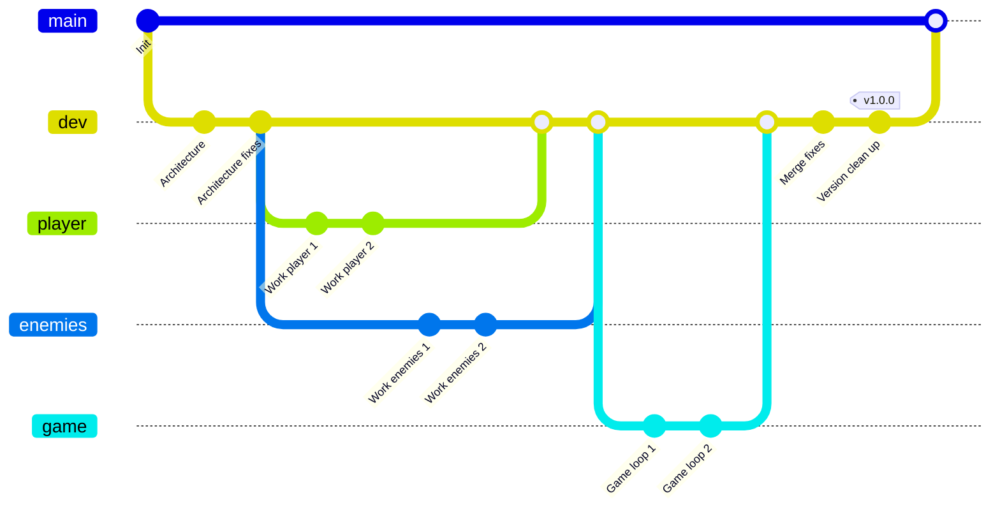

# Git flow

La gestion de votre dépôt Git doit respecter les règles suivantes :

- **Branche `main` :** réservée aux releases et aux fins de milestones. Chaque release ou fin de milestone doit être accompagnée d'un tag.

- **Branche `dev` :** issue directement de `main`, elle sert de point de départ aux branches de travail et de point de rassemblement des **pull requests**. Aucun développement ne doit être effectué directement sur cette branche, à l'exception des travaux de configuration initiale (*setup*) et d'architecture.

- **Branches `feature` :** créées à partir de `dev`, une nouvelle branche `feature` doit être créée pour chaque fonctionnalité à développer. Chaque branche est attribuée à un unique développeur. Une fois le travail terminé, la branche `dev` doit être fusionnée dans la branche `feature` afin de résoudre les éventuels conflits avant l'ouverture de la **pull request** visant à fusionner `feature` dans `dev`.

- **Pull requests :** chaque **pull request** doit obligatoirement être relue et validée par au moins un autre membre de l'équipe. Cette revue doit porter sur les aspects fonctionnels et techniques, ainsi que sur le respect des conventions de code. Les membres de l'équipe doivent analyser le code, échanger et proposer des améliorations si nécessaire.

- **Fusion et suppression :** une fois la **pull request** validée, la branche `feature` est fusionnée dans `dev`, puis supprimée. Un **squash** peut être effectué lors de la fusion si l'historique des commits de la branche `feature` manque de clarté.

Exemple de git flow :

