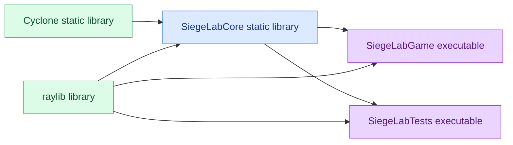
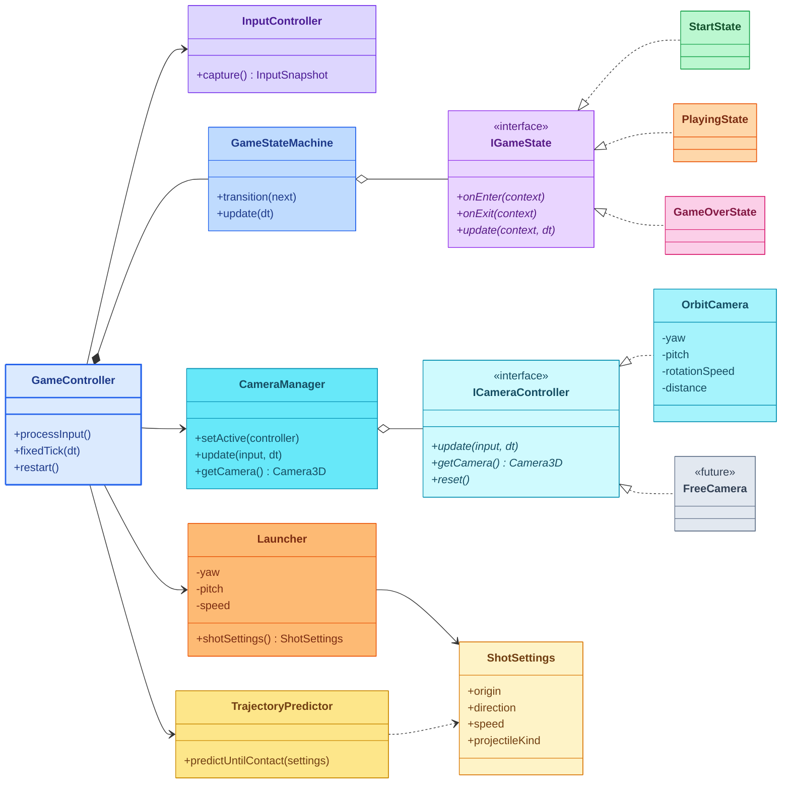
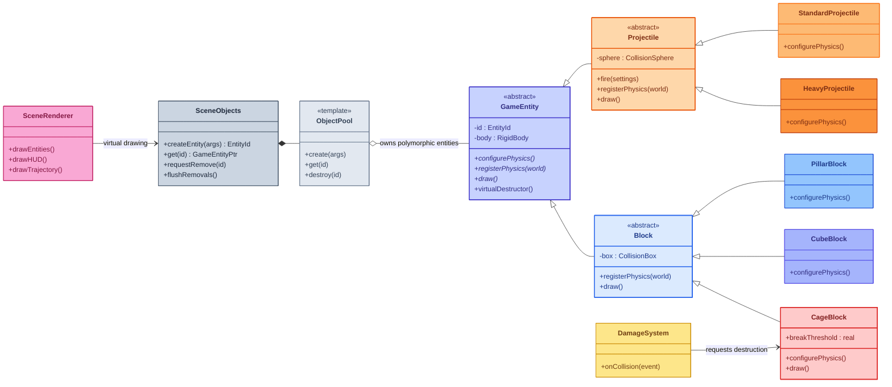
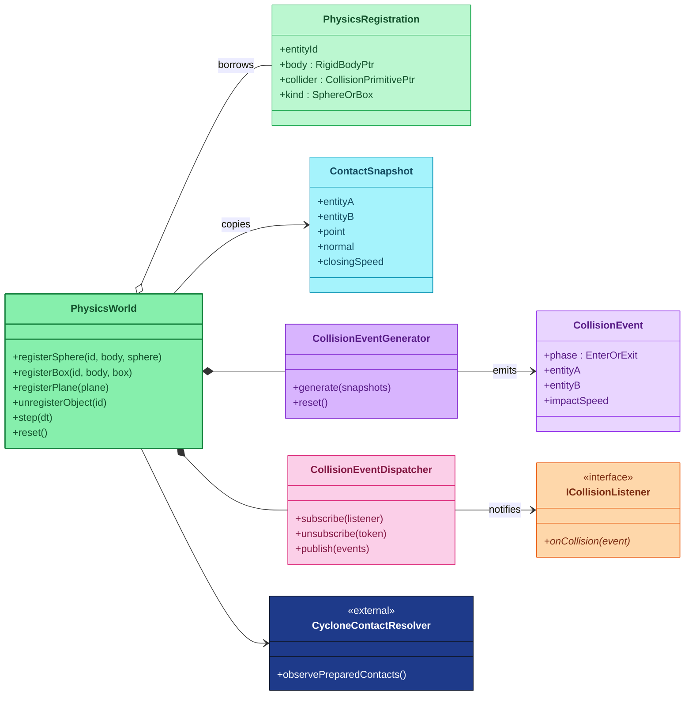
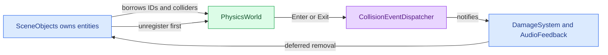

# Siege Lab — 00. Setup & Architecture

**Year 2 · Pairs · C++20 · Cyclone · raylib · Visual Studio · GoogleTest**

## The game

Aim a fixed launcher through an orbital camera and fire Cyclone-simulated projectiles. Preview the real path with an isolated ghost simulation. Topple a **3 m pillar supporting a cube**; destroy a **single solid cage block** either directly or with the falling cube. Win/lose states and a few sounds complete the game.

**Rules:** All motion/collisions use Cyclone; no animated fake collapses. One cage = one fixed `RigidBody` + one `CollisionBox`, no bird body, bars, joints, ropes, fragments or kinematic obstacle.

## Controls and reference scene

Use a fixed world convention throughout gameplay and tests. The camera never determines the launcher direction.

| Item | Reference |
|---|---|
| Axes / ground | +X toward tower; +Y up; +Z depth; ground `y=0` |
| Launcher | `(-8,1,0)` m; yaw/pitch in Euler angles |
| Camera | RMB drag orbit; mouse wheel zoom; independent from launcher |
| Launcher keys | `A/D` yaw; `W/S` pitch; `Q/E` speed; `1/2` projectile; Space fire |
| Game keys | Enter start; R reset/menu |
| Physics | Fixed `dt=1/60 s`, gravity `(0,-9.81,0) m/s²` |
| Collision events | `Enter` and `Exit` only; quiet resting contacts remain silent |

## Solution setup (30 min)

Use [raylib-quickstart](https://github.com/raylib-extras/raylib-quickstart) and its Visual Studio generation script. Pin the supplied Cyclone archive and one raylib revision so everyone builds the same code.

1. Run `build-VisualStudio2022.bat` or `build-VisualStudio2026.bat` as appropriate. Update `build/premake5.lua`; select **x64**, Debug/Release and **C++20**.
2. Configure `Cyclone` (static library), `SiegeLabCore` (static library), `SiegeLabGame` (executable), `SiegeLabTests` (GoogleTest executable). The quickstart raylib project may remain alongside them.
3. Convert the template entry point to `.cpp`; link raylib with the game/core as required. Install GoogleTest reproducibly; the quickstart does not supply it.
4. Build all targets, open one raylib window, then run a headless GoogleTest assertion: `2+3==5`.

**Files:** `build/premake5.lua`, `src/main.cpp`, supplied Cyclone `include/` and `src/`. **Cyclone edits:** none.

## Cyclone source map

Use the **teacher ZIP**. It contains flat `include/*.h` paths: stage them under `cyclone/` for source directives such as `<cyclone/body.h>`.

| Library | Use | Edit? |
|---|---|---|
| `include/body.h`, `src/body.cpp` | `RigidBody`, transform, integration | No |
| `include/core.h`, `src/core.cpp` | `Vector3`, quaternion, inertia | No |
| `include/collide_fine.h`, `src/collide_fine.cpp` | Sphere, box, plane, detectors | `src/collide_fine.cpp` in M7 only |
| `include/contacts.h`, `src/contacts.cpp` | `Contact`, `ContactResolver` | M7 observer/getter only |
| `include/world.h`, `src/world.cpp` | Existing Cyclone `World` example | Read only; not our `PhysicsWorld` |
| `include/fgen.h`, `src/fgen.cpp` | Optional force generators | Read only |

**Safety:** `CollisionPrimitive` has no virtual destructor; `CollisionPlane` is not derived from it. Never delete colliders via `CollisionPrimitive*`. Do not mistake `RigidBody::integrate()` for contact solving.

## Gameplay orchestration

Game flow and camera selection are independent of physics internals. Only `OrbitCamera` is required now; `FreeCamera` is a future extension, not a student deliverable.

## Entity inheritance and rendering

`GameEntity` owns a body, `Projectile` composes a `CollisionSphere`, and `Block` composes a `CollisionBox`. Concrete types set their own mass, size and appearance. Render through `GameEntity::draw()` with raylib primitives and `rlgl` rotation.

**Ownership:** `SceneObjects` owns `ObjectPool<std::unique_ptr<GameEntity>, N>` and a C++20-constrained `createEntity<T>()`. The objects must keep stable addresses while registered. No `variant`, `dynamic_cast`, geometry-specific renderer switches or mandatory meshes.

## PhysicsWorld and event boundaries

`PhysicsWorld` borrows existing bodies and typed colliders. It detects/resolves contacts, copies prepared speeds and emits **impact episodes**; gameplay may only request deletion after the step.

**Patch scope:** only `include/contacts.h`, `src/contacts.cpp`, `src/collide_fine.cpp` in M7. See [PhysicsWorld milestones](./02_PhysicsWorld_Milestones.md).

## Two-student integration

Build gameplay and the world in parallel. Gameplay may initially call Cyclone directly; at merge, replace the temporary loop with **one** `PhysicsWorld::step(dt)` and register the unchanged, already-owned objects.

## Fixed-step contract

There is one authoritative update sequence. The Cyclone observer sees prepared contacts **before solving**, but listeners are notified **after** solving; deletion always follows unregistration.

## Deliverables & acceptance

The application must demonstrate both direct and indirect cage destruction with genuine Cyclone collisions. Submit compilable code, tests and concise build notes; do not submit only screenshots.

1. Reproducible Visual Studio solution with pinned dependencies and `SiegeLabGame`/`SiegeLabTests`.
2. All 12 numbered milestones, the generic pool and 80 implemented GoogleTest cases (**55 Gameplay / 25 PhysicsWorld**).
3. `PillarBlock` + `CubeBlock` remain at rest; projectile dislodges them; `CageBlock` disappears when hit hard enough.
4. No double stepping, unsafe collider deletion, fake physics, event spam or stale listener subscriptions.

**Verification status:** Earlier teacher C++20 probes compiled Cyclone under GCC/Clang and exercised physical scenarios. **The finished student game, Windows build, raylib window/audio and all 80 student GoogleTests have not been executed.**