# Siege Lab — Gameplay Milestones

| Milestone | Points | Time |
|---|---:|---:|
| 0 — Setup & tests | 0 | 30 min |
| Generic `ObjectPool<T,N>` | 0.5 | 30 min |
| 1 — Orbital camera | 1 | 1 h |
| 2 — Euler launcher | 2 | 1 h 15 |
| 3 — Cyclone projectile | 1 | 45 min |
| 4 — Ghost preview | 1 | 45 min |
| 5 — Pillar + cube | 0.5 | 30 min |
| 8 — Direct cage destruction | 1 | 45 min |
| 9 — Indirect cage destruction | 0.5 | 1 h 30 |
| 10 — State machine | 1 | 45 min |
| 11 — Audio | 0.5 | 30 min |
| **Total** | **9** | **9 h 45** |

## Generic object pool

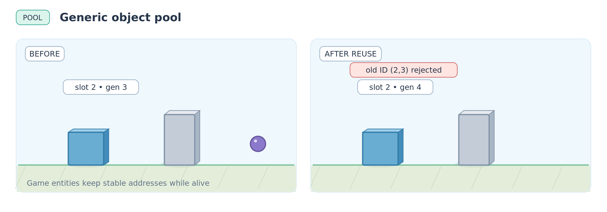

Build a reusable C++20 container independent of Cyclone/raylib. `SceneObjects` later uses it to own entities, not to implement collision algorithms.

**Classes:** `ObjectPool<T,Capacity>`, generation-based `EntityId`, `SceneObjects`, constrained `createEntity<T>()`. **Cyclone files/edits:** none. **Tests:** `P01–P05`, `GO01`, `GO05–GO06`.

1. Implement fixed-capacity `create/get/destroy/forEach/clear` with stable storage.
2. Reject stale handles after recycle/reset; preserve live addresses.
3. Store `unique_ptr<GameEntity>`; use concepts to accept only concrete `GameEntity` subclasses.
4. Unregister before destroying any entity with registered collider pointers.

**Pass when:** old IDs never resolve to a new object and no derived object is deleted incorrectly.

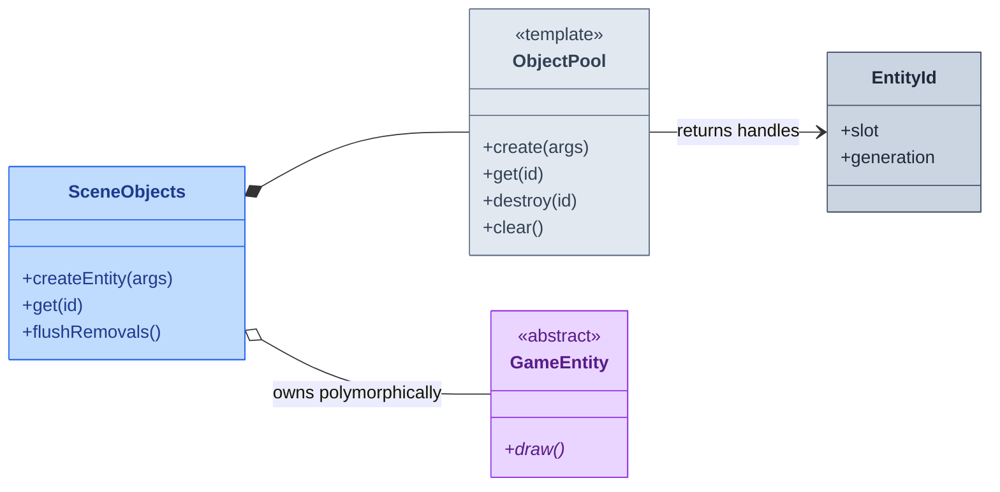

## M1 — Orbital camera

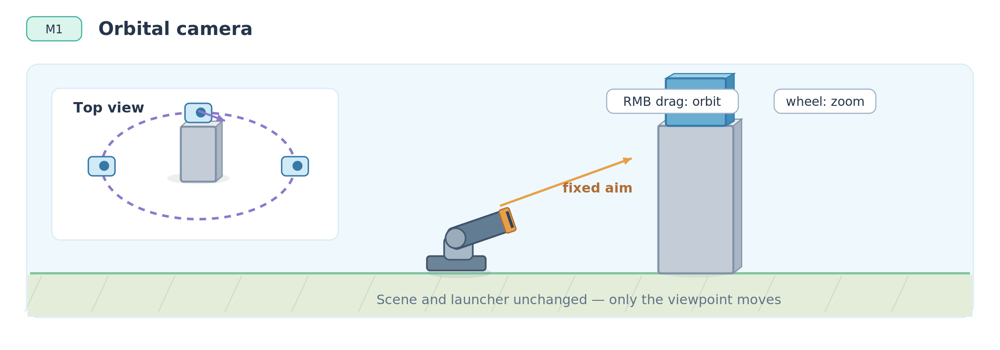

An orbital camera explores the scene without changing the launcher aim. Design the interface for later replacement with a free camera, but do **not** implement `FreeCamera` now.

**Classes:** `ICameraController` (interface), `OrbitCamera`, `CameraManager`, `InputController`/`InputSnapshot`; `FreeCamera` is future-only.

**Cyclone to inspect:** none; raylib `Camera3D`, `GetMouseDelta`, `GetMouseWheelMove`, raymath rotation helpers. **Cyclone edits:** none. **Tests:** `C01–C05`, `CAM06` ([specifications](./Siege_Lab_03_Gameplay_Unit_Tests_EN.md)).

1. Implement yaw/pitch around a fixed target, radius, zoom and configurable angular speed (°/s).
2. Use RMB drag; map raw pixels × degrees/pixel **without an extra `dt`**. Keyboard held axis uses speed × `dt`.
3. Clamp pitch/zoom; convention: `(yaw,pitch)=(0,0)` puts camera at target `+Z`, positive yaw toward `+X`, pitch upward.
4. Expose camera pose via `ICameraController`; let `CameraManager` switch controllers without type checks.

**Pass when:** full orbit, steady target, frame-rate-independent controls and substitutable controller

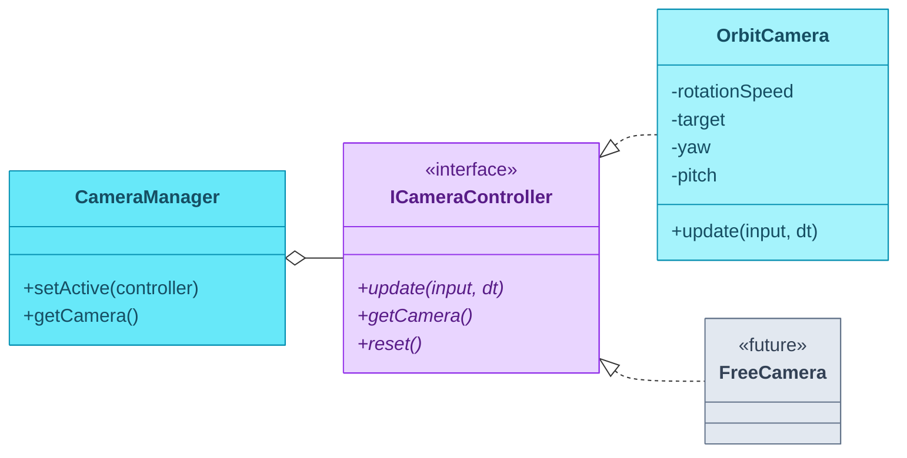

**Only provided C++ usage example** (not the camera implementation):

```cpp
#include "raylib.h"
#include "OrbitCamera.hpp" // To implement

int main() {
    InitWindow(1280, 720, "Siege Lab");
    OrbitCamera orbit({2.0f, 1.5f, 0.0f}, 12.0f, 90.0f);
    while (!WindowShouldClose()) {
        orbit.update(GetFrameTime(), IsMouseButtonDown(MOUSE_BUTTON_RIGHT),
                     GetMouseDelta(), GetMouseWheelMove());
        BeginDrawing();
        ClearBackground(RAYWHITE);
        BeginMode3D(orbit.getCamera());
        DrawGrid(20, 1.0f);
        EndMode3D();
        EndDrawing();
    }
    CloseWindow();
}
```

The convenience overload above is illustrative; students may adapt it to `update(InputSnapshot,dt)`.

## M2 — Euler-angle launcher

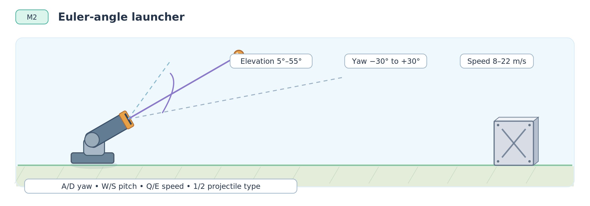

The fixed launcher calculates its world-space firing direction; camera movement must not change it. Choose either standard or heavy ammunition.

**Classes:** `Launcher`, `ShotSettings`, `InputController`; no dependency on `CameraManager`.

**Cyclone to inspect:** none; raymath `MatrixRotateY`, `MatrixRotateZ` or equivalent rotations. **Cyclone edits:** none. **Tests:** `L01–L05` ([specifications](./Siege_Lab_03_Gameplay_Unit_Tests_EN.md)).

1. Use `A/D` for azimuth, `W/S` for elevation, `Q/E` for speed, `1/2` for projectile kind.
2. Clamp yaw `[-30°,30°]`, pitch `[5°,55°]`, speed `[8,22] m/s`.
3. Default direction is `+X`; pitch lifts toward `+Y`, positive azimuth turns toward `+Z` (check rotation signs).
4. Return `ShotSettings` with normalized direction and selected kind; initial velocity = direction × speed.

**Pass when:** aim is deterministic, normalized and camera-independent

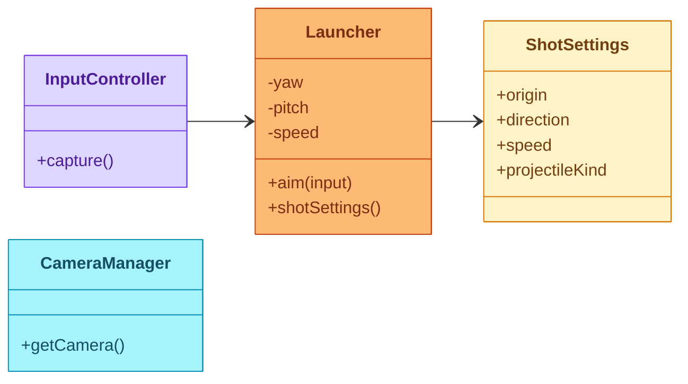

## M3 — Real Cyclone projectile

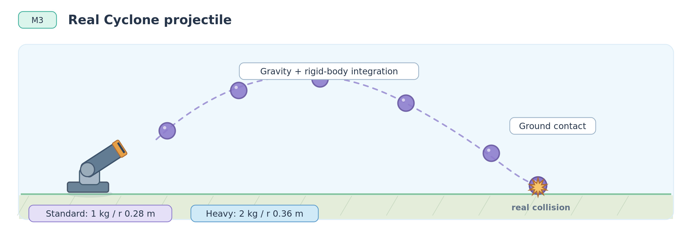

A shot is a real rigid body, not a ray or animated sphere. Share launching and rendering code through inheritance, while subclasses supply different physics profiles.

**Classes:** `GameEntity` (abstract + virtual destructor), `Projectile` (abstract), `StandardProjectile`, `HeavyProjectile`, `SceneObjects`.

**Cyclone to inspect:** `include/body.h`, `src/body.cpp`, `include/collide_fine.h`, `src/collide_fine.cpp`, `include/contacts.h`, `src/contacts.cpp`, `include/core.h`. **Cyclone edits:** none. **Tests:** `GO01–GO03`, `PR01–PR05` ([specifications](./Siege_Lab_03_Gameplay_Unit_Tests_EN.md)).

1. Own one `RigidBody` per entity; `Projectile` composes **one** `CollisionSphere` and draws via virtual `draw()`.
2. Use standard `(mass,radius)=(1 kg,0.28 m)`; heavy `(2 kg,0.36 m)`. Initialize inertia, damping and body/collider pointers.
3. Set shot velocity; integrate, detect sphere–ground contacts and resolve with Cyclone. A held Space creates only one shot.
4. Render from the body pose using `DrawSphere` (not interpolated fake physics). The temporary local Cyclone loop is replaced in M6.

**Pass when:** the shot falls and rests on the plane using genuine contact resolution

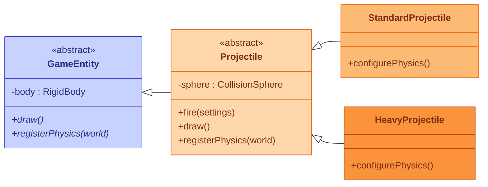

**Library caveat:** In this Cyclone ZIP `Vector3::X`/`Y` constants are swapped; use explicit vectors or `RIGHT`/`UP`. Qualify `cyclone::Vector3` and raylib `::Vector3`.

## M4 — Cyclone ghost trajectory

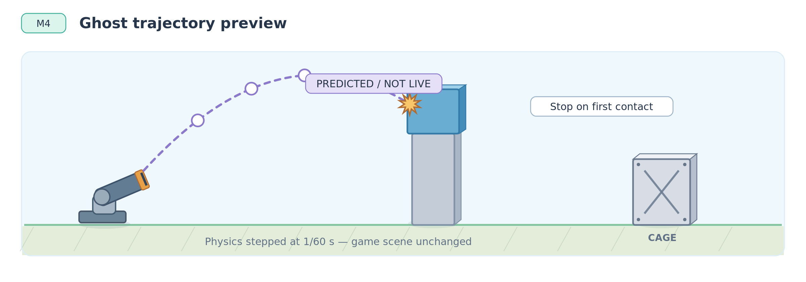

Preview the selected shot by running an isolated Cyclone body. The predictor must stop at the **first genuine collider contact**, not a calculated parabola/plane intersection.

**Classes:** `TrajectoryPredictor`, temporary `GhostBody` helper, `Launcher`/`ShotSettings`, read-only `SceneObjects`.

**Cyclone to inspect:** `include/body.h`, `src/body.cpp`, `include/collide_fine.h`, `src/collide_fine.cpp`, `include/contacts.h`. **Cyclone edits:** none. **Tests:** `T01–T04` ([specifications](./Siege_Lab_03_Gameplay_Unit_Tests_EN.md)).

1. Copy the selected projectile profile and launch settings to a temporary body/collider.
2. Snapshot obstacle poses and shapes into separate temporary Cyclone data; never step live objects.
3. Integrate at `1/60 s`, test ground, pillar, cube and cage; record positions from launch through first contact.
4. Enforce maximum steps; no ghost registration, gameplay event, real-body mutation or bounce.

**Pass when:** the returned path ends on first collision, or at the step limit, without changing game state

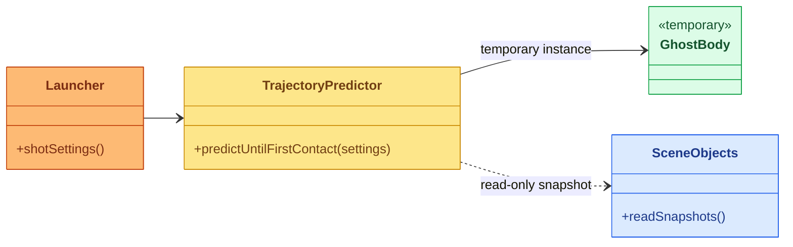

## M5 — Pillar + cube

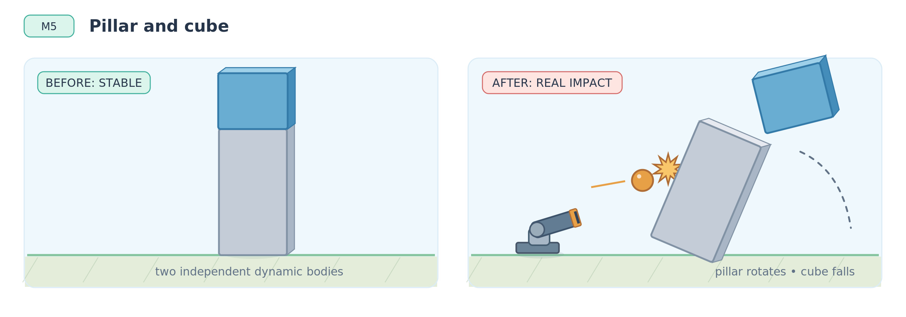

Build exactly two independent dynamic boxes. They touch at `y=3 m` without initial overlap and must stand at rest before a projectile can topple the pillar.

**Classes:** `Block` (abstract, composes `CollisionBox`), `PillarBlock`, `CubeBlock`, `LevelBuilder`, `GameEntity`.

**Cyclone to inspect:** `include/body.h`, `src/body.cpp`, `include/core.h`, `src/core.cpp`, `include/collide_fine.h`, `src/collide_fine.cpp`, `include/contacts.h`, `src/contacts.cpp`. **Cyclone edits:** none. **Tests:** `CO01–CO03`, `GO04` ([specifications](../tests/0_Gameplay_Unit_Tests.md)).

1. Pillar: full `1×3×1 m`, `3 kg`, center `(0,1.5,0)`; cube: `1×1×1 m`, `1.5 kg`, center `(0,3.5,0)`.
2. Set block inertia; gravity `−9.81`, friction `0.5`, restitution `0`, linear/angular damping `0.98/0.85`.
3. Use solver iterations `100/100`; draw quaternion rotation with `rlgl` + `DrawCube`.
4. Test `780` ticks at rest, then a real off-center shot; do not animate collapse or stack four small cubes.

**Pass when:** both remain stacked at rest, then physically rotate and separate after impact

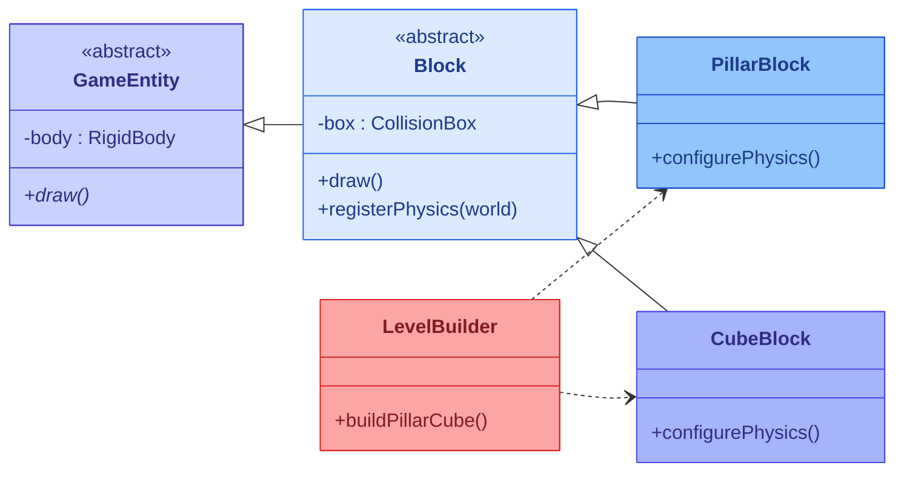

## M8 — Direct cage destruction

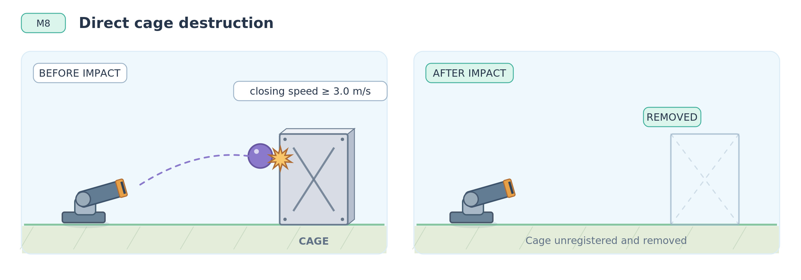

The cage is **one fixed solid box**, not separate bars or a simulated bird. Destroy it once when any meaningful `CollisionEnter` reaches the common threshold.

**Classes:** `CageBlock : Block`, `DamageSystem : ICollisionListener`, `SceneObjects`, `PhysicsWorld`.

**Cyclone to inspect:** `include/body.h`, `include/collide_fine.h`, `src/collide_fine.cpp`, `include/contacts.h` (M7 getter). **Cyclone edits:** none. **Tests:** `CA01–CA06` ([specifications](../tests/01_Gameplay_Unit_Tests.md)).

1. Create one `CageBlock` at `(3.6,0.65,0)`, full `0.7×1.3×1.0 m`, inverse mass/inertia `0`.
2. On an `Enter` involving its ID with prepared closing speed `≥3.0 m/s`, queue its ID for removal.
3. After contact solving/dispatch, unregister it, destroy the entity and cease drawing it; trigger break sound once.
4. Direct fixture: standard projectile from `(-8,1,0)`, `16 m/s`, azimuth `0°`, elevation `9°`, with no pillar/cube.

**Pass when:** `2.9 m/s` does not break; `3.0 m/s` does; verified direct reference ≈`15.6 m/s` at step `41` (nonportable)

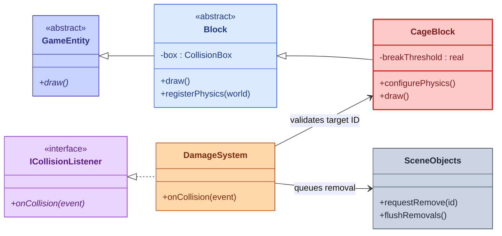

## M9 — Indirect destruction

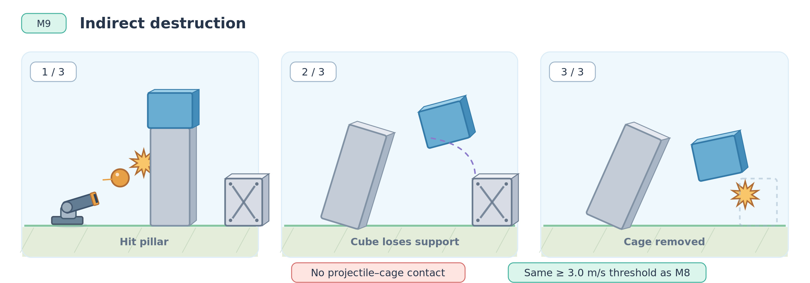

Use the **same `CageBlock` and `DamageSystem`** as M8. The projectile hits the pillar; its falling cube then breaks the cage without a direct projectile–cage contact.

**Classes:** `PillarBlock`, `CubeBlock`, `CageBlock`, `DamageSystem`, `SceneObjects`, `PhysicsWorld`.

**Cyclone to inspect:** `include/body.h`, `src/body.cpp`, `include/collide_fine.h`, `src/collide_fine.cpp`, `include/contacts.h`, `src/contacts.cpp`. **Cyclone edits:** none. **Tests:** `CH01–CH03` ([specifications](../tests//01_Gameplay_Unit_Tests.md)).

1. Reuse M5 tower and M8 cage; projectile origin `(-8,1,0)`, speed `16 m/s`, yaw `0°`, elevation `26°`.
2. Run genuine Cyclone box–box and box–sphere contacts at `1/60 s` with friction `0.5` and solver `100/100`.
3. Count **zero** projectile–cage physical contacts and exactly **one** cube–cage destruction.
4. Repeat five times after resetting world, collision pairs and listener subscriptions.

**Pass when:** reference cube–cage closing speed ≈`5.56 m/s` at step `73`, downward ≈`−1.6 m/s` (tolerant tests, not exact trajectory)

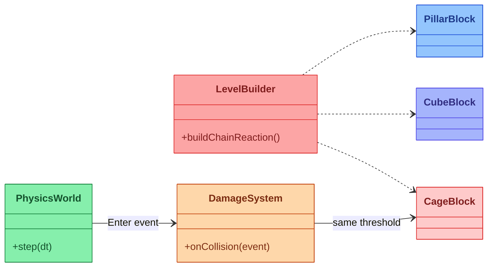

## M10 — Game states

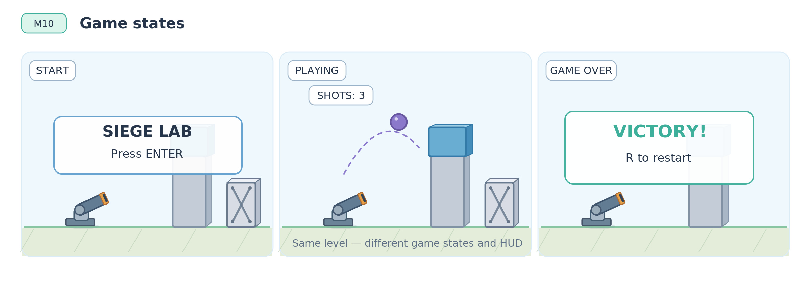

Implement the State pattern with three real states. Win/lose is data stored by `GameOverState`, not a fourth class.

**Classes:** `IGameState` (interface), `StartState`, `PlayingState`, `GameOverState`, `GameStateMachine`, `GameController`.

**Cyclone to inspect:** none; `PhysicsWorld` emits read-only events, not a new Cyclone API. **Cyclone edits:** none. **Tests:** `GS01–GS09` ([specifications](../tests/01_Gameplay_Unit_Tests.md)).

1. Call `StartState::onEnter()` once on startup; real transitions run old `onExit` then new `onEnter` exactly once.
2. Ignore no-op transitions; prevent reentrant lifecycle calls. Fire only while `Playing`.
3. Win after cage destruction; lose after ammunition ends and bodies settle, or after a settling timeout.
4. On R: unsubscribe, clear pair history, remove entities safely, rebuild and subscribe exactly once.

**Pass when:** correct state order, no duplicate lifecycle/audio effects, no stuck loss screen

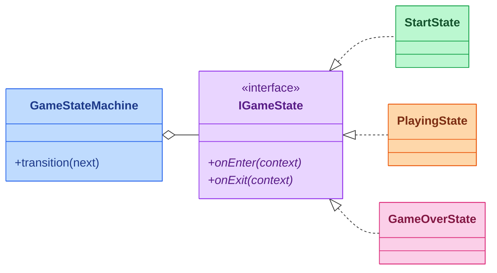

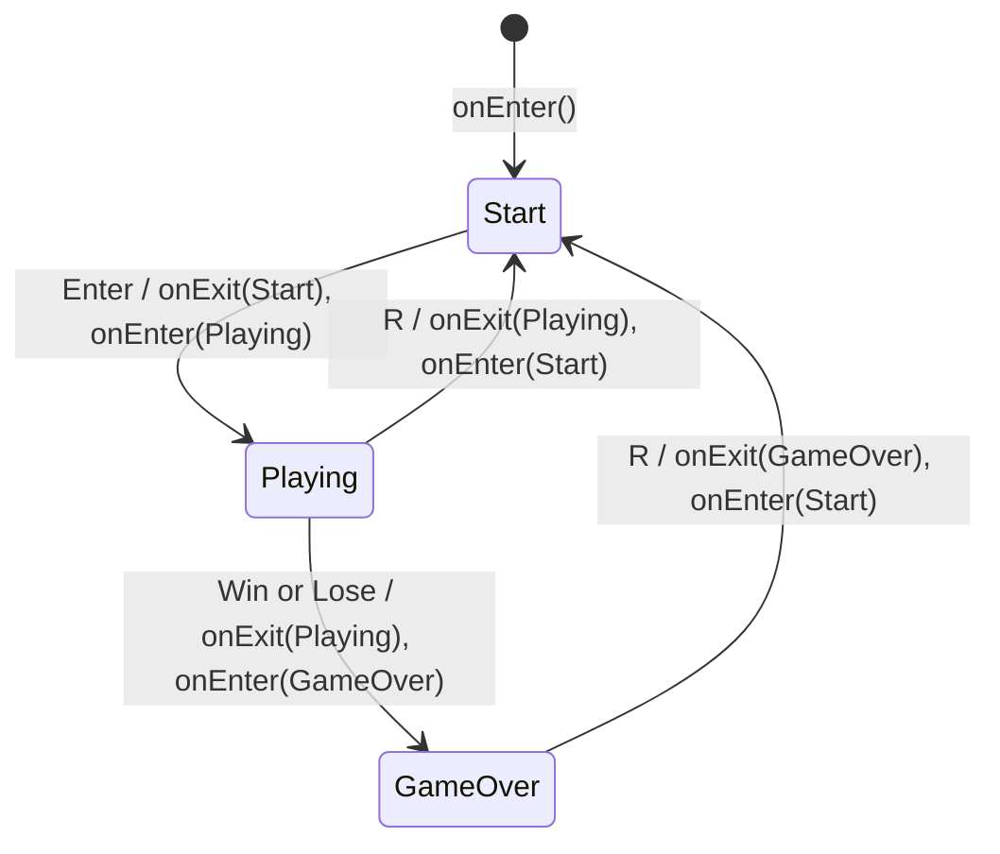

## M11 — Audio and polish

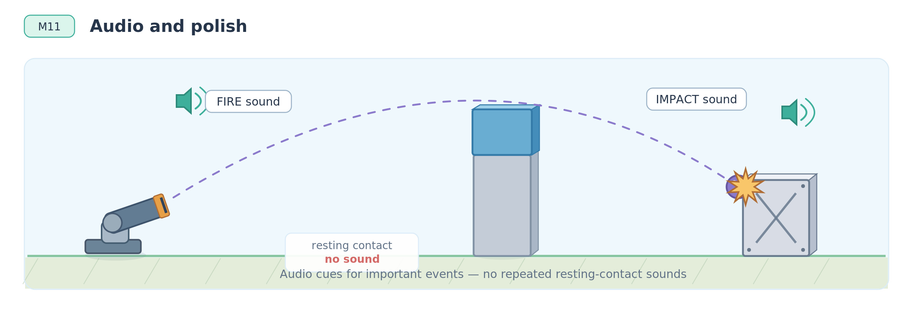

Add a few short raylib sound effects; collisions must not create a flood of audio while objects rest.

**Classes:** `AudioFeedback : ICollisionListener`, `SoundBank`, `GameOverState`, `SceneRenderer`.

**Cyclone to inspect:** none; audio uses copied `CollisionEvent`s, not live Cyclone contacts. **Cyclone edits:** none. **Tests:** `AU01–AU03` ([specifications](../tests/01_Gameplay_Unit_Tests.md)).

1. Play fire, meaningful impact, cage break and win/lose commands; only significant `Enter` triggers impact sound.
2. Play cage break once; invoke win/lose sound only in `GameOverState::onEnter()`.
3. Call `InitAudioDevice` before sound loading; unload sounds before `CloseAudioDevice`.
4. Draw entities via virtual `draw()`; draw HUD and ghost, without RTTI or meshes.

**Pass when:** three headless audio-command tests plus one manual listening check

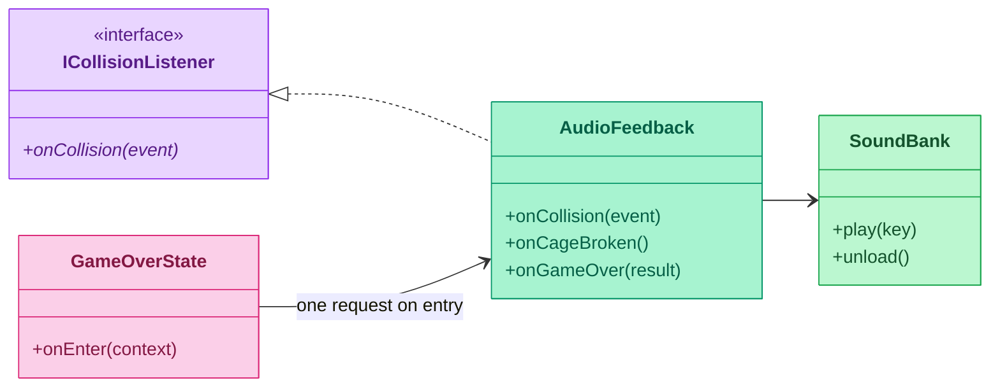

## Final gameplay integration

When both tracks merge, the physical objects and their addresses stay in `SceneObjects`. Only the authority to advance the simulation moves to `PhysicsWorld`.

1. Keep `GameEntity` polymorphic, with a virtual destructor and stable body/collider addresses.
2. Register all live shapes, including the single fixed cage, then **step exactly once per fixed tick**.
3. Listen to copied `Enter` events; queue removals; unregister before deletion.
4. Check direct and indirect wins, restart, remaining ammo and silence at rest.
5. Run all **55** [Gameplay tests](../tests/01_Gameplay_Unit_Tests.md) and check visuals/audio manually.