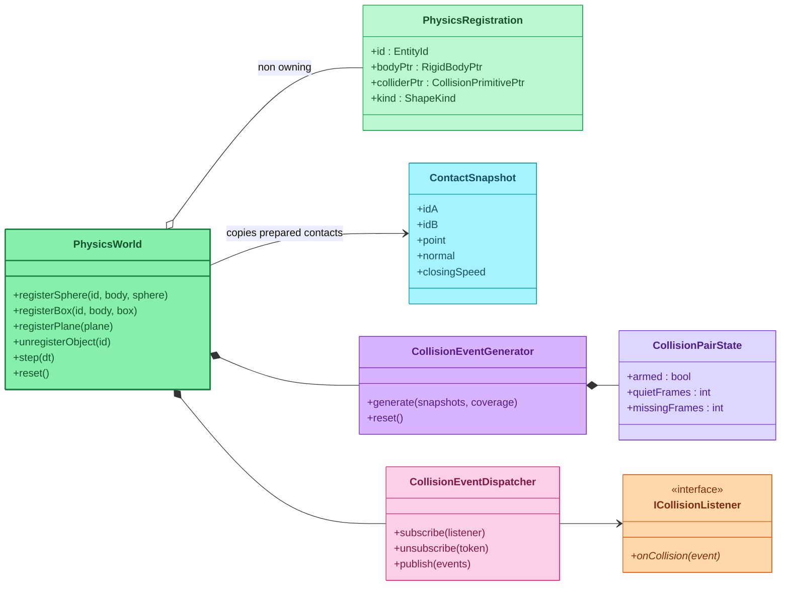
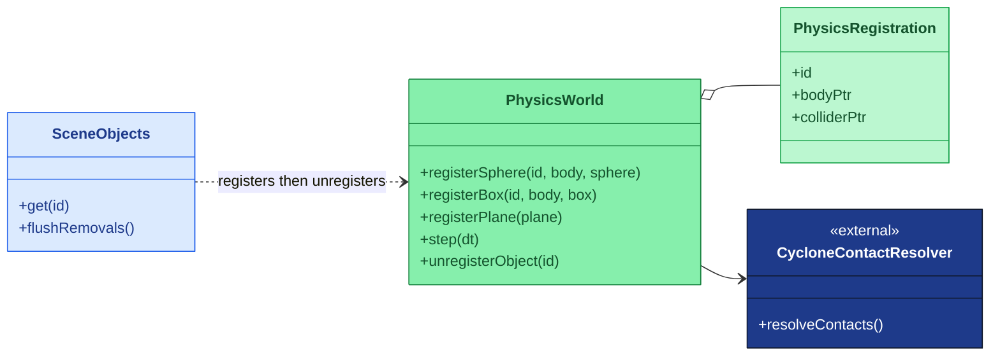
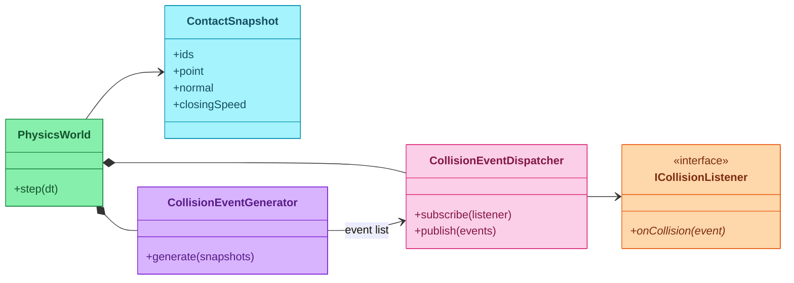
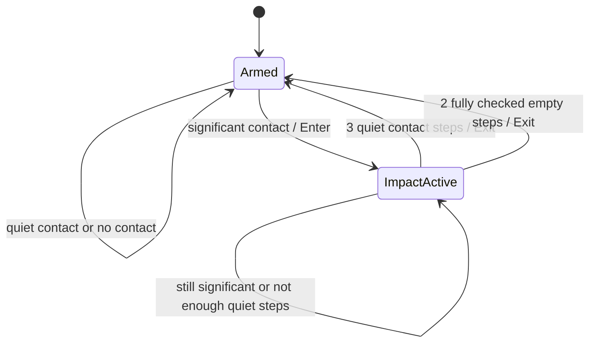

# Siege Lab — PhysicsWorld Milestones

| Milestone | Points | Time |
|---|---:|---:|
| 6 - Registration and one step | 0.5 | 1h |
| 7 - Prepared contacts and impact episodes | 2.5 | 3h |
| **Total** | **3** | **4h** |

## World ownership and classes

`CollisionSphere` and `CollisionBox` inherit `CollisionPrimitive`, but Cyclone's detector functions are shape-specific. Register them with typed overloads and keep ground planes separate. One fixed `CageBlock` is just one `CollisionBox`.

**Forbidden:** collider deletion via `CollisionPrimitive*`, homemade contact solving or impact-speed recalculation, `CollisionStay`, dynamic bird or cage bars.

## Parallel development

Gameplay may use direct Cyclone calls until M6 is integrated. The PhysicsWorld student can test with their own fixture-owned bodies; the final step simply borrows the existing game bodies.

```mermaid
flowchart LR
    A[Gameplay constructs bodies and colliders] --> B[PhysicsWorld borrows typed pointers]
    B --> C[One fixed step via Cyclone]
    C --> D[Copy prepared contact data]
    D --> E[Enter and Exit generator]
    E --> F[Deferred gameplay removals]
    F --> G[Unregister before pool destroy]
    classDef obj fill:#DBEAFE,stroke:#2563EB,color:#1E3A8A
    classDef phy fill:#DCFCE7,stroke:#15803D,color:#14532D
    classDef evt fill:#E9D5FF,stroke:#9333EA,color:#581C87
    class A,F,G obj
    class B,C phy
    class D,E evt
```

**Merge sequence:** register stable pointers → disable the gameplay-only step → run **one** PhysicsWorld fixed tick → unregister before destroying objects.

## M6 — Registration and one step

Create a thin world orchestrator using **Cyclone's existing detector and resolver**. Do not modify the physics library in M6.

**Classes:** `PhysicsWorld`, `PhysicsRegistration` (non-owning), `SceneObjects` (owner); use Cyclone `CollisionData`, `CollisionDetector`, `ContactResolver`.

**Cyclone to inspect:** `include/body.h`, `src/body.cpp`, `include/collide_fine.h`, `src/collide_fine.cpp`, `include/contacts.h`, `src/contacts.cpp`, `include/world.h`, `src/world.cpp`, `include/core.h`. **Cyclone edits:** none.

1. Register `EntityId` + `RigidBody&` + typed `CollisionSphere&` / `CollisionBox&`; register `CollisionPlane` separately.
2. Step **only** bodies with `getInverseMass()>0`; fixed cage uses zero inverse mass, inertia and acceleration.
3. Refresh collider internals; detect sphere/sphere, box/sphere (**box first**), box/box, sphere/plane and box/plane. Skip fixed–fixed.
4. Guard `CollisionData` remaining capacity **before** each detector; report incomplete pair coverage.
5. Resolve all contacts together via Cyclone, refresh transforms and support safe later unregistration.

**Pass when:** `PW01–PW05` work with real Cyclone. `PW06` belongs to M7 because it requires the buffer patch. Configure solver iterations using `setIterations(velocity,position)`; this ZIP's multiargument constructor does not honor both limits.

## M7 — Prepared contacts and impact episodes

Cyclone already computes contact-point relative velocity, including rotation. Expose the **prepared value** before solving, copy it, then turn significant contacts into `Enter`/`Exit` episodes **after** solving.

**Classes:** `ContactSnapshot`, `CollisionEvent`, `CollisionPairState`, `CollisionEventGenerator`, `CollisionEventDispatcher`, `ICollisionListener`; extend `PhysicsWorld`.

**Cyclone files to modify (exactly three):**

| Source file in supplied ZIP | Small permitted change |
|---|---|
| `include/contacts.h` | Read-only `Contact::getClosingSpeed()` and resolver observer declaration |
| `src/contacts.cpp` | Read existing `contactVelocity` normal axis; invoke observer **after `prepareContacts()` and before `adjustPositions/adjustVelocities`** |
| `src/collide_fine.cpp` | Fix `boxAndHalfSpace` early-return contact count/remaining-capacity bookkeeping |

1. Keep original Cyclone solver algorithms and `resolveContacts(...)` API intact. Observer must copy data, not call gameplay.
2. Snapshot IDs, point, consistently oriented normal, **maximum prepared closing speed**; handle `WorldGround` without body pointer.
3. Generate one `Enter` per unordered pair when armed and speed `≥1.0 m/s`; no `Stay`.
4. Generate one `Exit` after **3** consecutive checked quiet contacts `≤0.2 m/s`, or **2** fully checked missing-contact steps. Re-arm thereafter.
5. Skip absent-pair exit updates on **incomplete** detector steps; clear pair history on reset/unregister.
6. Dispatch copied events **after** solve; support safe unsubscribe during dispatch. Queue destruction until unregister is safe.

**Pass when:** `PW06` plus `EV01–EV19` pass, resting pillar/cube emits zero events after settling, and no buffer overwrite occurs.

## Impact episode ≠ geometric separation

A pair can still touch after its significant impact has ended. `Exit` means **episode closed**, not necessarily physical separation; subthreshold-only contact emits nothing.

**Thresholds:** `Enter ≥1.0 m/s`; `Exit` after 3 quiet checked steps `≤0.2 m/s` or 2 fully checked absent steps. Canonical pair keys include ID generation; 4 contact points still yield 1 pair event.

## Fixed tick / lifetime

Cyclone prepares contacts internally; PhysicsWorld must **not** call the protected `prepareContacts()` directly. Contact snapshots remain valid after the temporary solver buffer disappears because they contain copies.

```mermaid
flowchart LR
    A[Integrate dynamic bodies] --> B[Update collider transforms]
    B --> C[Detect supported pairs with bounds checks]
    C --> D[Resolver prepares contacts]
    D --> E[Observer copies snapshots]
    E --> F[Resolver corrects poses and velocities]
    F --> G[Refresh derived transforms]
    G --> H[Generate Enter or Exit]
    H --> I[Dispatch copied events]
    I --> J[Unregister then destroy queued IDs]
    classDef a fill:#DCFCE7,stroke:#15803D,color:#14532D
    classDef b fill:#E9D5FF,stroke:#9333EA,color:#581C87
    classDef c fill:#DBEAFE,stroke:#2563EB,color:#1E3A8A
    class A,B,C,D,F,G a
    class E,H,I b
    class J c
```

**Deletion ordering:** solve → publish events → unregister collider/body → purge pair keys → destroy owned entity. Missing coverage is not proof of separation.

## Final checks

The PhysicsWorld module is accepted only with genuine Cyclone contact generation and a safe teardown. Compare the written contract with [the 25 test cases](../tests/02_PhysicsWorld_Unit_Tests.md) before submission.

1. Validate pointer/address stability and plane handling; no fixed–fixed pairs or double integration.
2. Protect contact buffers and fixed objects; no `CollisionPrimitive*` virtual deletion.
3. Preserve prepared impact speed, including rotation; no recomputation in gameplay.
4. Ensure quiet stacks do not spam; re-impact may trigger a new episode.
5. Do not publish ghost contacts or retain `Contact*`; remove pair history on restart.
