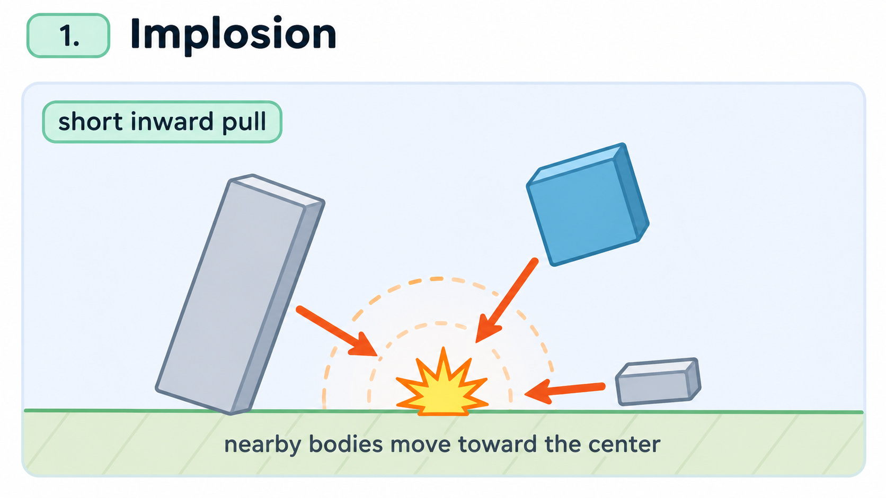
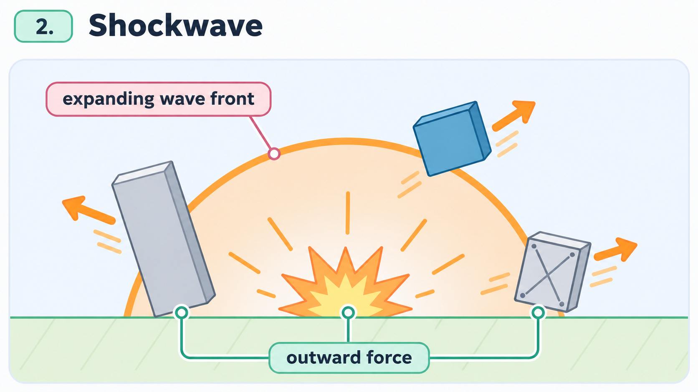
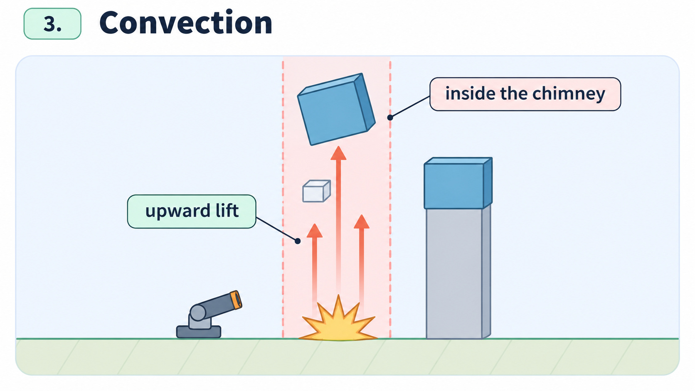

# Siege Lab — Explosion Force Generator

| Milestone | Points | Time |
|---|---:|---:|
| Implosion | 0.5 | 30 min |
| Shock Wave | 1.5 | 1h 30min |
| Convection Flow | 1.5 | 2h |
| Utilities | 0.5 | 1h |
| **Total** | **4** | **5h** |

## 1. Goal and scope

Add an **explosive projectile** to Siege Lab. On a significant collision, it creates a physical explosion that exerts forces on nearby **`RigidBody`** objects. Cyclone then integrates those forces and resolves the resulting contacts. The explosion must **not** directly change block positions, set velocities, or delete the target cage merely because it is close to the detonation.

The assignment has two layers:

1. **Complete the unfinished `cyclone::Explosion` force generator** in the supplied Cyclone source, with a short implosion, a travelling shock wave, and a lingering upward convection flow.
2. **Use that generator in Siege Lab** through `ForceRegistry` and the existing `PhysicsWorld`, `CollisionEnter`, entity pool, and deferred-removal mechanisms.

The three physical effects are required; visual effects, level design, shot properties, and the detailed class organization are your choice. **Use `RigidBody`, not `Particle`, for gameplay debris.** The particle overload is addressed only to make the original class usable; particle simulation is not part of this assignment.

> This handout is self-contained. You do not need the textbook. It explains the physical model and its parameters, but deliberately does **not** give the finished C++ implementation.

## 2. Inspect the actual Cyclone API

| Supplied file | Read these elements | Change? |
|---|---|---|
| `include/fgen.h` | `ForceGenerator`, `Explosion`, `ForceRegistry`, `ParticleForceGenerator` inheritance | Add only the declarations needed |
| `src/fgen.cpp` | Existing empty `Explosion::updateForce(RigidBody*, real)`; `ForceRegistry::add()` and `updateForces()` | Implement missing methods |
| `include/body.h`, `src/body.cpp` | `RigidBody::getPosition()`, `getVelocity()`, `addForce()`, `addForceAtPoint()`, `integrate()`, `hasFiniteMass()` | Read; do not rewrite |
| `include/pfgen.h` | Why `Explosion` inherits a particle-force interface | Read |
| Siege Lab's `PhysicsWorld` and `SceneObjects` | Fixed-step integration, collision events, registration and destruction | Integrate the new feature |

**Missing in the original ZIP:** `Explosion::Explosion()` has no definition; `Explosion::updateForce(RigidBody*, real)` has an empty body; `Explosion::updateForce(Particle*, real)` is pure virtual; `ForceRegistry::remove()` and `clear()` are declared without definitions. These are real gaps, not optional APIs that can be assumed to work.

`ForceRegistry` holds **non-owning** `RigidBody*` and `ForceGenerator*`. Its registrations must be removed **before either referenced object is destroyed**. Avoid ownership/deletion through the original `ForceGenerator*` base interface, which has no virtual destructor.

## 3. Mathematical notation — define everything before implementing

**Math display format:** all standalone equations in this document use GitHub-compatible `$$` fences on separate lines; inline mathematical notation uses `$...$`. The literal square brackets `[ ... ]` are **not** math delimiters. Read the raw `.md` file in a Markdown viewer with LaTeX math support.

Use world coordinates with **+Y upward**. SI units are assumed. A bold quantity is a vector; an ordinary italic quantity is a scalar.

### 3.1 Core quantities

| Symbol | Definition | Unit |
|---|---|---|
| $\mathbf{C}$ | Detonation position in world coordinates, stored in `detonation` | m |
| $\mathbf{P}$ | Current center-of-mass position of the affected rigid body, in world coordinates | m |
| $\mathbf{v}$ | Current linear velocity of that body | m/s |
| $\boldsymbol{\delta}=\mathbf{P}-\mathbf{C}$ | Vector from the explosion center to the body | m |
| $d=\lVert\boldsymbol{\delta}\rVert$ | Euclidean distance from the detonation to the body | m |
| $\varepsilon$ | Small positive distance tolerance used to avoid division by zero; e.g. $10^{-8}$ m | m |
| $\mathbf{n}$ | Outward unit radial direction, defined as $\boldsymbol{\delta}/d$ only when $d>\varepsilon$ | dimensionless |
| $\mathbf{0}$ | Zero vector, meaning no applied force | appropriate vector unit |
| $t$ | Explosion age: elapsed time since detonation | s |
| $\Delta t$ | One simulation time step, normally $1/60$ s | s |
| $m$ | Finite mass of the affected rigid body | kg |
| $\mathbf{F}$ | Force vector exerted on a body | N |
| $\mathbf{a}$ | Linear acceleration caused by a force | m/s² |
| $\Delta\mathbf{v}$ | Change in linear velocity over a single short step | m/s |

For a finite-mass body and an isolated applied force, Newton's second law gives

$$
\mathbf{a}=\frac{\mathbf{F}}{m}
$$

$$
\Delta\mathbf{v}\approx\frac{\mathbf{F}}{m}\ \Delta t
$$

The approximation becomes exact for the velocity update of the simple Cyclone fixture used in the tests (constant force during the step, zero acceleration from other sources, and damping equal to 1). Cyclone performs the actual integration.

**How the tests measure force.** For a single step, define the measured Cartesian force components as

$$
F_x^{\mathrm{measured}}=m\ \frac{v_x^{\mathrm{after}}-v_x^{\mathrm{before}}}{\Delta t}
$$

$$
F_y^{\mathrm{measured}}=m\ \frac{v_y^{\mathrm{after}}-v_y^{\mathrm{before}}}{\Delta t}
$$

Here $F_x^{\mathrm{measured}}$ and $F_y^{\mathrm{measured}}$ are estimated force components along world +X and +Y (N); $v_x$ and $v_y$ are the corresponding components of the body's linear velocity (m/s); the superscripts $\mathrm{before}$ and $\mathrm{after}$ indicate immediately before and after **the same** integration step. This method assumes the isolated test configuration specified above and does not access private Cyclone accumulators.

### 3.2 Notation used in the formulas

- $\lVert\mathbf{x}\rVert$ is the Euclidean length of a vector $\mathbf{x}$; $\mathbf{u}\cdot\mathbf{w}$ is the dot product of vectors $\mathbf{u}$ and $\mathbf{w}$; $\mathbf{u}\times\mathbf{w}$ is their cross product.
- The **maximum** of two scalar values is the larger value; their **minimum** is the smaller value.
- **Clamping** a scalar $x$ between bounds $\ell$ and $u$ means replacing values below $\ell$ with $\ell$ and values above $u$ with $u$. The lower bound must not exceed the upper bound.
- The Cartesian coordinates of $\mathbf{P}$ are $P_x$ $P_y$ $P_z$. Those of $\mathbf{C}$ are $C_x$ $C_y$ $C_z$.
- The vector $\mathbf{e}_y$ is the upward unit vector along world +Y.
- A force described as zero outside a domain must not be evaluated using a denominator that is zero or invalid.

## 4. Stage A — Construct and configure an explosion

**Files to modify:** `include/fgen.h`, `src/fgen.cpp`.

Define `Explosion::Explosion()` and initialize all fields to known, finite values. Retain the public parameter names from the Cyclone header:

| Member | Meaning | Suggested trial setting |
|---|---|---:|
| `detonation` | Detonation position $\mathbf{C}$ | $\mathbf{0}$ m (world origin) |
| `implosionMinRadius` | Inner implosion radius $r_{\min}$ | 0.15 m |
| `implosionMaxRadius` | Outer implosion radius $r_{\max}$ | 3 m |
| `implosionDuration` | Implosion duration $T_i$ | 0.12 s |
| `implosionForce` | Magnitude of implosion force $F_i$ | 12 N |
| `shockwaveSpeed` | Radial propagation speed $s$ | 20 m/s |
| `shockwaveThickness` | Width of the wave's maximum-force plateau $w$ | 0.5 m |
| `peakConcussionForce` | Maximum shock force on a stationary body $F_c$ | 80 N |
| `concussionDuration` | Shock phase duration $T_c$ | 0.8 s |
| `peakConvectionForce` | Maximum upward convection force $F_v$ | 8 N |
| `chimneyRadius` | Radius of the convection cylinder $R$ | 2 m |
| `chimneyHeight` | Height of the convection cylinder $H$ | 4 m |
| `convectionDuration` | Convection phase duration $T_v$ | 2 s |
| `timePassed` | Current explosion age $t$ | 0 s |

The numbers above are **illustrative**, not constants to hard-code. The tests use separately specified, deterministic configurations.

**Input rules:** radii, force magnitudes, and durations cannot be negative. A stage with zero duration or zero peak force is disabled. When the shock stage is enabled, require $s>0$ and $w>0$; when convection is enabled, require $R>0$ and $H>0$. Require $r_{\min}\leq r_{\max}$. Document how invalid settings are handled. Never produce a NaN or infinite force.

**Task:** make `Explosion` instantiable without removing its existing base classes. Since `updateForce(Particle*, real)` is pure virtual in the supplied header, either provide a clearly documented no-op overload for this rigid-body assignment or support particles as an optional extension. This assignment does **not** require particle dynamics.

## 5. Stage B — Calculate shared geometric values

**Function to complete:** `Explosion::updateForce(RigidBody*, real)` in `src/fgen.cpp`.

For each valid, dynamic body:

1. Read $\mathbf{P}$ and $\mathbf{v}$ from Cyclone.
2. Calculate $\boldsymbol{\delta}$ and $d$.
3. If $d>\varepsilon$, calculate $\mathbf{n}=\boldsymbol{\delta}/d$. If not, choose **zero radial force** to avoid an arbitrary direction.
4. Use the explosion age $t$ **without changing it** in this function.
5. Accumulate forces via Cyclone; do not call `integrate()` inside a force generator.

Skip null body pointers, bodies of infinite mass, and invalid step durations. No force generator should call `setPosition()` or directly overwrite the body's velocity.

## 6. Stage C — Implosion: a short inward pull

During the initial interval, only bodies in a spherical shell are attracted toward the detonation. Define:

- $F_i$: peak implosion force magnitude, `implosionForce`, in newtons.
- $T_i$: implosion duration, `implosionDuration`, in seconds.
- $r_{\min}$ and $r_{\max}$: inclusive inner/outer radii, in meters.

**Required implosion force:**

$$
\mathbf{F}_{\mathrm{imp}}=-F_i\ \mathbf{n}
$$

Apply this inward force **only when all three conditions hold**:

- The explosion is still in the implosion phase: `0 <= t < T_i`.
- The body lies in the permitted shell: `r_min <= d <= r_max`.
- The distance is sufficiently large for a radial direction: `d > epsilon`.

**In every other case, the implosion force is zero.** Here `t`, `T_i`, `r_min`, `r_max`, `d`, and `epsilon` have the meanings and units defined in Sections 3 and 4.

The minus sign makes the force point inward. Use `RigidBody::addForce()` to apply this force through the center of mass.

**Reasoning check:** for a detonation at the world origin, a body at $x=1$ m with $y=z=0$ is pulled toward $-X$; a body at $x=-1$ m with $y=z=0$ is pulled toward $+X$. No force acts at the exact center.

## 7. Stage D — Travelling shock wave

The shock starts when the implosion phase finishes. Define **shock-relative age**:

$$
\tau=t-T_i
$$

The shock is active only while $0\le\tau<T_c$. A disabled implosion ($T_i=0$) therefore allows an immediate shock.

Let:

- $s$: shock propagation speed, `shockwaveSpeed`, in m/s;
- $w$: thickness of the maximum-force region, `shockwaveThickness`, in m;
- $T_c$: shock duration, `concussionDuration`, in s;
- $k$: **dimensionless taper multiplier**; the required reference model uses $k=1$;
- $b(\tau)=s\tau$: inner boundary of the flat, maximum-force part of the wave, in m.

At age $\tau$, the maximum-force region occupies distances satisfying $b(\tau)\leq d\leq b(\tau)+w$. The zones immediately behind and ahead of it fade linearly over length $kw$.

Define the **dimensionless spatial profile** $g_{\tau}(d)$. The subscript $\tau$ means that the profile is evaluated at a fixed shock age, while its argument $d$ is the body's distance:

The function has **five spatial zones**. Calculate `g` using the rule matching the body's distance `d`:

1. **Outside, behind the wave:** When `d < b - k*w`, set `g = 0`.
2. **Rear taper (rising):** When `b - k*w <= d < b`, set `g = 1 - (b - d)/(k*w)`.
3. **Maximum-force plateau:** When `b <= d <= b + w`, set `g = 1`.
4. **Front taper (falling):** When `b + w < d <= b + (k + 1)*w`, set `g = 1 - (d - b - w)/(k*w)`.
5. **Outside, ahead of the wave:** When `d > b + (k + 1)*w`, set `g = 0`.

All distances (`b`, `d`, `w`) are in meters. `k` and `g` are dimensionless; `k` must be positive (the reference value is 1). These five conditions cover every distance without overlap.

In this expression, $b$ is shorthand for $b(\tau)$. Within the active shock interval, $g_{\tau}(d)$ is continuous and satisfies $0\leq g_{\tau}(d)\leq1$. For example, with $s=10$ m/s, $w=1$ m, $k=1$, and a shock age of 0.2 s, the plateau is between 2 and 3 m. The profile equals 1 at 2.5 m, 0.5 at 1.5 and 3.5 m, and 0 at 0.5 and 4.5 m.

### Avoid skipping objects between ticks

With a discrete simulation, a very thin travelling wave can move past a body between successive force evaluations. Use the following **minimum-width design guideline**:

$$
w\ge s\ \Delta t
$$

For $s=20$ m/s and $\Delta t=1/60$ s, this gives $w\ge 1/3$ m. It reduces sampling gaps but does not guarantee collision-free detection for rapidly moving bodies. Do not interpret this as a collision-detection algorithm.

## 8. Stage E — Shock strength, motion, and optional torque

The spatial profile $g$ identifies **where** the wave acts. The final force also depends on the explosion's age and the body's motion.

**Temporal attenuation.** Let $F_c$ be `peakConcussionForce` (N). Define a dimensionless factor:

$$
q_c(\tau)=1-\frac{\tau}{T_c}
$$

Evaluate this expression only if $T_c>0$ and $0\le\tau<T_c$. Outside the active interval, the shock force is zero. In the active interval the factor is already between zero and one, so no clamping is needed.

**Radial body velocity.** Define the scalar radial speed $v_r$ (m/s):

$$
v_r=\mathbf{v}\cdot\mathbf{n}
$$

Positive $v_r$ means the body is moving away from the detonation; negative $v_r$ means it is moving toward it. First calculate the **raw dimensionless velocity factor** $q_v^{\mathrm{raw}}$:

$$
q_v^{\mathrm{raw}}=1-\frac{v_r}{s}
$$

Then obtain the final factor $q_v$ by clamping $q_v^{\mathrm{raw}}$ between **0 and 3**. Values below zero become zero; values above three become three. This upper limit is a **gameplay stability cap**, not a physical constant. Only evaluate the expression when $s>0$ and $d>\varepsilon$.

**Resulting shock force.** Within the active shock interval, use

$$
\mathbf{F}_{\mathrm{shock}}=F_c\ g_{\tau}(d)\ q_c(\tau)\ q_v\ \mathbf{n}
$$

Outside the interval, or where $d\le\varepsilon$, the shock force is $\mathbf{0}$.

**Optional rotation.** A force acting away from the center of mass also produces torque. If $\mathbf{Q}$ is the selected force-application point in world coordinates, and $\boldsymbol{\Gamma}$ is the torque vector (N·m), then

$$
\boldsymbol{\Gamma}=(\mathbf{Q}-\mathbf{P})\times\mathbf{F}_{\mathrm{shock}}
$$

You may apply the force through the center using `addForce()` or at a chosen point using `addForceAtPoint()` / `addForceAtBodyPoint()`. **Specify whether the point is in world or body-local coordinates.** Off-center application is optional and is not required by the 15 reference tests.

If you extend the model to account for the velocity of an **off-center impact point**, that point's world-space velocity on a rigid body A is:

$$
\mathbf{v}_{pA}=\mathbf{v}_{A}+\boldsymbol{\omega}_{A}\times\left(\mathbf{p}-\mathbf{x}_{A}\right)
$$

In this optional equation, **A** labels the rigid body; $\mathbf{v}_{pA}$ is the world-space velocity of the selected point (m/s); $\mathbf{v}_{A}$ is the body's center-of-mass linear velocity (m/s); $\boldsymbol{\omega}_{A}$ is its world-space angular velocity (rad/s); $\mathbf{p}$ is the world-space location of that point (m); and $\mathbf{x}_{A}$ is the body's center-of-mass position (m). The cross product converts rotation into the point's linear velocity. **Do not use this optional point-velocity equation in place of the required center-of-mass radial-speed model.**

## 9. Stage F — Upward convection after detonation

Convection models a temporary column of rising air. It begins at shock-relative age $\tau=0$, so it can **overlap with the shock phase**. Unlike a spherical shock, the affected region is a vertical cylinder above the detonation.

Define:

- $\rho=\sqrt{(P_x-C_x)^2+(P_z-C_z)^2}$: horizontal distance from the cylinder's vertical axis (m);
- $h=P_y-C_y$: body height above the detonation (m);
- $R$: chimney radius, `chimneyRadius` (m);
- $H$: chimney height, `chimneyHeight` (m);
- $T_v$: convection duration, `convectionDuration` (s);
- $F_v$: maximum convection force, `peakConvectionForce` (N).

The phase is active only when $0\le\tau<T_v$, $0\le\rho<R$, and $0\le h<H$.

Define the **dimensionless radial and temporal attenuation factors**:

$$
q_r(\rho)=1-\frac{\rho}{R}
$$

$$
q_t(\tau)=1-\frac{\tau}{T_v}
$$

For the **required reference model**, the convection force is vertical:

$$
\mathbf{F}_{\mathrm{conv}}=F_v\ q_r(\rho)\ q_t(\tau)\ \mathbf{e}_y
$$

Outside the active cylinder or time interval, $\mathbf{F}_{\mathrm{conv}}=\mathbf{0}$. Evaluate these factors only if $R>0$ and $T_v>0$. Both factors are nonnegative within that active domain; no clamping is needed there.

An outward-tilting convection direction is an **optional extension**, but it must preserve a positive upward component and be documented separately from the vertical reference formula. The reference model intentionally uses $1-\rho/R$: the upward force is strongest at the center, not at the outer radius.

## 10. Stage G — Let Cyclone accumulate and integrate forces

The force applied during a step is the vector sum:

$$
\mathbf{F}_{\mathrm{total}}=\mathbf{F}_{\mathrm{imp}}+\mathbf{F}_{\mathrm{shock}}+\mathbf{F}_{\mathrm{conv}}
$$

Here $\mathbf{F}_{\mathrm{total}}$ is the sum of the explosion's contributions only; other existing forces and acceleration (such as gravity) remain Cyclone's responsibility. Applying the contributions separately through `addForce()` is equivalent to applying their vector sum at the center. If you choose an off-center shock, use an appropriate point-force API so that Cyclone also applies the torque.

**Do not:** set the object's position, manually add a velocity jump, call `integrate()` from the generator, or add gravity again if the `RigidBody` already has gravitational acceleration.

For a mass $m$ in an isolated, no-gravity, no-damping fixture, the approximate velocity change over one fixed step is

$$
\Delta\mathbf{v}\approx\frac{\mathbf{F}_{\mathrm{total}}}{m}\ \Delta t
$$

This is also the basis for the numeric reference tests.

## 11. Stage H — One explosion clock, not one clock per body

`ForceRegistry::updateForces(duration)` invokes the registered generator once for **each** registered body. Increasing the number of blocks must not make an explosion age faster.

Extend `Explosion` with an explicit time-control API. The method names are your choice; for example:

- `advanceTime(real duration)`: advance the explosion's age once for a valid positive duration;
- `resetTime()`: reset the age to zero;
- `elapsedTime() const`: read the current age without changing it.

**Required invariant:** `updateForce(RigidBody*, real)` reads the age but **never advances it**. Every active explosion has its own independent clock.

Use this logical tick order (pseudocode, not a C++ solution):

1. Keep only valid body/generator registrations.
2. Apply registered forces **once** with the current explosion age.
3. Integrate each dynamic rigid body **once** using the regular `PhysicsWorld` fixed tick.
4. Detect and resolve physical collisions with Cyclone.
5. Publish copied collision events, then perform deferred removals safely.
6. Advance the age of each active explosion **once**.
7. After all enabled phases end, unregister and destroy the explosion generator.

The explosion has fully expired when its age $t$ reaches the implosion duration $T_i$ plus the **longer** of the shock duration $T_c$ and the convection duration $T_v$. Disabled phases have duration zero. Do not retain its registry entries after expiry.

## 12. Stage I — Complete the missing library functions safely

**`src/fgen.cpp`:** implement the declared constructor, both `Explosion::updateForce` overloads (a documented no-op for `Particle*` is permitted), `ForceRegistry::remove(RigidBody*, ForceGenerator*)`, and `ForceRegistry::clear()`. Implement your chosen time-control methods. Add matching declarations in **`include/fgen.h`**.

The registry behavior is a strict contract:

- `remove(body, generator)` removes only registrations matching **both pointers**. If the same pair was added multiple times, remove all those matching registrations.
- `clear()` removes every registration, **without deleting any body or generator**.
- Before deleting a `RigidBody`, remove all its registrations and unregister it from `PhysicsWorld`.
- Before deleting an `Explosion`, remove all entries referring to that generator. Clear the registry on full game reset.
- Do not let a deleted body or force generator remain in a `ForceRegistry` entry. A dangling pointer can cause undefined behavior on the next `updateForces()` call.

**Safe destruction order:** finish the physics step and collision callbacks, unregister forces, unregister the physical collider/body, destroy the owned entity. During reset, clear registrations before clearing the owned objects and generators.

## 13. Stage J — Create an explosive projectile in Siege Lab

**Example scene (not mandatory):** put a rigid block between the launcher and the cage. The projectile hits that block, detonates, and the displaced block can then hit and destroy the cage. Reuse the existing cage damage threshold and `CollisionEnter` events.

Required properties, regardless of the chosen level design:

1. The projectile detonates on a **significant** impact and only **once**.
2. The explosion position comes from the impact event (or a clearly defined nearby impact position).
3. The force affects **live dynamic** bodies; fixed objects remain fixed.
4. Motion and subsequent block–block / block–cage collisions are computed by Cyclone.
5. The cage is destroyed **only by its existing collision/damage rules**, never by a direct distance check performed by the explosion.
6. Projectile and explosion cleanup is deferred until no live solver/registry pointer is being used.
7. A reset during an active blast clears the active generators, registrations, and collision/event state.

You may choose the level, shot profiles, explosion parameters, and visual/audio effects. The [companion tests](../tests/03_Explosion_Unit_Tests.md) provide one reproducible reference configuration; they do not impose that configuration on the final playable level.

## 14. What to submit and how it is assessed

- Modified `fgen.h` and `fgen.cpp`, plus any small necessary Siege Lab integration code.
- A brief explanation of **the three forces**, the timing model, and the ownership/cleanup strategy.
- **15 GoogleTest cases** corresponding to the companion behavioral contracts (headless tests; use genuine Cyclone).
- One playable or demonstrable Siege Lab scene showing that an impact-triggered explosion moves rigid bodies and can contribute to destruction.
- A C++20 Debug and Release build; use AddressSanitizer/UndefinedBehaviorSanitizer when available.

**You are free to:** rename helper functions; factor out geometry and attenuation functions; change visual presentation; add optional off-center torque, multiple blasts, particles as a bonus, or alternate levels.

**You must preserve:** the stated reference behavior, parameter interpretation, one clock per explosion, safe pointer lifetimes, and compatibility with the original Siege Lab milestones. This is a **student assignment**, not a finished implementation or a ready-passing test suite.
