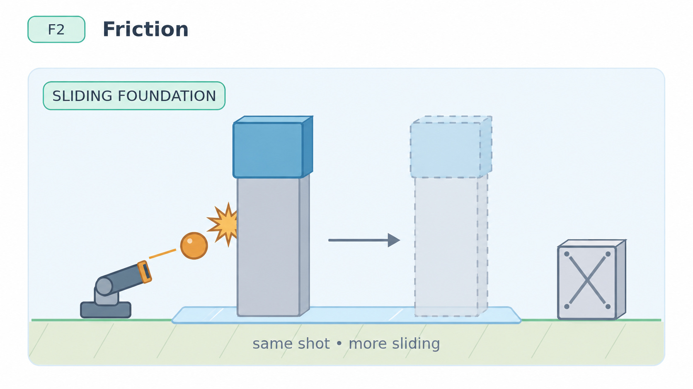
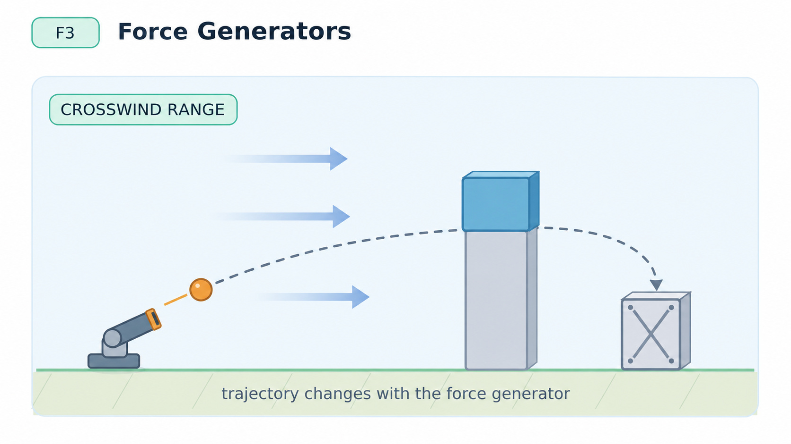
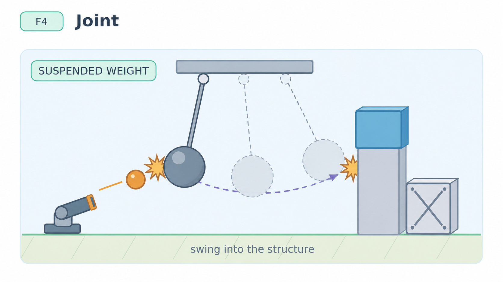

# Siege Lab — Physics Scenes

| Milestone | Points | Time |
|---|---:|---:|
| Frictions | 1 | 30 min |
| ForceGenerators | 1.5 | 1h 30min |
| Joints | 1.5 | 1h 30 |
| **Total** | **4** | **3h 30min** |

## Objective

Extend **Siege Lab**, the projectile-based structure-destruction game, with **three additional playable scenes**. Each new scene must demonstrate one feature of the supplied Cyclone library:

- **Friction** at rigid-body contacts
- **Force generators** acting on rigid bodies
- **Joints** constraining rigid bodies

The original scene must remain playable. Students implement the scene-selection mechanism themselves and reuse their existing `GameController`, `LevelBuilder`, `SceneObjects` and `PhysicsWorld` as appropriate.

**The scenes below are examples, not mandatory level designs.** You may freely choose the layout, objects, gameplay objective, visual presentation and implementation classes. What matters is that the assigned Cyclone feature is actually used, has an observable effect and is correctly integrated into the game.

## Scene selection — required behavior

| Key | Scene | Required feature |
|---|---|---|
| **F1** | Original Siege Lab | Original M0–M11 scene, unchanged |
| **F2** | Friction scene | Contact friction |
| **F3** | Forces scene | Rigid-body force generator |
| **F4** | Joint scene | Rigid-body joint |
| **Backspace** | Reload current scene | Restore its initial state |

Keep the existing launcher and game controls. In particular, **1/2** still select ammunition, and **R** keeps its original meaning. Scene selection must work without closing the executable.

### What to implement

1. Represent the selected scene explicitly. Choose your own structure: an enumeration, a scene manager, or another clear design.
2. Detect the requested scene change in the existing input system. A key press must request **one** change, not continuously rebuild the scene while the key is held.
3. Apply the change at a **safe point outside** collision detection, contact resolution and collision-event callbacks.
4. Unload the current scene safely, then build the requested scene through the existing level/world architecture.
5. Support reloading the active scene with the same cleanup and reconstruction rules.
6. Reset relevant gameplay state, ammunition, temporary forces, collision history and scene-specific timers. Do not leave registrations or listeners from the previous scene.

**Design freedom:** No particular `SceneSwitcher` class, method names or class hierarchy is required. The table describes observable behavior, **not** a prescribed implementation.

## F1 — Friction scene

**Cyclone to inspect:** `include/collide_fine.h`, `src/collide_fine.cpp`, `include/contacts.h`, `src/contacts.cpp`.

**Example — Sliding Foundation:** A small structure stands on a base that can slide. Hitting the base produces different movements when the contact friction is low or high. The player can use sliding to destabilize the structure.

**Required work**

1. Identify where Cyclone stores the friction coefficient and where contact generation passes it to the solver.
2. Configure friction for the relevant contacts using the existing Cyclone contact system.
3. Demonstrate **two friction settings** with the same geometry, mass, shot and other physical parameters.
4. Keep motion and collisions entirely physical; do not animate or reposition blocks to imitate sliding.

**Important:** The supplied Cyclone `CollisionData` exposes a single friction coefficient for contacts generated with its current settings. Cyclone does **not** automatically provide a per-object material system. A scene-wide coefficient is sufficient here; a material system is optional.

**Pass when:** A repeatable comparison shows a measurable difference in sliding or stability attributable to friction alone.

## F2 — Forces scene

**Cyclone to inspect:** `include/fgen.h`, `src/fgen.cpp`, `include/body.h`, `src/body.cpp`.

**Example — Spring Return:** A projectile strikes a crate attached to a fixed support by a spring. The crate moves, then the spring pulls it back, potentially hitting another part of the construction.

**Required work**

1. Read how `ForceGenerator` and `ForceRegistry` interact with `RigidBody`.
2. Use **at least one** rigid-body force generator supplied by Cyclone. `Spring` is the suggested choice, but another existing force generator is acceptable if its behavior is visible in the scene.
3. Apply registered forces at the correct point in the **fixed simulation tick**, before body integration. Do not apply gravity twice.
4. Demonstrate a controlled comparison with the generator enabled and disabled, keeping other initial conditions unchanged.
5. Handle the lifetime of the generator and of every body it references.

**Important:** In the supplied ZIP, `Spring` applies an **attractive** force, even when the endpoints are closer than its nominal rest length. Do not assume it behaves like an ordinary two-sided spring. The original `ForceRegistry::remove()` and `clear()` are declared but have no definitions: these functions must be available and used for safe teardown if they have not already been completed in an earlier extension.

**Pass when:** The generator changes real rigid-body motion, and reloading or leaving the scene cannot retain a registration pointing to a destroyed body or generator.

## F3 — Joint scene

**Cyclone to inspect:** `include/joints.h`, `src/joints.cpp`, `include/contacts.h`, `src/contacts.cpp`.

**Example — Suspended Weight:** A heavy body is attached to a fixed support. The projectile strikes it, and its constrained motion causes a secondary impact against the target structure.

**Required work**

1. Study `cyclone::Joint` and its relation to `ContactGenerator`.
2. Configure a joint between **two valid rigid bodies**, with meaningful attachment points and a suitable allowed error.
3. Integrate joint-generated constraint contacts into the same Cyclone solving step as physical contacts, **without exceeding contact-buffer capacity**.
4. Keep joint constraint contacts separate from the collision events used for damage and sounds.
5. Remove the joint before deleting either connected body, including during scene switching and reset.

**Important:** `Joint` constrains the separation of two attachment points. It is **not** a ready-made single-axis hinge or a rope made of segments. The example is illustrative; any construction that clearly demonstrates the supplied constraint is acceptable.

**Pass when:** The constraint changes the body's motion after a real impact, the solver remains stable, and repeated scene reloads leave no invalid joint references.

## Safe scene changes

The existing game entities own their bodies and colliders, while `PhysicsWorld` and force generators may hold **non-owning pointers** to them. Respect this dependency whenever a scene is replaced.

At a safe point between physics steps:

1. Stop scene-specific effects and detach subscriptions or callbacks that refer to the outgoing scene.
2. Remove force registrations and joints that reference bodies in the outgoing scene.
3. Unregister bodies/colliders from `PhysicsWorld` and clear collision-pair history. Ensure constraint contacts are no longer registered.
4. Destroy the outgoing scene's entities and any remaining scene-owned resources only after all borrowing systems are detached.
5. Construct the new scene, register its bodies, colliders, generators and joints, and restore its initial game state.

If your existing world-reset function already performs some of these operations safely, reuse it rather than duplicating the work. **Never delete a body while a registered force generator or joint can still refer to it.**

## Verification and deliverable

Provide one working Siege Lab executable with the **original scene plus exactly one scene for each of the three features**. You may use the suggested scenes or replace them with your own.

Verify at least the following:

| Check | Expected behavior |
|---|---|
| Scene keys | F1–F4 select the correct scene without restarting the application |
| Reload | Backspace restores the active scene's initial state |
| Baseline | F1 retains the behavior and reference tests of M0–M11 |
| Friction | Changing only friction produces a measurable difference |
| Forces | Enabling/disabling the generator produces a measurable difference |
| Joint | The constraint is enforced without generating false damage events |
| Lifetime | Repeated switching/reset creates no stale pointers, duplicated listeners or extra integrations |

Write focused **headless GoogleTests** for selection/reload and for the feature-specific behavior, using the genuine Cyclone library where physical behavior is asserted. Check the playable scenes visually as well.

**Submission:** Source code, a short explanation of which Cyclone classes were used in each scene, evidence of the tests, and a playable demonstration. Students are evaluated on the **physical feature and safe integration**, not on reproducing the example construction or using prescribed class names.
